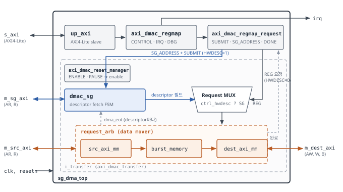
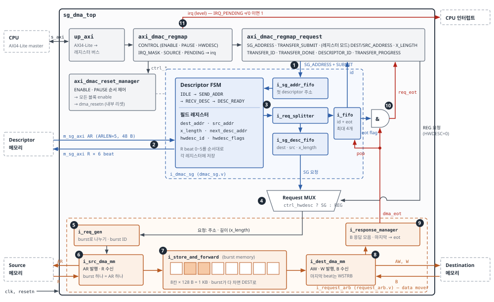
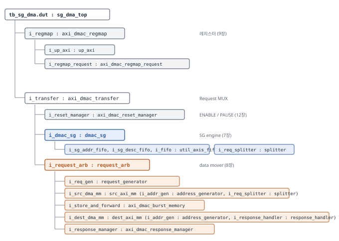
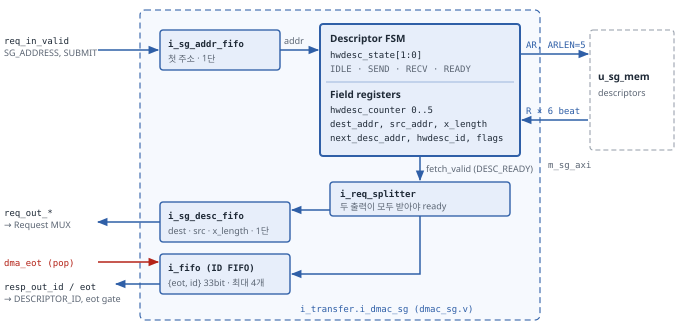
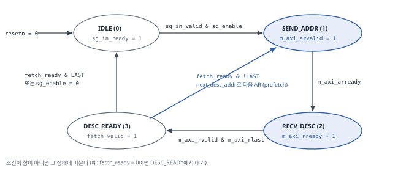
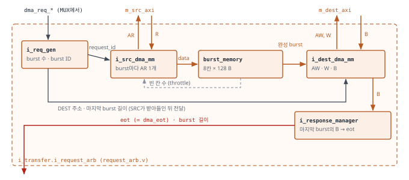
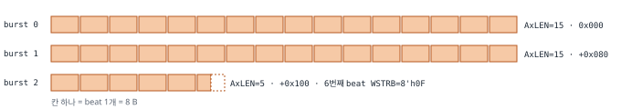
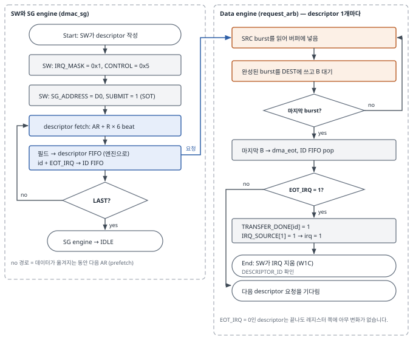
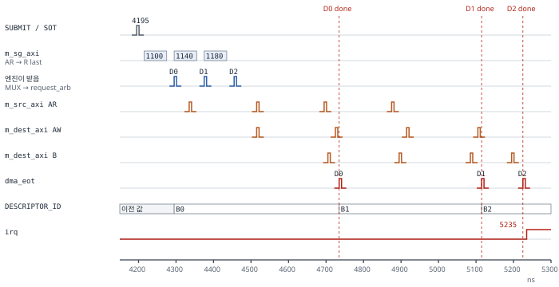
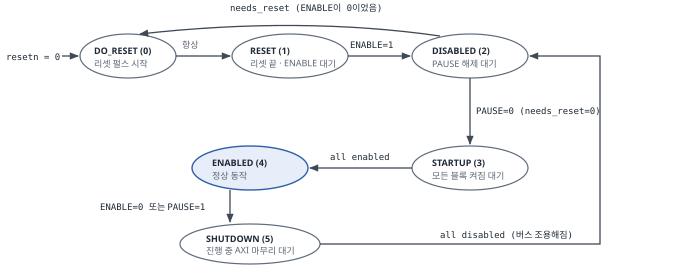

# SG DMA Architecture Specification

*Scatter-Gather DMA (메모리 → 메모리) · sg_dma_top*

| 항목 | 내용 |
|---|---|
| 문서 ID | SGDMA-ARCH-rel-v2.0.0 |
| 날짜 | 2026-10-17 |
| 작성자 | 조혜린 (hrcho) |
| 대상 DUT | `rtl/sg_dma_top.v` |
| 기준 RTL | 정리된 sg_dma RTL (18개 파일) — ADI axi_dmac hdl_2026_r1 기반 |
| 기준 TB | `tb/tb_sg_dma.sv` (Sanity 46/46 PASS) |
| 이전 판 | SG DMA Architecture Specification (2026-10-12, 정리 전 RTL 기준) |

# 문서 안내

## 개정 이력

| 판 | 날짜 | 내용 |
|---|---|---|
| v1.0 (이전 판) | 2026-10-12 | ADI `axi_dmac` 원본 구조(`rtl/sg_dma/sgdma_top.v` + `rtl/third_party/`) 기준으로 작성 |
| rel-v2.0.0 | 2026-10-17 | 정리된 RTL 기준으로 다시 씀. 파일 구성·계층 경로·모듈 설명을 새 코드에 맞춤. 내부 동작을 한눈에 보는 그림(Figure 3) 추가. 실측 타이밍(Figure 10)과 reset manager FSM(Figure 12) 추가. PAUSE 관련 주의사항(15.1) 추가 |

## 이전 판(v1.0)을 읽은 분께 — 바뀐 점

DMA의 **동작과 레지스터 맵은 바뀌지 않았습니다.** 정리 전 RTL과 정리 후 RTL을 같은 입력으로 나란히 돌려 모든 출력 포트를 매 클럭 비교했고, 차이가 없었습니다(4.4절). 바뀐 것은 코드의 모양입니다.

| 항목 | v1.0 (정리 전) | v2.0 (현재) |
|---|---|---|
| Top 파일 | `rtl/sg_dma/sgdma_top.v` → `axi_dmac` 인스턴스 | `rtl/sg_dma_top.v`. `axi_dmac.v`는 이 파일로 합쳐짐 |
| RTL 파일 수 | 39개 (실제 사용 27개) | 18개 (모두 사용) |
| 계층 경로 | `dut.i_axi_dmac.i_transfer…` | `dut.i_transfer…` (`i_axi_dmac` 단계 없음) |
| Stream / FIFO / 2D / framelock / CDC 코드 | 파일 안에 `generate` 분기로 남아 있음 | 삭제 |
| 클럭 / 리셋 | 포트별 클럭·리셋 (모두 같은 신호를 연결) | `clk` 1개, `resetn` 1개. 내부 리셋은 `dma_resetn` 1개 |
| 0x450 PARTIAL_TRANSFER_ID | 읽으면 내부 FIFO가 하나 빠짐 | FIFO가 없어져 항상 0이 읽힘 (부작용 없음) |

## 목차

- 1 Introduction
  - 1.1 Purpose
  - 1.2 Scope
  - 1.3 Terms
  - 1.4 Reference
  - 1.5 읽는 순서
- 2 SG DMA Basics
  - 2.1 Simple DMA
  - 2.2 Why Scatter-Gather
  - 2.3 Descriptor Chain Example
- 3 System Architecture
  - 3.1 Top Block Diagram
  - 3.2 Internal Operation Overview
  - 3.3 Functional Block Organization
  - 3.4 System Parameters
  - 3.5 Interfaces
    - 3.5.1 Clock, Reset, Interrupt
    - 3.5.2 AXI4-Lite Slave (s_axi_*)
    - 3.5.3 AXI4 Masters
- 4 RTL File Organization
  - 4.1 Directory Structure
  - 4.2 Module Hierarchy
  - 4.3 File List
  - 4.4 ADI 원본과의 차이
  - 4.5 Register Decode Location
- 5 Module Descriptions
  - 5.1 sg_dma_top
  - 5.2 axi_dmac_regmap / up_axi
  - 5.3 axi_dmac_regmap_request
  - 5.4 axi_dmac_transfer (Request MUX)
  - 5.5 axi_dmac_reset_manager
  - 5.6 dmac_sg (SG Engine)
  - 5.7 request_arb (Data Mover)
  - 5.8 request_generator
  - 5.9 src_axi_mm
  - 5.10 axi_dmac_burst_memory
  - 5.11 dest_axi_mm
  - 5.12 axi_dmac_response_manager
  - 5.13 Supporting Modules
- 6 Descriptor Format
  - 6.1 Layout
  - 6.2 Field Description
  - 6.3 Example (SAN-005 D0)
  - 6.4 Rules and Cautions
- 7 SG Engine (dmac_sg) Architecture and FSM
  - 7.1 Internal Block Diagram
  - 7.2 Internal Blocks
  - 7.3 State Diagram
  - 7.4 State Description
  - 7.5 Transition Rules
  - 7.6 Prefetch
- 8 Data Path and Burst Handling
  - 8.1 Data Path Diagram
  - 8.2 Burst Splitting
  - 8.3 Store-and-Forward Buffer
  - 8.4 Flow Control
  - 8.5 End-of-Transfer Generation
  - 8.6 AXI Behavior Summary
- 9 Register Interface
  - 9.1 Access Conventions
  - 9.2 Register Map
  - 9.3 CONTROL (0x400)
  - 9.4 IRQ_MASK / IRQ_PENDING / IRQ_SOURCE (0x080 / 0x084 / 0x088)
  - 9.5 DBG_STATUS (0x43C)
  - 9.6 DBG_IDS0 / DBG_IDS1 (0x440 / 0x444)
- 10 Operation Flow
  - 10.1 Programming Sequence
  - 10.2 Transfer Flow Chart
  - 10.3 Step-by-Step with RTL (SAN-005)
  - 10.4 Timing Overview
- 11 Interrupt and Status
  - 11.1 Interrupt Path
  - 11.2 Event Summary
  - 11.3 Transfer vs Descriptor
  - 11.4 Interrupt Handling Rules
- 12 ENABLE / PAUSE Control
  - 12.1 Reset Manager FSM
  - 12.2 ENABLE = 0
  - 12.3 PAUSE = 1
- 13 Debug Signal Guide
  - 13.1 Group A — External Interfaces
  - 13.2 Group B — Control and Status
  - 13.3 Group C — SG Engine
  - 13.4 Group D — Request MUX and Data Engine
  - 13.5 Reading Stuck Points
- 14 CPU-Side Tracing
  - 14.1 What Software Can Read
  - 14.2 Recommended Tracing Methods
  - 14.3 What Software Cannot See
- 15 Error Model and Debug Checklist
  - 15.1 Error Conditions and Hardware Behavior
  - 15.2 Recovery
  - 15.3 Debug Checklist
- Appendix A. Verification Team Q&A
  - A.1 Open Items for Verification

# 1 Introduction

이 문서는 SG(Scatter-Gather) DMA IP인 `sg_dma_top`의 구조와 동작을 설명합니다. 이 IP는 ADI `axi_dmac`(hdl_2026_r1)에서 SG 메모리→메모리 복사에 필요한 부분만 남겨 정리한 것입니다.

목표는 SG DMA를 처음 보는 사람이 **이 문서만 읽고 RTL을 열어 따라갈 수 있고, 시뮬레이션 파형에서 문제의 원인을 찾을 수 있게** 하는 것입니다.

## 1.1 Purpose

- SG DMA가 무엇이고, 일반 DMA에 무엇이 더해졌는지 설명합니다.
- RTL 파일 구성, 모듈 계층, 모듈마다 하는 일을 정리합니다.
- descriptor 형식, SG 엔진(`dmac_sg`) FSM, 데이터 경로, 레지스터, 인터럽트를 정의합니다.
- 검증·디버깅에 필요한 신호, CPU가 읽을 수 있는 상태 정보, 문제가 생겼을 때 볼 곳을 알려 줍니다.

## 1.2 Scope

| 구분 | 내용 |
|---|---|
| 대상 DUT | `rtl/sg_dma_top.v` |
| 원본 RTL | ADI `analogdevicesinc/hdl` `library/axi_dmac` (hdl_2026_r1, b62abeff). SG 메모리→메모리 구성만 남기고 정리함 (4.4절) |
| 구성 | SG 모드 + 레지스터 모드, 메모리→메모리(AXI4 → AXI4), 클럭 1개, 32bit 주소, 64bit 데이터 |
| 없는 기능 | 2D 전송, cyclic 전송, framelock, autorun, 외부 sync, AXI-Stream / FIFO 인터페이스, 비동기 클럭. 코드에서 삭제됨 |
| 기준 TB | `tb/tb_sg_dma.sv` (Sanity SAN-001 ~ SAN-007, 46 checks) |

## 1.3 Terms

| 용어 | 뜻 |
|---|---|
| DMA | Direct Memory Access. CPU 대신 메모리 복사를 해 주는 하드웨어 |
| SG | Scatter-Gather. 여기저기 흩어진 메모리 조각들을 "할 일 목록" 하나로 이어서 처리하는 방식 |
| Descriptor | 할 일 하나(어디서 읽고, 어디에 쓰고, 몇 바이트인지)를 적은 48바이트 데이터 구조. 메모리에 있음 |
| Chain | descriptor들이 "다음 descriptor 주소(next)"로 줄줄이 이어진 목록 |
| beat | AXI 데이터 한 번 전송. 이 IP에서는 64bit = 8바이트 |
| burst | 주소 한 번에 이어서 보내는 beat 묶음. `AxLEN + 1` 개. 이 IP는 최대 16 beat = 128바이트 |
| SOT / EOT | Start Of Transfer(전송 접수) / End Of Transfer(전송 완료) 이벤트 |
| W1C | Write 1 to Clear. 1을 쓰면 해당 비트가 지워짐 |
| SFR | Special Function Register. CPU가 읽고 쓰는 레지스터 |
| valid / ready | 보내는 쪽이 valid=1, 받는 쪽이 ready=1인 클럭에 데이터가 넘어가는 핸드셰이크 |
| FIFO | 먼저 들어간 것이 먼저 나오는 대기열 |
| prefetch | 앞 일을 하는 동안 다음 descriptor를 미리 읽어 두는 것 |
| Gray 코드 | 이웃한 값끼리 1비트만 다른 숫자 표기. 내부 burst 번호에 쓰임 |

## 1.4 Reference

- AXI DMA Technical Specification (기본 DMA 스펙, 2026-02-07) — 이 문서의 구성과 형식을 따름
- SGDMA-SFR-rel-v2.0.0 (레지스터 상세) · SGDMA-SOR-rel-v2.0.0 (검증 요구사항, T-01 ~ T-15) · SGDMA-SANITY-rel-v2.0.0 (Sanity Test)
- AMBA AXI and ACE Protocol Specification (ARM IHI 0022)

*SFR / SOR / SANITY rel-v2.0.0(2026-10-19)은 이 문서와 같은 정리된 RTL을 기준으로 합니다. 레지스터 리셋값과 ENABLE/PAUSE 영향의 측정값은 SFR v2.0.0에 있습니다.*

## 1.5 읽는 순서

| 이런 분이라면 | 이 순서로 읽으세요 |
|---|---|
| SG DMA가 처음 | 2장 → 3.1 → **3.2 (Figure 3)** → 10장 |
| RTL을 열어 보려는 분 | 3.2 → 4장 → 5장 → 7장 → 8장 |
| 검증 / 디버깅 | 3.2 → 10.3 → 13장 → 15장 → 부록 A |
| 드라이버(SW) | 6장 → 9장 → 10.1 → 11장 → 14장 |

# 2 SG DMA Basics

SG DMA는 일반 DMA 앞에 **"descriptor를 메모리에서 읽어 전송 요청으로 바꿔 주는 블록"**을 하나 더 붙인 것입니다. 데이터를 실제로 옮기는 엔진은 일반 DMA와 같습니다.

## 2.1 Simple DMA

일반(simple) DMA는 CPU가 레지스터에 `SRC 주소`, `DST 주소`, `길이`를 쓰고 START하면, DMA가 직접 읽고 쓴 뒤 인터럽트로 끝났음을 알립니다. 한 번 설정하면 **이어진 메모리 한 덩어리**만 옮길 수 있습니다. 이 IP도 `CONTROL.HWDESC = 0`이면 이렇게 동작합니다(레지스터 모드).

## 2.2 Why Scatter-Gather

실제 버퍼는 메모리 여러 곳에 흩어져 있는 경우가 많습니다. 예를 들어 OS가 잡아 준 버퍼는 4KB 페이지 단위로 물리 주소가 흩어져 있습니다. Simple DMA로 조각 N개를 옮기려면 CPU가 N번 설정하고 N번 인터럽트를 처리해야 합니다.

SG DMA에서는 CPU가 할 일 목록(descriptor)을 메모리에 미리 써 두고, **첫 descriptor 주소 하나만** DMA에 알려 줍니다. DMA는 descriptor를 하나씩 읽어 처리하고, `next` 주소를 따라 다음 descriptor로 넘어가며, `LAST` 표시가 있는 descriptor에서 멈춥니다.

| 항목 | Simple DMA | SG DMA |
|---|---|---|
| 전송 정보 위치 | 레지스터 (SRC / DST / LEN) | 메모리의 descriptor |
| CPU 설정 횟수 (조각 N개) | N번 | 1번 (SG_ADDRESS + SUBMIT) |
| 인터럽트 횟수 | N번 | 원하는 descriptor에서만 (보통 마지막 1번) |
| 추가 AXI master | 없음 | descriptor 읽기용 `m_sg_axi` |
| 추가 블록 | 없음 | `dmac_sg` (descriptor를 읽는 FSM) |

## 2.3 Descriptor Chain Example

이 문서 전체에서 TB의 **SAN-005**(descriptor 3개 gather)를 예제로 씁니다. CPU는 `SG_ADDRESS`에 D0 주소만 씁니다. DMA는 D0 → D1 → D2를 `next`로 따라가며 흩어진 A, B, C를 `0x21000`부터 이어 붙이고, LAST가 있는 D2에서 멈춥니다.

**SG_ADDRESS를 한 번 쓰면 descriptor 3개를 따라가며 조각 3개를 모은다**


*Figure 1. Descriptor chain (TB SAN-005). 파란 상자는 메모리에 놓인 descriptor, 주황 상자는 데이터 조각입니다.*

# 3 System Architecture

`sg_dma_top`은 AXI4-Lite slave 1개, AXI4 master 3개(SRC 읽기, DEST 쓰기, SG 읽기), 인터럽트 출력 1개를 가집니다. 안쪽은 크게 세 부분입니다.

| 부분 | 모듈 | 하는 일 |
|---|---|---|
| Control plane | `up_axi`, `axi_dmac_regmap`, `axi_dmac_regmap_request` | CPU가 쓰는 레지스터, 인터럽트 |
| SG engine | `dmac_sg` | descriptor를 읽어 "주소 + 길이" 요청으로 바꿈 |
| Data engine | `request_arb`와 그 아래 모듈 | 요청 하나를 burst로 나눠 실제로 읽고 씀 |

## 3.1 Top Block Diagram

**descriptor는 m_sg_axi로 들어와 레지스터 요청과 같은 데이터 엔진을 움직인다**



*Figure 2. sg_dma_top top-level block diagram. 회색 = Control plane, 파랑 = SG engine, 주황 = Data engine. 점선 화살표는 완료(응답) 방향입니다.*

위쪽 줄이 레지스터를 맡는 Control plane이고, 점선 상자가 `i_transfer`입니다. `HWDESC = 1`이면 `dmac_sg`가 descriptor를 읽어 MUX에 넣고, `request_arb`는 이를 레지스터 요청과 똑같이 처리합니다. descriptor 하나가 끝날 때마다 `dma_eot`가 `dmac_sg`로 돌아갑니다.

## 3.2 Internal Operation Overview

Figure 2는 블록이 무엇인지 보여 주고, 다음 쪽의 **Figure 3은 그 블록들 안에서 일이 어떤 순서로 흘러가는지** 보여 줍니다. 원 안의 번호 ①~⑪을 따라가면 CPU가 설정한 뒤부터 인터럽트가 올라갈 때까지의 전체 흐름을 코드를 보지 않고도 따라갈 수 있습니다. 번호마다의 설명은 그림 다음 쪽의 표에 있습니다.

그림을 읽는 규칙은 아래와 같습니다.

- **색:** 회색 = 레지스터(Control plane), 파랑 = SG engine(`i_dmac_sg`), 주황 = Data engine(`i_request_arb`)
- **상자 이름:** 시뮬레이션 계층의 인스턴스 이름(`i_…`)을 그대로 적었습니다. 파형에서 신호를 찾을 때 그대로 쓰면 됩니다.
- **선:** 실선 화살표 = 요청과 데이터가 가는 방향. 위로 올라가는 화살표(⑨ → ⑩ → ⑪) = 완료가 돌아오는 방향
- **바깥 점선 상자:** DMA 밖의 메모리와 CPU

**Figure 3. Internal operation overview — SUBMIT부터 IRQ까지 한눈에 보기**



*번호 ①~⑪은 다음 쪽 표와 같습니다. 점선 화살표(enable)는 reset manager가 각 블록을 켜고 끄는 신호입니다. `dma_eot`는 descriptor 하나가 끝날 때마다 나오고, 그 descriptor의 EOT_IRQ 플래그가 1일 때만 `req_eot`가 되어 레지스터 쪽으로 올라갑니다.*

### Figure 3 단계 설명

| # | 단계 | 무엇이 일어나나 | 보는 신호 (인스턴스) |
|---|---|---|---|
| ① | SUBMIT | CPU가 `SG_ADDRESS`에 첫 descriptor 주소를 쓰고 `TRANSFER_SUBMIT ← 1`. `CONTROL.HWDESC = 1` 이므로 요청이 SG 쪽 주소 FIFO로 들어갑니다. 이 순간이 **SOT** (전송 접수)입니다. | `up_dma_req_valid`, `up_sot` (REQ) |
| ② | Descriptor fetch | FSM이 `m_sg_axi`로 AR 1개(48바이트, 6 beat)를 내고, 돌아오는 R 6 beat를 필드 레지스터에 칸별로 저장합니다. | `hwdesc_state`, `hwdesc_counter` (SG) |
| ③ | Split | 읽은 descriptor를 splitter가 둘로 나눕니다. 주소·길이는 descriptor FIFO로(전송용), id와 EOT_IRQ 플래그는 ID FIFO로(완료 처리용). LAST가 아니면 FSM은 바로 다음 descriptor를 읽으러 갑니다( **prefetch** ). | `fetch_valid`, `fetch_ready` (SG) |
| ④ | Request MUX | `CONTROL.HWDESC`가 1이면 descriptor 요청을, 0이면 레지스터 요청(DEST/SRC_ADDRESS, X_LENGTH)을 데이터 엔진에 넘깁니다. 여기서부터는 SG인지 아닌지 구분하지 않습니다. | `dma_req_valid`, `dma_req_length` (TR) |
| ⑤ | Burst 나누기 | 길이를 128바이트 burst로 나누고 burst마다 번호(burst ID)를 붙입니다. | `request_id` (ARB.i_req_gen) |
| ⑥ | SRC 읽기 | burst마다 `m_src_axi`에 AR을 내고 R 데이터를 받습니다. 버퍼에 빈 칸이 있을 때만 AR을 냅니다. | `m_src_axi_ar*`, `DBG_IDS1` |
| ⑦ | 버퍼 (store-and-forward) | 받은 데이터를 burst 단위 칸(8칸 × 128B)에 모읍니다. 한 burst가 다 모이면 그 칸을 DEST 쪽에 넘깁니다. | `dest_request_id` (DBG_IDS0) |
| ⑧ | DEST 쓰기 | 완성된 칸마다 `m_dest_axi`에 AW와 W를 냅니다. 길이가 8의 배수가 아니면 마지막 beat의 `WSTRB`로 유효 바이트만 표시합니다. | `m_dest_axi_aw*`, `w*`, `b*` |
| ⑨ | 완료 (dma_eot) | B 응답을 모아, 요청(=descriptor)의 마지막 burst에 대한 B가 오면 `dma_eot` 펄스를 냅니다. | `dma_eot` (TR) |
| ⑩ | EOT 판단 | `dma_eot`가 ID FIFO에서 1개를 꺼냅니다(→ `DESCRIPTOR_ID`). 꺼낸 항목의 EOT_IRQ 플래그가 1이면 AND를 통과해 `req_eot`가 됩니다. → `TRANSFER_DONE`, `IRQ_SOURCE[1]`가 섭니다. | `resp_out_eot`, `req_eot`, `up_eot` |
| ⑪ | IRQ | `IRQ_PENDING = ~IRQ_MASK & IRQ_SOURCE`가 0이 아니면 다음 클럭에 `irq = 1`. CPU가 `IRQ_PENDING`에 1을 써서 지우면 내려갑니다. | `up_irq_pending`, `irq` (REG) |

> **[참고]** **두 줄이 동시에 돈다.** ②~③(descriptor 읽기)과 ⑤~⑨(데이터 이동)는 서로 기다리지 않고 동시에 진행됩니다. SAN-005에서는 descriptor 3개를 다 읽은 뒤에야 첫 DEST 쓰기가 나갑니다(10.4절 실측).

## 3.3 Functional Block Organization

| 블록 | RTL 모듈 (인스턴스) | 역할 |
|---|---|---|
| AXI4-Lite Slave I/F | `up_axi` (`i_regmap.i_up_axi`) | AXI4-Lite 핸드셰이크를 처리하고 바이트 주소를 워드 주소(`up_waddr`)로 바꿈 |
| Register Bank (global) | `axi_dmac_regmap` (`i_regmap`) | CONTROL, IRQ, VERSION, 디버그 레지스터 |
| Register Bank (transfer) | `axi_dmac_regmap_request` (`i_regmap.i_regmap_request`) | SUBMIT, SG_ADDRESS, DESCRIPTOR_ID, TRANSFER_DONE 등 전송 레지스터 |
| Reset / Enable Control | `axi_dmac_reset_manager` (`i_transfer.i_reset_manager`) | ENABLE·PAUSE에 따라 각 블록을 켜고 끔. 끌 때 진행 중인 AXI를 마무리한 뒤 내부 리셋(`dma_resetn`) |
| SG Engine | `dmac_sg` (`i_transfer.i_dmac_sg`) | descriptor를 `m_sg_axi`로 읽어 전송 요청으로 바꿈. 완료 시 descriptor id와 EOT_IRQ 플래그를 돌려줌 |
| Request MUX | `axi_dmac_transfer` 안의 `assign` (`i_transfer`) | `CONTROL.HWDESC`에 따라 레지스터 요청과 SG 요청 중 하나를 고름 |
| Data Mover | `request_arb` (`i_transfer.i_request_arb`) | 요청 하나를 burst로 나눠 SRC 읽기 → 버퍼 → DEST 쓰기 |
| Burst Generator | `request_generator` (`…i_req_gen`) | 길이로 burst 개수를 계산하고 burst마다 ID를 발급 |
| AXI4 Read Master | `src_axi_mm` (`…i_src_dma_mm`) | `m_src_axi` AR / R 채널 |
| Data Buffer | `axi_dmac_burst_memory` (`…i_store_and_forward`) | SRC와 DEST 사이 1KB 버퍼. burst 단위 store-and-forward |
| AXI4 Write Master | `dest_axi_mm` (`…i_dest_dma_mm`) | `m_dest_axi` AW / W / B 채널 |
| Completion | `axi_dmac_response_manager` (`…i_response_manager`) | DEST 쓰기 응답(B)을 모아 요청 완료(`eot`)를 만듦 |

## 3.4 System Parameters

`sg_dma_top`의 파라미터는 아래 9개뿐입니다. 정리 전에는 `axi_dmac`에 38개를 넘겼지만, 기능을 끄는 파라미터는 코드와 함께 삭제했습니다.

| Parameter | 기본값 | 의미 / 영향 |
|---|---|---|
| `ID` | 0 | PERIPHERAL_ID(0x004) 읽기값. 같은 IP를 여러 개 붙일 때 구분용 |
| `ADDR_WIDTH` | 32 | master 주소 폭. 32보다 크면 `*_ADDRESS_HIGH` 레지스터가 생김 (현재 0으로 읽힘) |
| `DATA_WIDTH` | 64 | SRC / DEST 데이터 폭. 1 beat = 8B, `AxSIZE = 3` |
| `LENGTH_WIDTH` | 24 | 길이 폭. descriptor 1개 최대 16 MiB |
| `MAX_BYTES_PER_BURST` | 128 | burst 최대 크기. 64bit에서 16 beat (`AxLEN ≤ 15`) |
| `FIFO_SIZE` | 8 | 버퍼 크기(burst 단위). 8 × 128B = 1KB. burst ID 폭(`ID_WIDTH`)도 이것으로 정해짐 |
| `AXI_ID_WIDTH` | 1 | master 포트 ID 폭. 값은 항상 0 |
| `AXI_AXCACHE` | 4'b0000 | 세 master 공통 AxCACHE. Device Non-bufferable (2026-10-06 팀 결정) |
| `AXI_AXPROT` | 3'b000 | 세 master 공통 AxPROT |

파라미터에서 자동으로 계산되는 값(`sg_dma_top.v` 149~160행)입니다.

| localparam | 계산 | 값 | 쓰이는 곳 |
|---|---|---|---|
| `BYTES_PER_BEAT_WIDTH` | log2(64/8) | 3 | 주소 하위 3bit 무시(8B 정렬), INTERFACE_DESCRIPTION_1 |
| `REAL_MAX_BYTES_PER_BURST` | min(128, 256×8) | 128 | burst 크기 |
| `BYTES_PER_BURST_WIDTH` | log2(128) | 7 | 길이를 burst 수 / 나머지로 자르는 위치 |
| `ID_WIDTH` | log2(8×2) | 4 | burst ID 폭 (Gray 코드), DBG_IDS0/1 |

> **[주의]** **검증된 구성은 기본값뿐입니다.** Sanity와 정리 전/후 비교는 기본값으로 했고, 비교는 DATA_WIDTH 32·128, 버퍼 크기 2·4·16, ADDR_WIDTH 40에서도 했습니다. 다만 **DATA_WIDTH = 32**에서는 체인 전송 중 AWLEN과 WLAST 위치가 어긋나는 AXI 규칙 위반이 정리 전 ADI 코드에서도 똑같이 관찰되었습니다. 기본값이 아닌 구성을 쓰려면 먼저 따로 검증해야 합니다(부록 A.1).

## 3.5 Interfaces

### 3.5.1 Clock, Reset, Interrupt

| Signal | Dir | Bits | 설명 |
|---|---|---|---|
| `clk` | In | 1 | 모든 포트와 내부 블록의 공통 클럭 |
| `resetn` | In | 1 | Active-low 동기 리셋. 레지스터와 reset manager를 초기화. 내부 데이터 경로는 reset manager가 만든 `dma_resetn`으로 리셋됨 |
| `irq` | Out | 1 | 인터럽트. `IRQ_PENDING`이 0이 아니면 1 (level, 1클럭 늦게 반영) |

### 3.5.2 AXI4-Lite Slave (`s_axi_*`)

레지스터 접근용입니다. 주소 11bit(0x000 ~ 0x7FF), 데이터 32bit. AW / W / B / AR / R 다섯 채널을 모두 씁니다. burst는 지원하지 않습니다.

- `s_axi_wstrb`와 `s_axi_awprot` / `arprot`는 연결만 되어 있고 쓰이지 않습니다. 모든 쓰기는 32bit 전체 쓰기입니다.
- `bresp` / `rresp`는 항상 OKAY입니다. 없는 주소를 읽으면 0이 나오고, 없는 주소에 쓰면 무시됩니다.

### 3.5.3 AXI4 Masters

| Port | 채널 | 폭 | 용도 | 고정 값 / 참고 |
|---|---|---|---|---|
| `m_src_axi_*` | AR, R | 64 | 원본 데이터 읽기 | `ARBURST` =INCR, `ARSIZE` =3, `ARID` =0, `ARLOCK` =0. `RRESP`· `RID`는 쓰이지 않음 |
| `m_dest_axi_*` | AW, W, B | 64 | 데이터 쓰기 | `AWBURST` =INCR, `AWSIZE` =3, `AWID` =0, `AWLOCK` =0. `BRESP`· `BID`는 쓰이지 않음 |
| `m_sg_axi_*` | AR, R | 64 (고정) | descriptor 읽기 | `ARLEN` =5, `ARSIZE` =3, `ARBURST` =INCR, `ARID` =0. `RRESP`· `RID`는 쓰이지 않음 |

각 master에서 쓰지 않는 방향(SRC의 쓰기, DEST의 읽기, SG의 쓰기)은 포트 자체가 없습니다. 세 master 모두 `AxCACHE = 4'b0000`, `AxPROT = 3'b000`입니다.

# 4 RTL File Organization

RTL은 `rtl/` 한 폴더에 18개 파일로 되어 있습니다. top인 `sg_dma_top.v`를 빼면 모두 ADI `axi_dmac`에서 가져와 SG 메모리→메모리 구성에 필요한 부분만 남긴 파일입니다. ADI 파일은 원래 라이선스 헤더를 그대로 유지합니다.

## 4.1 Directory Structure

```
.
├── rtl/                      ← RTL 18개 (하위 폴더 없음)
│   ├── sg_dma_top.v          ← DUT top
│   ├── axi_dmac_*.v, dmac_sg.v, request_arb.v, …
│   └── inc_id.vh             ← Gray 코드 함수 (include 파일)
├── tb/                       ← Sanity TB
│   ├── tb_sg_dma.sv          ← SAN-001 ~ SAN-007
│   ├── axi_mem_slave.sv      ← AXI 메모리 모델 (SRC / SG / DST)
│   └── tb_mem_pkg.sv         ← 세 모델이 함께 쓰는 메모리 배열
├── filelists/
│   ├── rtl.f                 ← RTL 컴파일 목록 (-i ../rtl)
│   └── tb.f
├── licenses/adi_hdl/         ← ADI 라이선스 + 출처 / 수정 내역 (README.md)
├── xsim/                     ← Makefile (make clean; make sim), xsim_run.tcl
└── docs/                     ← SFR, SOR, SANITY, 이 문서
```

## 4.2 Module Hierarchy

시뮬레이션 계층 경로 기준입니다. 파형에서 신호를 찾을 때 이 경로를 그대로 씁니다. 상자는 `인스턴스 : 모듈` 입니다.

**SG 기능은 i_dmac_sg 하나, 나머지는 일반 DMA 엔진**



*Figure 4. Instance hierarchy (instance : module). `request_arb` 안에는 이 밖에 요청·burst 길이를 넘기는 1단 FIFO 3개(`i_src_req_fifo`, `i_dest_req_fifo`, `i_src_dest_bl_fifo`)가 있습니다.*

## 4.3 File List

`filelists/rtl.f`의 순서대로입니다. 줄 수는 ADI 라이선스 헤더(약 40줄)를 포함합니다.

| 파일 | 줄 | 분류 | 역할 |
|---|---|---|---|
| `sg_dma_top.v` | 366 | top | 파라미터 계산, regmap + transfer 연결, AXI ID / LOCK = 0 |
| `axi_dmac_regmap.v` | 307 | 레지스터 | CONTROL, IRQ, VERSION, 디버그 레지스터 |
| `axi_dmac_regmap_request.v` | 238 | 레지스터 | 전송 레지스터 (SUBMIT, SG_ADDRESS, DONE, …) |
| `up_axi.v` | 238 | 레지스터 | AXI4-Lite → 단순 레지스터 버스 (ADI 원본 그대로) |
| `axi_dmac_transfer.v` | 331 | 연결 | reset manager, dmac_sg, request_arb 연결. Request MUX |
| `axi_dmac_reset_manager.v` | 226 | 제어 | ENABLE / PAUSE 순서 제어, 내부 리셋 |
| `dmac_sg.v` | 291 | SG | descriptor fetch FSM |
| `request_arb.v` | 535 | 데이터 | data mover 상위 (SRC → 버퍼 → DEST 연결, burst ID 관리) |
| `request_generator.v` | 139 | 데이터 | burst 개수 계산, burst ID 발급 |
| `src_axi_mm.v` | 219 | 데이터 | SRC AXI 읽기 |
| `dest_axi_mm.v` | 187 | 데이터 | DEST AXI 쓰기 |
| `address_generator.v` | 190 | 데이터 | burst 주소와 AxLEN 계산 (SRC, DEST가 각각 1개씩 사용) |
| `response_handler.v` | 94 | 데이터 | DEST B 응답 받기 |
| `axi_dmac_burst_memory.v` | 330 | 데이터 | 1KB store-and-forward 버퍼 |
| `axi_dmac_response_manager.v` | 165 | 데이터 | B 응답 → 요청 완료(eot) |
| `splitter.v` | 68 | 공용 | valid 1개를 N개로 나눔 (ADI 원본 그대로) |
| `util_axis_fifo.v` | 139 | 공용 | 단일 클럭 FIFO (깊이 0 = 1단 레지스터) |
| `inc_id.vh` | 67 | 공용 | Gray 코드 함수 `inc_id`, `g2b`, `b2g` (ADI 원본 그대로) |

## 4.4 ADI 원본과의 차이

ADI `axi_dmac`는 Stream / FIFO / 2D / 비동기 클럭 등 여러 구성을 하나의 코드로 지원합니다. 이 구성에서 쓰이지 않는 코드는 모두 지웠습니다(2026-10-17).

| 지운 것 | 원래 하던 일 |
|---|---|
| AXI-Stream / FIFO 인터페이스 | `src/dest_axi_stream`, `src/dest_fifo_inf`, `data_mover`, rewind·completion 경로 |
| 2D 전송, framelock | `dmac_2d_transfer`, `axi_dmac_framelock`. 해당 레지스터는 0으로 읽힘 |
| 비동기 클럭 CDC | `sync_bits`, `sync_gray`, `sync_event`, `sync_data`, 4단 리셋 체인 → 리셋 생성기 1개 |
| 다른 데이터 폭 지원 | `axi_dmac_resize_src/dest`, `ad_mem_asym` → 버퍼 안의 RAM 하나 |
| register slice, ext sync, diagnostics | `axi_register_slice`, `axi_dmac_ext_sync` |
| partial 전송 보고 | AXI-Stream 전용. 0x44C / 0x450은 0으로 읽힘 |
| cyclic, autorun | FLAGS[0]은 0으로 읽힘 |

**동작이 같다는 근거:** 정리 전 RTL과 정리 후 RTL을 같은 입력으로 나란히 돌리고, 모든 출력 포트를 매 클럭 비교했습니다. 레지스터 전체 읽기·쓰기, SG / 레지스터 모드 전송, 1바이트 단위 길이, 체인 길이 1~32개, 중간 EOT, IRQ 마스크 4종, 전송 중 ENABLE=0, PAUSE, 비정렬 주소, 메모리 쪽 무작위 지연, 무작위 시퀀스를 넣었고, 약 9만 클럭 동안 차이가 0이었습니다. Sanity 로그도 정리 전과 같습니다.

**그 전부터 있던 수정 1건:** `axi_dmac_burst_memory.v`의 `{DMA_LENGTH_ALIGN{1'b1}}`(0번 반복은 Verilog 문법 위반) 수정입니다. 이 구성에서는 값이 0이라, 지금 코드는 `dest_burst_len_data = 'h0`으로 단순해졌습니다.

## 4.5 Register Decode Location

레지스터는 두 파일에서 처리됩니다. 바이트 주소를 4로 나눈 값을 `9'hXXX`로 검색하면 됩니다 (예: 0x408 → `9'h102`).

| 파일 | 담당 레지스터 |
|---|---|
| `axi_dmac_regmap.v` | VERSION, PERIPHERAL_ID, SCRATCH, IDENTIFICATION, INTERFACE_DESCRIPTION_1/2, IRQ_MASK / PENDING / SOURCE, CONTROL, 디버그(0x434 ~ 0x444, 0x498, 0x49C) |
| `axi_dmac_regmap_request.v` | TRANSFER_ID, TRANSFER_SUBMIT, FLAGS, DEST / SRC_ADDRESS, X_LENGTH, TRANSFER_DONE, ACTIVE_TRANSFER_ID, TRANSFER_PROGRESS, DESCRIPTOR_ID, SG_ADDRESS, *_ADDRESS_HIGH. 그 밖의 주소는 모두 0 |

# 5 Module Descriptions

SG 전송 한 번에 관여하는 모듈을 위에서 아래 순서로 설명합니다. 모듈끼리는 모두 **valid / ready 핸드셰이크**로 요청을 넘깁니다. 계층 경로의 약어는 13장 첫 표를 따릅니다(TOP = `tb_sg_dma.dut`).

## 5.1 sg_dma_top

- **파일:** `rtl/sg_dma_top.v` (TOP)
- **역할:** 파라미터에서 내부 값을 계산하고(3.4절), `i_regmap`과 `i_transfer` 두 블록을 연결합니다. 정리 전에 `axi_dmac.v`가 하던 일을 이 파일이 직접 합니다.
- **그 밖:** 디버그 레지스터용 `dbg_ids0/1`을 만들고, 세 master의 `AxID`, `AxLOCK`을 0으로 묶습니다. 로직은 이것뿐입니다.

## 5.2 axi_dmac_regmap / up_axi

- **파일 / 인스턴스:** `axi_dmac_regmap.v`, `up_axi.v` / `i_regmap`, `i_regmap.i_up_axi`
- **역할:** `up_axi`가 AXI4-Lite를 받아 `up_wreq`, `up_waddr`(워드 주소), `up_wdata`로 바꿉니다. regmap은 이를 보고 CONTROL과 IRQ 레지스터를 바꿉니다.
- **출력:** `ctrl_enable`, `ctrl_pause`, `ctrl_hwdesc`, `irq`
- **IRQ 로직** (158~174행): `up_irq_source`에 SOT / EOT 이벤트를 모으고, `up_irq_pending = ~up_irq_mask & up_irq_source`가 0이 아니면 다음 클럭에 `irq = 1`.

## 5.3 axi_dmac_regmap_request

- **파일 / 인스턴스:** `axi_dmac_regmap_request.v` / `i_regmap.i_regmap_request`
- **역할:** 전송 요청 레지스터를 관리합니다. `TRANSFER_SUBMIT`에 1이 쓰이면 `up_dma_req_valid`를 1로 올리고(131행), 요청이 받아들여지면(SOT) 내립니다. `ENABLE = 0`이면 SUBMIT은 무시됩니다.
- **SG 관련:** `SG_ADDRESS`(0x47C)를 저장해 `request_sg_address`로 내보내고(148행), 완료된 descriptor의 id를 `DESCRIPTOR_ID`(0x454)로 보여 줍니다(177행).
- **상태 카운터:** `up_transfer_id` (SOT마다 +1), `up_transfer_id_eot` (EOT마다 +1), `up_transfer_done_bitmap`, `up_measured_transfer_length`(TRANSFER_PROGRESS). 이 카운터들은 `ENABLE = 0`이면 0이 됩니다.
- **SOT / EOT 펄스** (186~187행): `up_sot = up_dma_req_valid & request_ready`, `up_eot = response_eot & response_valid & response_ready`

## 5.4 axi_dmac_transfer (Request MUX)

- **파일 / 인스턴스:** `axi_dmac_transfer.v` / `i_transfer`
- **역할:** reset manager, `dmac_sg`, `request_arb`를 연결합니다. SG 모드와 레지스터 모드를 가르는 MUX가 이 파일에 있습니다.
- **핵심 코드** (199~256행):

```
assign req_valid_gated      = req_enable & req_valid;                         // 199  꺼져 있으면 요청을 막음
assign req_eot              = ctrl_hwdesc ? (dma_eot & dma_sg_hwdesc_eot) : dma_eot;  // 203
assign dma_sg_in_req_valid  = ctrl_hwdesc ? req_valid_gated : 1'b0;           // 205  SUBMIT → SG 엔진
assign dma_req_valid        = ctrl_hwdesc ? dma_sg_out_req_valid : req_valid_gated;   // 250  MUX
assign dma_req_dest_address = ctrl_hwdesc ? dma_sg_out_dest_address : req_dest_address;
assign dma_req_src_address  = ctrl_hwdesc ? dma_sg_out_src_address  : req_src_address;
assign dma_req_length       = ctrl_hwdesc ? dma_sg_x_length : req_x_length;   // 256
```

- **읽는 법:** `ctrl_hwdesc = 1`이면 엔진에 들어가는 주소·길이가 레지스터가 아니라 descriptor에서 옵니다. 완료(`req_eot`)는 descriptor의 EOT_IRQ 플래그가 1일 때만 레지스터 쪽으로 올라갑니다.

## 5.5 axi_dmac_reset_manager

- **파일 / 인스턴스:** `axi_dmac_reset_manager.v` / `i_transfer.i_reset_manager`
- **역할:** `CONTROL.ENABLE` / `PAUSE`를 받아 블록들의 enable을 켜고 끕니다. ENABLE이 1→0이 되면 진행 중인 AXI 트랜잭션이 끝나기를 기다린 뒤 내부 리셋 `dma_resetn`을 몇 클럭 동안 0으로 만듭니다.
- **상태:** `DO_RESET(0)` → `RESET(1)` → `DISABLED(2)` → `STARTUP(3)` → `ENABLED(4)` → `SHUTDOWN(5)`. CPU는 `DBG_STATUS[2:0]`으로 볼 수 있습니다. 상세는 12장.
- **출력:** `req/src/dest/sg_enable`(모두 같은 값), `dma_resetn`(데이터 경로와 SG 엔진의 리셋), `dbg_status`

## 5.6 dmac_sg (SG Engine)

- **파일 / 인스턴스:** `dmac_sg.v` / `i_transfer.i_dmac_sg`
- **역할:** SG 기능의 거의 전부입니다. descriptor 주소를 받아 `m_sg_axi`로 48B를 읽고, 필드를 레지스터에 저장한 뒤 전송 요청으로 내보냅니다. `LAST`가 아니면 `next` 주소로 다음 descriptor를 읽습니다.
- **구성:** FSM 1개, 필드 레지스터, FIFO 3개, splitter 1개. 상세는 7장.

## 5.7 request_arb (Data Mover)

- **파일 / 인스턴스:** `request_arb.v` / `i_transfer.i_request_arb`
- **역할:** "주소 + 길이" 요청 하나를 받아 실제 AXI 읽기·쓰기를 합니다. 요청이 SG에서 왔는지 모릅니다.
- **하는 일:** 아래 하위 블록들을 연결하고, burst마다 "이 burst가 요청의 마지막인가"를 기록하는 표(`eot_mem_src`, `eot_mem_dest`)와 SRC가 버퍼보다 앞서 가지 않게 하는 조절(`src_throttled_request_id`, 399행)을 가집니다. 상세는 8장.

| 인스턴스 | 모듈 | 역할 |
|---|---|---|
| `i_req_gen` | `request_generator` | 길이로 burst 개수를 계산하고 burst마다 ID를 발급 (5.8) |
| `i_src_req_fifo` | `util_axis_fifo` (1단) | 요청의 주소와 마지막 burst 길이를 SRC 쪽에 넘김 |
| `i_src_dma_mm` | `src_axi_mm` | `m_src_axi` AR 발행, R 수신 (5.9) |
| `i_store_and_forward` | `axi_dmac_burst_memory` | burst 8개(1KB)까지 저장하는 버퍼 (5.10) |
| `i_dest_req_fifo`, `i_src_dest_bl_fifo` | `util_axis_fifo` (1단) | SRC가 받아들인 요청의 DEST 주소와 마지막 burst 길이를 DEST 쪽에 넘김 |
| `i_dest_dma_mm` | `dest_axi_mm` | `m_dest_axi` AW / W 발행, B 수신 (5.11) |
| `i_response_manager` | `axi_dmac_response_manager` | B 응답을 레지스터 쪽으로 넘기고, 마지막 burst의 B에서 요청 완료(`eot`)를 냄 (5.12) |

## 5.8 request_generator

- **파일 / 인스턴스:** `request_generator.v` / `…i_request_arb.i_req_gen`
- **역할:** 요청 길이의 윗부분(`x_length[23:7]` = burst 개수 − 1)을 받아, burst마다 `request_id`를 하나씩 올립니다. 마지막 burst에서 `eot = 1`입니다.
- **상태:** `IDLE`(요청 대기) → `GEN_ID`(burst ID 발급) 두 개뿐입니다.
- **조절:** DEST 응답 ID(`response_id`)를 한 바퀴 앞지르지 않도록 `incr_en = (response_id != id_next)`일 때만 ID를 올립니다(88행).

## 5.9 src_axi_mm

- **파일 / 인스턴스:** `src_axi_mm.v` / `…i_src_dma_mm` (안에 `i_addr_gen : address_generator`, `i_req_splitter : splitter`)
- **역할:** 허락된 burst ID마다 AR을 하나 내고, R 데이터를 그대로 버퍼로 넘깁니다(`RREADY`는 항상 1). 마지막 R beat(`RLAST`)마다 데이터 ID를 올립니다.
- **주소:** `address_generator`가 시작 주소에서 burst마다 128B씩 더합니다(140행). 마지막 burst만 `ARLEN`이 짧습니다.
- **바이트 수:** 마지막 beat의 유효 바이트 수를 burst ID별로 기억해 두었다가 데이터와 함께 버퍼에 넘깁니다.

## 5.10 axi_dmac_burst_memory

- **파일 / 인스턴스:** `axi_dmac_burst_memory.v` / `…i_store_and_forward`
- **역할:** SRC와 DEST 사이의 1KB 버퍼(64bit × 128줄 RAM)입니다. burst 하나가 다 들어온 칸만 DEST로 내보냅니다(store-and-forward).
- **칸 관리:** 칸 번호는 burst ID(Gray 코드)에서 만듭니다. 칸마다 "beat 수 − 1, 마지막 beat 유효 바이트 − 1"을 기록해 두었다가(`burst_len_mem`), DEST 쪽에서 마지막 beat의 `WSTRB`를 만듭니다(268행).

## 5.11 dest_axi_mm

- **파일 / 인스턴스:** `dest_axi_mm.v` / `…i_dest_dma_mm` (안에 `i_addr_gen : address_generator`, `i_response_handler : response_handler`)
- **역할:** 버퍼에 완성된 burst가 있으면 AW를 내고, 버퍼에서 나오는 데이터를 W 채널로 그대로 보냅니다. `response_handler`가 B 응답을 받아 burst ID와 함께 넘깁니다.
- **그 밖:** burst ID마다 바이트 수를 기억해 두었다가, B 응답이 오면 함께 넘깁니다(→ TRANSFER_PROGRESS).

## 5.12 axi_dmac_response_manager

- **파일 / 인스턴스:** `axi_dmac_response_manager.v` / `…i_response_manager`
- **역할:** DEST의 B 응답을 하나씩 레지스터 쪽에 넘깁니다. 그 burst가 요청의 마지막이면 `response_eot = 1`입니다(113행). 이것이 `dma_eot`입니다.
- **상태:** `IDLE` → `ACC`(응답 받음) → `WRITE_RESPR`(레지스터 쪽으로 전달) 3개뿐입니다. B 응답에서 `dma_eot`까지 약 3클럭이 걸립니다.

## 5.13 Supporting Modules

| 모듈 | 역할 |
|---|---|
| `util_axis_fifo` | 단일 클럭 valid / ready FIFO. `ADDRESS_WIDTH = 0` 이면 1단 레지스터(요청 전달용), 2면 최대 4개를 담는 FIFO(`dmac_sg`의 ID FIFO) |
| `splitter` | valid 1개를 N개로 복제. 모든 출력이 받아 가야 입력의 ready가 됨 |
| `address_generator` | burst 주소와 `AxLEN` 계산. 다음 burst 주소 = 이전 + 128B. `AxSIZE`, `AxBURST=INCR`, `AxCACHE`, `AxPROT` 출력 |
| `response_handler` | DEST B 응답을 받아 burst ID 순서대로 넘김. `BRESP` 값은 보지 않음 |
| `inc_id.vh` | Gray 코드 함수. burst ID는 Gray 코드로 +1씩 증가(`inc_id`) |

# 6 Descriptor Format

descriptor 1개는 메모리에 이어서 놓인 **48바이트(64bit × 6)**입니다. `dmac_sg`는 이것을 AXI 읽기 1번(`ARLEN=5`, `ARSIZE=3`, `ARBURST=INCR`)으로 가져옵니다.

## 6.1 Layout

| Offset | Beat | [63:32] | [31:0] | 실제로 저장되는 것 (`dmac_sg.v` 185행 `case`) |
|---|---|---|---|---|
| +0x00 | 0 | `id` | `flags[1:0]` (나머지 0) | `hwdesc_id ← rdata[63:32]` (32bit), `hwdesc_flags ← rdata[1:0]` |
| +0x08 | 1 | dest_addr 상위 | dest_addr 하위 | `dest_addr ← rdata[31:3]` (29bit) |
| +0x10 | 2 | src_addr 상위 | src_addr 하위 | `src_addr ← rdata[31:3]` |
| +0x18 | 3 | next 상위 | next 하위 | `next_desc_addr ← rdata[31:3]` |
| +0x20 | 4 | `x_length` | (y_length) | `x_length ← rdata[55:32]` (24bit). [31:0]은 저장 안 함 |
| +0x28 | 5 | (dest_stride) | (src_stride) | 저장 안 함. beat는 받지만 버림 |

메모리 형식은 ADI가 64bit 주소와 2D 전송까지 담을 수 있게 정한 것입니다. 이 구성은 32bit 주소, 24bit 길이, 2D 없음이라 각 칸의 일부만 씁니다. 괄호 친 칸은 쓰지 않으므로 0으로 채우면 됩니다. 받은 beat 번호는 `hwdesc_counter`(0~5)가 셉니다.

## 6.2 Field Description

| Field | 뜻 | 이 구성의 규칙 |
|---|---|---|
| `flags[0]` LAST | 1이면 이 descriptor가 체인의 마지막 | 1이면 처리 후 FSM이 IDLE로. `next`는 무시 |
| `flags[1]` EOT_IRQ | 1이면 이 descriptor가 끝날 때 완료 이벤트(EOT)를 올림 | 0이면 끝나도 TRANSFER_DONE·IRQ 변화 없음 |
| `id` | SW가 붙이는 32bit 번호 | 완료될 때 `DESCRIPTOR_ID` (0x454)에 보임 |
| `dest_addr` | 쓸 곳 시작 주소 | 하위 32bit만 사용, 하위 3bit 버림 (8B 정렬) |
| `src_addr` | 읽을 곳 시작 주소 | 하위 32bit만 사용, 하위 3bit 버림 |
| `next` | 다음 descriptor 주소 | 하위 32bit만 사용, 하위 3bit 버림 |
| `x_length` | **옮길 바이트 수 − 1** | 하위 24bit만 사용. 0 = 1바이트, `0xFF_FFFF` = 16 MiB |

자주 쓰는 `flags` 값: 마지막 descriptor `2'b11`(LAST + EOT_IRQ), 중간 descriptor `2'b00`.

## 6.3 Example (SAN-005 D0)

TB `write_desc(0x1100, 2'b00, 32'hB0, 0x21000, 0x11000, 0x1140, 128)`(570행)이 메모리에 쓰는 값입니다.

| 주소 | 64bit 값 | 뜻 |
|---|---|---|
| 0x1100 | `0x000000B0_00000000` | id = 0xB0, flags = 00 |
| 0x1108 | `0x00000000_00021000` | dest = 0x21000 |
| 0x1110 | `0x00000000_00011000` | src = 0x11000 |
| 0x1118 | `0x00000000_00001140` | next = 0x1140 |
| 0x1120 | `0x0000007F_00000000` | x_length = 127 (128B) |
| 0x1128 | `0x00000000_00000000` | 쓰지 않음 |

## 6.4 Rules and Cautions

- **정렬:** 주소 레지스터는 [31:3]만 저장합니다. 8B로 정렬되지 않은 주소를 쓰면 하위 3bit가 경고 없이 버려집니다.
- **길이 0은 없다:** `x_length = 0`이 이미 1바이트입니다. "0 − 1"을 쓰면 `0xFFFF_FFFF`가 24bit로 잘려 `0xFF_FFFF` = **16 MiB를 전송**합니다.
- **4KB 경계 (descriptor):** descriptor 48B가 4KB 경계를 넘는 주소(예: 0x0FF0)에 놓이면 `m_sg_axi` burst가 경계를 넘습니다(AXI 규칙 위반). descriptor는 64B 정렬로 두는 것을 권장합니다.
- **4KB 경계 (데이터):** DMA는 burst를 4KB 경계에서 자르지 않습니다. 데이터 주소를 128B 정렬로 두면 burst가 경계를 넘지 않습니다.
- **끝나지 않는 체인:** LAST가 없는 체인은 `next`를 계속 따라갑니다. 자기 자신을 가리키는 `next`는 무한 반복이 되며 `CONTROL.ENABLE = 0`으로만 멈출 수 있습니다.

# 7 SG Engine (dmac_sg) Architecture and FSM

`dmac_sg`는 4-state FSM이 `m_sg_axi`로 descriptor를 읽고, splitter가 같은 descriptor를 두 FIFO로 나눠 보내는 구조입니다. 하나는 전송 엔진으로, 하나는 완료 처리용입니다.

## 7.1 Internal Block Diagram

**dmac_sg는 descriptor를 읽은 뒤 전송용과 완료 처리용으로 나눈다**



*Figure 5. dmac_sg internal block diagram. 왼쪽은 `i_transfer` 쪽 신호, 오른쪽은 `m_sg_axi` 포트와 TB의 descriptor 메모리입니다.*

FSM이 AR 1번과 R 6 beat로 필드를 채우면 splitter가 필드는 `i_sg_desc_fifo`로, id와 EOT_IRQ 플래그는 `i_fifo`로 보냅니다. `i_fifo`는 `dma_eot`가 올 때마다 하나씩 빠집니다.

## 7.2 Internal Blocks

| 블록 | 인스턴스 / 신호 | 폭 / 깊이 | 역할 |
|---|---|---|---|
| Address FIFO | `i_sg_addr_fifo` | 29bit / 1단 | SUBMIT 때의 SG_ADDRESS를 받음. 1단이라 체인이 도는 중에도 SUBMIT 1개를 미리 받아 둘 수 있음 |
| Descriptor FSM | `hwdesc_state` | 2bit | AR 발행, R 수신, 결과 전달 순서 제어 |
| Beat Counter | `hwdesc_counter` | 3bit | R beat 번호 0~5. `rvalid` 마다 +1, DESC_READY에서 0 |
| Field Registers | `dest_addr`, `src_addr`, `x_length`, `next_desc_addr`, `hwdesc_id`, `hwdesc_flags` | – | descriptor 필드 저장 |
| Splitter | `i_req_splitter` | 2-way | DESC_READY의 `fetch_valid`를 두 FIFO로 복제. 둘 다 받아야 `fetch_ready` |
| Descriptor FIFO | `i_sg_desc_fifo` | 주소·길이 / 1단 | 필드를 전송 엔진(MUX → `request_arb`)으로 보냄 |
| ID FIFO | `i_fifo` | 33bit / 최대 4개 | 진행 중인 descriptor의 id와 EOT_IRQ 플래그. `dma_eot` 마다 1개 출력. 출력값이 `DESCRIPTOR_ID` |

## 7.3 State Diagram

**네 상태로 descriptor 하나를 읽고, LAST가 다음 fetch와 IDLE을 가른다**



*Figure 6. dmac_sg descriptor FSM (`hwdesc_state`, `dmac_sg.v` 199~235행). 파란 두 상태가 `m_sg_axi`를 쓰는 구간입니다.*

## 7.4 State Description

| State | 값 | 하는 일 | 1이 되는 출력 | 다음 상태 조건 |
|---|---|---|---|---|
| IDLE | 0 | 첫 descriptor 주소를 기다림 | `sg_in_ready` | `sg_in_valid & sg_enable` → SEND_ADDR |
| SEND_ADDR | 1 | `m_sg_axi` AR 발행 (`araddr = {next_desc_addr, 3'b0}`) | `m_axi_arvalid` | `m_axi_arready` → RECV_DESC |
| RECV_DESC | 2 | R 6 beat 수신, 필드 저장 | `m_axi_rready` | `m_axi_rvalid & m_axi_rlast` → DESC_READY |
| DESC_READY | 3 | descriptor를 splitter로 전달 | `fetch_valid` | 아래 표 |

DESC_READY에서는 아래 우선순위로 갈 곳을 정합니다.

| 우선순위 | 조건 | 다음 상태 | 뜻 |
|---|---|---|---|
| 1 | `sg_enable == 0` | IDLE | DMA가 꺼짐(ENABLE=0) 또는 일시정지(PAUSE=1). 체인을 더 읽지 않음 (12.3절 주의) |
| 2 | `fetch_ready & flags[0] == 1` | IDLE | LAST descriptor 전달 완료. 체인 끝 |
| 3 | `fetch_ready & flags[0] == 0` | SEND_ADDR | `next_desc_addr`로 다음 descriptor fetch |
| – | `fetch_ready == 0` | DESC_READY 유지 | FIFO가 차서 대기 |

## 7.5 Transition Rules

- `next_desc_addr`는 두 곳에서 바뀝니다. IDLE에서 시작할 때는 주소 FIFO 값(SG_ADDRESS)으로, RECV_DESC의 beat 3에서는 descriptor의 `next` 값으로. 그래서 AR 주소 식(145행) 하나로 첫 descriptor와 이후 descriptor를 모두 처리합니다.
- AR 신호 중 주소만 바뀝니다. `ARLEN = 5`, `ARSIZE = 3`, `ARBURST = 1`, `ARCACHE = 0`, `ARPROT = 0`은 상수입니다.
- `RRESP`는 연결되어 있지 않습니다. 에러 응답이 와도 그 데이터로 진행합니다(15장).
- `sg_enabled = sg_enable | ~sg_in_ready` (132행). FSM이 IDLE이 아니면 1이고, reset manager는 이것을 "SG가 아직 정리 중"으로 봅니다.

## 7.6 Prefetch

`dmac_sg`는 데이터 전송이 끝나기를 기다리지 않습니다. descriptor FIFO가 D0를 받아 가면 FSM은 바로 SEND_ADDR로 돌아가 D1을 읽습니다. 그래서 descriptor 읽기가 데이터 전송보다 앞서 갑니다. 앞서 갈 수 있는 한도는 두 가지입니다.

- **descriptor FIFO 1단:** 엔진이 이전 요청을 받아 가기 전에는 다음 descriptor가 DESC_READY에서 기다립니다.
- **ID FIFO 최대 4개:** 끝나지 않은 descriptor가 4개 쌓이면 splitter가 막혀 fetch가 멈춥니다.

SAN-005 실측: descriptor AR이 4,215 / 4,295 / 4,375 ns에 나가고, 첫 DEST AW는 4,515 ns입니다. descriptor 3개를 다 읽은 뒤에 첫 쓰기가 나갑니다(10.4절).

# 8 Data Path and Burst Handling

`request_arb`는 요청 하나(= descriptor 하나)를 128B burst로 나누고, SRC에서 읽은 burst를 버퍼에 다 모은 뒤 DEST로 씁니다. 그 요청의 마지막 burst에 대한 B 응답이 오면 `eot`를 냅니다.

## 8.1 Data Path Diagram

**burst 하나를 버퍼에 다 읽어 넣은 뒤에 쓴다**



*Figure 7. request_arb data path. 점선(throttle)은 버퍼가 받을 수 있을 때만 SRC가 AR을 내도록 하는 피드백입니다.*

`i_req_gen`이 요청을 burst로 나누면 SRC가 burst 단위로 읽어 버퍼에 넣고, DEST는 완성된 burst만 꺼내 씁니다. DEST의 B 응답 중 요청의 마지막 burst에 대한 응답에서만 `eot`가 나갑니다.

## 8.2 Burst Splitting

요청 길이(`x_length` = 바이트 수 − 1)를 비트로 잘라 burst 개수와 마지막 burst 길이를 구합니다.

```
x_length[23:7] = burst 개수 − 1        → i_req_gen (req_burst_count)
x_length[6:0]  = 마지막 burst 바이트 수 − 1 → i_src_req_fifo → src / dest
중간 burst      : AxLEN = 15 (16 beat = 128B)
다음 burst 주소 : 이전 주소 + 128B          (address_generator.v 140행)
```

| 전송 길이 | x_length | burst 수 | burst별 AxLEN | 마지막 beat의 유효 바이트 |
|---|---|---|---|---|
| 1B | 0x0 | 1 | 0 | 1B (`WSTRB = 8'h01`) |
| 64B | 0x3F | 1 | 7 | 8B |
| 128B | 0x7F | 1 | 15 | 8B |
| 256B | 0xFF | 2 | 15, 15 | 8B |
| 300B | 0x12B | 3 | 15, 15, 5 | 4B (`WSTRB = 8'h0F`) |

**예: 300바이트 = 128 + 128 + 44, 마지막 beat는 4바이트만 쓴다**



*Figure 8. 300B 전송의 burst 분할. 마지막 beat의 앞 4바이트만 유효합니다.*

MM→MM 구성이라 바이트 단위 길이가 허용됩니다. 시작 주소는 8B 정렬이어야 하므로, `WSTRB`가 1111_1111이 아닌 경우는 **전송의 마지막 beat 하나**뿐입니다.

## 8.3 Store-and-Forward Buffer

`axi_dmac_burst_memory`(`i_store_and_forward`)는 burst 1개(16 beat)가 들어가는 칸 8개로 된 1KB 버퍼입니다.

- SRC 쪽은 burst의 마지막 beat(`RLAST`)까지 받아야 그 칸을 "완성"으로 표시합니다.
- DEST의 AW는 완성된 칸이 있을 때만 나갑니다. 그래서 W 채널은 burst 도중에 데이터가 끊기지 않습니다.
- DEST가 느려도 SRC는 최대 8 burst까지 미리 읽습니다. 8칸이 모두 차면 SRC의 다음 AR이 멈춥니다.

## 8.4 Flow Control

| 어디서 | 무엇이 막나 |
|---|---|
| SRC AR | 버퍼 빈 칸이 없으면 `src_throttled_request_id`가 올라가지 않아 AR이 멈춤 (request_arb.v 399행) |
| SRC R | `RREADY`는 항상 1. 버퍼에 자리가 있을 때만 AR을 냈으므로 받기를 멈출 일이 없음 |
| DEST AW / W | 완성된 burst가 없으면 AW가 안 나감. W는 slave의 `WREADY`를 따름 |
| DEST B | `BREADY`는 낸 AW 수만큼 응답을 기다리는 동안 1 |
| 요청 입력 | `i_req_gen`과 `i_src_req_fifo`가 둘 다 받을 수 있을 때만 다음 요청(다음 descriptor)을 받음 |

## 8.5 End-of-Transfer Generation

`eot`는 DEST의 B 응답에서 만들어집니다.

1. `i_req_gen`은 burst마다 "이 burst가 요청의 마지막인가"를 `eot_mem_src[]`에 기록합니다(request_arb.v 222행). SRC가 AR을 내면 이 값이 `eot_mem_dest[]`로 옮겨집니다.
2. `dest_axi_mm.response_handler`가 B 응답을 받으면 그 burst의 기록을 함께 `response_manager`로 넘깁니다.
3. `axi_dmac_response_manager`는 마지막 burst의 B 응답에서 `response_eot`를 냅니다 → `request_arb.eot` → `axi_dmac_transfer.dma_eot`.

그래서 256B descriptor에서는 첫 번째 B가 아니라 **두 번째 B에서만** `dma_eot`가 나옵니다. SAN-005의 D1(256B)은 B가 4,895 ns와 5,085 ns에 오고, `dma_eot`는 5,115 ns입니다.

## 8.6 AXI Behavior Summary

| 항목 | 동작 |
|---|---|
| Burst type | INCR만 사용 |
| Beat size | 항상 버스 폭 전체 (`AxSIZE = 3`, 8B) |
| Burst 크기 | 최대 16 beat (128B). 마지막 burst만 짧아질 수 있음 |
| AXI ID / LOCK | 항상 0 |
| Outstanding | SRC는 버퍼가 허락하는 만큼 AR을 이어서 낼 수 있음. DEST는 완성된 burst마다 AW. SG는 한 번에 AR 1개(→ R 6 beat) |
| 4KB 경계 | DMA가 나누지 않음. 데이터는 128B 정렬, descriptor는 64B 정렬 권장 |
| 에러 응답 | `RRESP` / `BRESP`를 보지 않음 (15장) |

# 9 Register Interface

SG 동작에 꼭 필요한 레지스터는 CONTROL, IRQ 3종, TRANSFER_SUBMIT, SG_ADDRESS, DESCRIPTOR_ID입니다. 나머지는 상태 확인과 디버깅용입니다. 이름·리셋값·비트는 SGDMA-SFR-rel-v2.0.0과 같습니다.

## 9.1 Access Conventions

- **RO:** 읽기 전용 / **RW:** 읽기·쓰기 / **RO-C:** 파라미터로 정해진 고정값
- **RW1C:** 1을 쓴 비트가 지워짐
- **RW1S-SC:** 1을 쓰면 서고, 하드웨어가 받아 가면 스스로 0이 됨
- **—:** 이 구성에 없는 기능. 쓰기 무시, 읽기 0
- 주소는 바이트 주소입니다. RTL의 `up_waddr`는 이 값 ÷ 4 (`9'hXXX`)입니다.
- 모든 쓰기는 32bit 전체 쓰기입니다(`WSTRB` 무시). 없는 주소는 0이 읽히고 응답은 항상 OKAY입니다.

## 9.2 Register Map

| Offset | RTL | Name | Access | Reset | 용도 |
|---|---|---|---|---|---|
| 0x000 | 0x000 | VERSION | RO-C | 0x0004_0565 | IP 버전 (4.05.65) |
| 0x004 | 0x001 | PERIPHERAL_ID | RO-C | 0x0000_0000 | `ID` 파라미터 |
| 0x008 | 0x002 | SCRATCH | RW | 0x0000_0000 | 버스 접근 확인용 |
| 0x00C | 0x003 | IDENTIFICATION | RO-C | 0x444D_4143 | "DMAC" |
| 0x010 | 0x004 | INTERFACE_DESCRIPTION_1 | RO-C | 0x3807_0303 | 합성 구성 요약 (burst 폭 7, beat 폭 3, SRC/DEST = MM) |
| 0x014 | 0x005 | INTERFACE_DESCRIPTION_2 | RO-C | 0x0000_0000 | AxPROT[10:8], AxCACHE[7:4] |
| 0x080 | 0x020 | IRQ_MASK | RW | **0x0000_0003** | 1 = 해당 인터럽트 막음 |
| 0x084 | 0x021 | IRQ_PENDING | RW1C | 0x0000_0000 | 마스크를 통과한 인터럽트 |
| 0x088 | 0x022 | IRQ_SOURCE | RO | 0x0000_0000 | 마스크와 상관없이 일어난 일 |
| 0x400 | 0x100 | CONTROL | RW | 0x0000_0000 | ENABLE / PAUSE / HWDESC (9.3) |
| 0x404 | 0x101 | TRANSFER_ID | RO | 0x0000_0000 | 다음 SOT에 붙을 transfer 번호 (0~3) |
| 0x408 | 0x102 | TRANSFER_SUBMIT | RW1S-SC | 0x0000_0000 | 1 쓰기 = 전송(체인) 시작. 받아들여지면 0 |
| 0x40C | 0x103 | FLAGS | RW | **0x0000_0002** | [0] CYCLIC 항상 0, [1] TLAST, [2] PARTIAL_REPORTING_EN. [1][2]는 RW지만 MM→MM 동작에 영향 없음 |
| 0x410 | 0x104 | DEST_ADDRESS | RW | 0x0000_0000 | 레지스터 모드 목적지 [31:3] |
| 0x414 | 0x105 | SRC_ADDRESS | RW | 0x0000_0000 | 레지스터 모드 소스 [31:3] |
| 0x418 | 0x106 | X_LENGTH | RW | 0x0000_0000 | 레지스터 모드 길이 (바이트 수 − 1) [23:0] |
| 0x428 | 0x10A | TRANSFER_DONE | RO | 0x0000_0000 | transfer 번호별 완료 비트 [3:0] |
| 0x42C | 0x10B | ACTIVE_TRANSFER_ID | RO | 0x0000_0000 | 다음에 완료될 transfer 번호 |
| 0x430 | 0x10C | STATUS | RO | 0x0000_0000 | 예약 (항상 0) |
| 0x434 | 0x10D | CURRENT_DEST_ADDRESS | RO | 가변 | `m_dest_axi_awaddr` 현재 값 (관찰용) |
| 0x438 | 0x10E | CURRENT_SRC_ADDRESS | RO | 가변 | `m_src_axi_araddr` 현재 값 (관찰용) |
| 0x43C | 0x10F | DBG_STATUS | RO | 가변 | reset manager 상태 (9.5, 관찰용) |
| 0x440 | 0x110 | DBG_IDS0 | RO | 0x0000_0000 | DEST 쪽 burst ID 4종 (9.6, 관찰용) |
| 0x444 | 0x111 | DBG_IDS1 | RO | 0x0000_0000 | SRC 쪽 burst ID 4종 (관찰용) |
| 0x448 | 0x112 | TRANSFER_PROGRESS | RO | 0x0000_0000 | 지금 transfer에서 DEST까지 끝난 바이트 수. EOT 다음 클럭에 0 |
| 0x454 | 0x115 | DESCRIPTOR_ID | RO | 0x0000_0000 * | ID FIFO 맨 앞의 descriptor `id` (11.4) |
| 0x47C | 0x11F | SG_ADDRESS | RW | 0x0000_0000 | 첫 descriptor 주소 [31:3] |
| 0x498 / 0x49C | 0x126/7 | CURRENT_*_ADDRESS_HIGH | RO | 0x0000_0000 | ADDR_WIDTH = 32라 0 |
| 0x41C, 0x420, 0x424 (Y_LENGTH, *_STRIDE) · 0x44C, 0x450 (PARTIAL_*) · 0x458, 0x45C (FRAMELOCK_*) · 0x490, 0x494, 0x4BC (*_ADDRESS_HIGH) |  |  | — | 0x0000_0000 | 이 구성에 없는 기능. 항상 0 |

* `DESCRIPTOR_ID`는 HWDESC = 0이면 0입니다. HWDESC = 1인데 아직 완료된 descriptor가 없으면 값이 정해져 있지 않습니다(ID FIFO 출력 레지스터에 리셋이 없음. 시뮬레이션에서는 X).

> **[참고]** **v1.0 / SFR 문서와 다른 점:** 0x450 `PARTIAL_TRANSFER_ID`는 이제 읽어도 내부 상태가 바뀌지 않습니다(이 기능의 FIFO가 삭제됨). 값은 전과 같이 0입니다. "0x450은 읽지 않는다"는 검증 규칙은 지켜도 되고 없애도 됩니다.

## 9.3 CONTROL (0x400)

| Bit | Name | Access | 설명 |
|---|---|---|---|
| 0 | ENABLE | RW | 1 = DMA 동작. 1→0이면 진행 중인 AXI를 마무리하고 내부를 리셋 (12.2) |
| 1 | PAUSE | RW | 1 = 일시 정지. 리셋 없이 멈췄다가 0이 되면 이어서 진행 (12.3 주의) |
| 2 | HWDESC | RW | 1 = SG 모드(descriptor에서 요청을 가져옴), 0 = 레지스터 모드 |
| 3 | FRAMELOCK | — | 항상 0 |
| 31:4 | — | — | Reserved |

네 비트가 한 번의 쓰기로 함께 바뀝니다. SG 모드로 시작하려면 `0x5`(ENABLE | HWDESC)를 씁니다. HWDESC는 전송 중에 바꾸지 않습니다.

## 9.4 IRQ_MASK / IRQ_PENDING / IRQ_SOURCE (0x080 / 0x084 / 0x088)

| Bit | Name | 이벤트가 일어나는 때 |
|---|---|---|
| 0 | SOT (TRANSFER_QUEUED) | SUBMIT된 요청을 DMA가 받아들일 때. SG 모드에서는 `i_sg_addr_fifo`가 SG_ADDRESS를 받을 때. **완료가 아닙니다** |
| 1 | EOT (TRANSFER_COMPLETED) | EOT_IRQ 플래그가 1인 descriptor의 마지막 B 응답이 처리될 때 (레지스터 모드에서는 전송 완료 때) |

`IRQ_PENDING = ~IRQ_MASK & IRQ_SOURCE`이고, `irq` 핀 = `|IRQ_PENDING` (1클럭 레지스터)입니다. IRQ_PENDING에 1을 쓰면 IRQ_SOURCE의 같은 비트가 지워집니다. 같은 클럭에 새 이벤트와 지우기가 겹치면 이벤트가 이깁니다.

## 9.5 DBG_STATUS (0x43C)

| Bit | Name | 설명 |
|---|---|---|
| 11 | needs_reset | ENABLE이 0이 된 적이 있어 리셋이 예약됨 |
| 10:7 | req / src / dest / sg_resetn | 내부 리셋 해제 상태. 지금은 리셋이 `dma_resetn` 하나라 **네 비트가 항상 같은 값** 입니다 |
| 6 | req_enabled | 요청 쪽 동작 중 |
| 5 | enabled_src | SRC 쪽 동작 중 (낸 AR의 데이터를 다 받기 전까지 1) |
| 4 | enabled_dest | DEST 쪽 동작 중 (낸 AW의 B를 다 받기 전까지 1) |
| 3 | enabled_sg | SG 쪽 동작 중 (`dmac_sg`가 IDLE이 아니거나 enable) |
| 2:0 | state | reset manager 상태: 0 DO_RESET, 1 RESET, 2 DISABLED, 3 STARTUP, 4 ENABLED, 5 SHUTDOWN |

## 9.6 DBG_IDS0 / DBG_IDS1 (0x440 / 0x444)

`request_arb` 안의 burst ID 8개를 보여 줍니다. 바이트마다 [3:0]에 4bit Gray 코드 ID가 있습니다. 같은 쪽 ID들이 서로 다르면 그 사이 단계에서 burst가 처리 중이라는 뜻입니다. 모든 ID가 같으면 그 쪽은 쉬는 중입니다.

| Register | [27:24] | [19:16] | [11:8] | [3:0] |
|---|---|---|---|---|
| DBG_IDS0 | `dest_response_id` <br> B를 받은 burst | `dest_data_id` <br> W를 다 보낸 burst | `dest_address_id` <br> AW를 낸 burst | `dest_request_id` <br> 버퍼에 완성된 burst |
| DBG_IDS1 | `src_response_id` <br> R을 다 받은 burst | `src_data_id` <br> R을 다 받은 burst | `src_address_id` <br> AR을 낸 burst | `src_request_id` <br> 발급된 burst |

# 10 Operation Flow

SW는 descriptor를 메모리에 쓰고 레지스터 3개(CONTROL, SG_ADDRESS, TRANSFER_SUBMIT)만 설정하면 됩니다. 그 뒤 체인 끝까지 하드웨어가 처리하고, EOT_IRQ가 켜진 descriptor에서 인터럽트가 납니다.

## 10.1 Programming Sequence

| 순서 | SW 동작 | 레지스터 / 메모리 | 비고 |
|---|---|---|---|
| 1 | 인터럽트 설정 | `IRQ_MASK ← 0x1` | SOT는 막고 EOT만 허용 (1 = 막음) |
| 2 | DMA 켜기 + SG 모드 | `CONTROL ← 0x5` | ENABLE \| HWDESC. 한 번만 하면 이후 체인마다 반복할 필요 없음 |
| 3 | descriptor 작성 | 메모리 (8B 정렬, 64B 권장) | 마지막 descriptor에 `flags = 2'b11` (LAST \| EOT_IRQ) |
| 4 | 첫 descriptor 주소 | `SG_ADDRESS ← D0 주소` |  |
| 5 | 시작 | `TRANSFER_SUBMIT ← 1` | 2번보다 먼저 하면 조용히 무시됨 |
| 6 | 완료 대기 | `irq` 또는 `TRANSFER_DONE` 반복 읽기 |  |
| 7 | 정리 | `IRQ_PENDING` 읽기 → 같은 값 쓰기 (W1C) | 필요하면 `DESCRIPTOR_ID` 읽기 (= 마지막 descriptor의 id) |

## 10.2 Transfer Flow Chart

**SW는 레지스터 세 개만 쓰고, SG 엔진은 LAST까지 반복한다**



*Figure 9. SG transfer flow chart. 두 레인은 동시에 돌고, 오른쪽 레인은 descriptor 수만큼 반복됩니다.*

## 10.3 Step-by-Step with RTL (SAN-005)

TB SAN-005(descriptor 3개 gather)에서 각 단계가 어느 코드에서 일어나는지, 그리고 실측 시각을 정리했습니다. D0 @0x1100 (128B), D1 @0x1140 (256B), D2 @0x1180 (64B, flags = 11). 시각은 `make sim` 실측(ns)입니다.

| 단계 | 일어나는 일 | 파일 : 행 | 실측 (ns) |
|---|---|---|---|
| 1. 설정 | CONTROL 쓰기 → `ctrl_hwdesc = 1`, `ctrl_enable = 1` | `axi_dmac_regmap.v` 199~204 | – |
| 2. descriptor | TB가 메모리 배열에 직접 씀 (버스 트랜잭션 없음) | `tb_sg_dma.sv` 570~572 | – |
| 3. SUBMIT | `SG_ADDRESS` 저장, `up_dma_req_valid = 1` | `axi_dmac_regmap_request.v` 148, 131 | – |
| 4. 요청 진입 · SOT | `req_valid_gated` → `dma_sg_in_req_valid` → `i_sg_addr_fifo`. 받아들여진 클럭에 `up_sot` | `axi_dmac_transfer.v` 199, 205 / `dmac_sg.v` 151 / `…regmap_request.v` 186 | 4195 |
| 5. Fetch D0 | AR 0x1100 (ARLEN 5) → R 6 beat → 필드 저장 | `dmac_sg.v` 145, 185, 205~221 | 4215 → 4275 |
| 6. 전달 | splitter → desc FIFO → MUX → `request_arb` / id 0xB0 → ID FIFO | `dmac_sg.v` 260, 242, 281 / `axi_dmac_transfer.v` 250~256 | 4295 |
| 7. Fetch D1, D2 | FSM이 바로 SEND_ADDR로 (prefetch). D2는 LAST라 그 뒤 IDLE | `dmac_sg.v` 227~231 | 4295, 4375 |
| 8. 데이터 D0 | SRC AR 0x11000 (ARLEN 15) → 버퍼 → DEST AW 0x21000 (AWLEN 15) → B | `request_arb.v` 327, 412, 247 | 4335 / 4515 / 4705 |
| 9. D0 완료 | 마지막 B → `dma_eot` → ID FIFO에서 0xB0 꺼냄. EOT 플래그 0 → 인터럽트 없음 | `…response_manager.v` 113 / `dmac_sg.v` 281 | 4735 |
| 10. D1 | 같은 과정. D1은 burst 2개 → 두 번째 B에서 `dma_eot` | – | B 4895, 5085 / eot 5115 |
| 11. D2 완료 | 0xB2 꺼냄, EOT 플래그 1 → `req_eot` → `up_eot` → IRQ_SOURCE[1] | `axi_dmac_transfer.v` 203 / `…regmap_request.v` 187 / `axi_dmac_regmap.v` 174 | 5225 |
| 12. IRQ | `irq = \|IRQ_PENDING` (1클럭 뒤) | `axi_dmac_regmap.v` 158, 166 | 5235 |
| 13. 정리 | TB `clear_irq` (W1C), `DESCRIPTOR_ID = 0xB2` 확인 | `tb_sg_dma.sv` 575~591 | – |

## 10.4 Timing Overview

**descriptor 읽기가 데이터보다 앞서 가고, irq는 마지막 descriptor에서만 올라간다**



*Figure 10. SAN-005 실측 타이밍 (단위 ns, 클럭 10 ns). `m_sg_axi` 칸은 AR부터 마지막 R까지입니다. DESCRIPTOR_ID는 ID FIFO의 맨 앞 값으로, `dma_eot`가 나는 클럭에 다음 descriptor의 id로 바뀝니다.*

- descriptor 3개는 4,435 ns까지 모두 읽혔고, 첫 DEST AW(4,515 ns)보다 앞섭니다(prefetch).
- `dma_eot`는 descriptor마다 나지만(4,735 / 5,115 / 5,225 ns), `irq`는 EOT_IRQ가 켜진 D2 완료 다음 클럭(5,235 ns)에만 올라갑니다.
- 마지막 B 응답에서 `dma_eot`까지 3클럭(30 ns)이 걸립니다(response manager의 단계).
- 체인이 끝난 뒤 DESCRIPTOR_ID는 0xB2로 남습니다. 중간 descriptor가 끝나는 순간에는 이미 다음 descriptor의 id로 바뀌어 있습니다.

# 11 Interrupt and Status

SG 모드의 인터럽트는 descriptor마다가 아니라 **EOT_IRQ 플래그가 켜진 descriptor마다** 납니다. 모든 descriptor에서 `dma_eot`는 나오지만, 플래그가 0이면 레지스터 쪽으로 올라가지 않습니다.

## 11.1 Interrupt Path

**dma_eot와 EOT 플래그가 AND되어야 IRQ_SOURCE[1]이 선다**


*Figure 11. Interrupt path. SG 모드에서는 `dma_eot`와 ID FIFO의 EOT 플래그가 AND되어 `req_eot`가 되고(`axi_dmac_transfer.v` 203행), `up_eot`가 IRQ_SOURCE[1]을 세웁니다. 마스크를 통과한 비트가 하나라도 있으면 1클럭 뒤 `irq = 1`.*

## 11.2 Event Summary

| 이벤트 | 일어나는 조건 (SG 모드) | 바뀌는 상태 |
|---|---|---|
| SOT | TRANSFER_SUBMIT 뒤 `i_sg_addr_fifo`가 요청을 받음. 이전 체인이 도는 중이어도 FIFO가 비어 있으면 바로 받음 | IRQ_SOURCE[0], TRANSFER_ID +1, TRANSFER_DONE[번호] ← 0, TRANSFER_SUBMIT ← 0 |
| descriptor 완료 | 그 descriptor의 마지막 burst의 B 응답 | ID FIFO 1개 출력, DESCRIPTOR_ID 바뀜, TRANSFER_PROGRESS 누적 |
| EOT | descriptor 완료 + 그 descriptor의 EOT_IRQ = 1 | IRQ_SOURCE[1], ACTIVE_TRANSFER_ID +1, TRANSFER_DONE[번호] ← 1, TRANSFER_PROGRESS ← 0 |

## 11.3 Transfer vs Descriptor

레지스터 쪽에서 보면 **SUBMIT 1번 = transfer 1개**입니다. 체인에 descriptor가 몇 개든 SOT는 1번입니다.

- 마지막 descriptor에만 EOT_IRQ를 켜면 SOT 1번, EOT 1번이 되어 TRANSFER_ID와 ACTIVE_TRANSFER_ID가 같이 움직입니다. **권장 설정**입니다.
- 중간 descriptor에도 EOT_IRQ를 켜면 SOT 1번에 EOT가 여러 번 나서 ACTIVE_TRANSFER_ID가 TRANSFER_ID보다 앞서 가고, TRANSFER_DONE 비트와 transfer 번호의 1:1 대응이 깨집니다. 이때는 TRANSFER_DONE으로 체인 완료를 판단하지 말고 인터럽트 횟수를 세거나 메모리를 확인합니다.
- 모든 descriptor의 EOT_IRQ가 0이면 체인이 끝나도 TRANSFER_DONE, IRQ가 바뀌지 않습니다. 완료는 메모리로만 알 수 있습니다.

## 11.4 Interrupt Handling Rules

- `irq`는 level 신호입니다. IRQ_PENDING이 0이 될 때까지 1을 유지합니다. level 트리거로 연결합니다.
- 지우는 방법: IRQ_PENDING을 읽고 같은 값을 다시 씁니다(W1C). 마스크된 비트는 IRQ_SOURCE에 남습니다(SAN-006: IRQ_SOURCE[0] = 1 유지).
- IRQ_MASK 리셋값은 0x3(모두 막힘)입니다. 설정하지 않으면 인터럽트가 나지 않습니다. 마스크를 풀기 전에 IRQ_PENDING에 0x3을 써서 쌓인 이벤트를 비웁니다.
- IRQ_MASK = 0x0이면 출발 직후 SOT(비트0) 알림이 먼저 옵니다. 첫 `irq`를 완료로 보면 안 됩니다.
- **DESCRIPTOR_ID는 ID FIFO의 맨 앞 값입니다.** FIFO가 비면 마지막 값이 남아 "마지막으로 끝난 descriptor id"로 읽힙니다. 이것은 구현의 특성이지 약속된 동작이 아닙니다. 중간 descriptor가 끝나는 순간에는 이미 다음 descriptor의 id가 보입니다(Figure 10). 완료 판단은 EOT 인터럽트나 TRANSFER_DONE으로 합니다.

# 12 ENABLE / PAUSE Control

`axi_dmac_reset_manager`는 CONTROL의 ENABLE과 PAUSE를 받아, 각 블록을 켜고 끄는 순서를 정합니다. 끌 때는 **이미 버스에 낸 요청은 끝까지 마무리**한 뒤에 멈춥니다.

## 12.1 Reset Manager FSM

**ENABLE=0은 SHUTDOWN을 거쳐 내부 리셋까지, PAUSE는 DISABLED에서 멈춘다**



*Figure 12. axi_dmac_reset_manager FSM (`DBG_STATUS[2:0]`). 실측: 켜기 1 → 2 → 3 → 4, 끄기 4 → 5 → 2 → 0 → 1, 일시정지 4 → 5 → 2.*

DO_RESET에서 수 클럭 길이의 내부 리셋 펄스가 시작되고, 그것이 풀려야(`dma_resetn = 1`) RESET에서 다음으로 갈 수 있습니다. 내부 리셋은 데이터 경로와 SG 엔진 전체에 걸리며, 레지스터(CONTROL, IRQ, 주소 등)에는 걸리지 않습니다.

## 12.2 ENABLE = 0

- 새 요청 받기를 멈추고, 이미 낸 AR의 R과 AW의 W/B는 끝까지 마무리합니다(SHUTDOWN). 그 뒤 내부 리셋.
- **지워지는 것:** TRANSFER_ID, ACTIVE_TRANSFER_ID, TRANSFER_DONE, TRANSFER_SUBMIT, TRANSFER_PROGRESS, 데이터 경로와 SG 엔진의 상태(남은 descriptor는 버려짐).
- **남는 것:** SCRATCH, IRQ_MASK, IRQ_SOURCE, FLAGS, 주소·길이 레지스터, SG_ADDRESS.
- DBG_STATUS[2:0]이 1(RESET)에서 멈춰 있으면 정리가 끝난 것입니다. 다시 `CONTROL ← 0x5`로 켭니다.

## 12.3 PAUSE = 1

- 각 블록을 멈추되 리셋하지 않습니다. 이미 낸 버스 요청은 마무리되므로 PAUSE 직후에는 값이 조금 더 바뀔 수 있습니다. 버스가 조용해진 뒤에 상태를 읽습니다.
- PAUSE를 풀면(`CONTROL ← 0x5`) 멈춘 자리부터 이어 갑니다. 단일 descriptor 전송에서는 이렇게 동작함을 확인했습니다.

> **[주의]** **⚠ 체인을 다 읽기 전에 PAUSE를 걸면 남은 descriptor가 버려집니다.** PAUSE도 `sg_enable`을 0으로 만들고, `dmac_sg`는 DESC_READY에서 `sg_enable = 0`이면 IDLE로 돌아갑니다(7.4절 우선순위 1). PAUSE를 풀어도 다음 descriptor를 읽으러 가지 않으므로, **이미 엔진에 넘어간 descriptor만 끝나고 체인은 완료되지 않습니다(EOT 없음)**.
>
> 512B × 8개 체인으로 확인한 결과, 시작 60~300클럭 뒤에 PAUSE를 걸면 3~7개만 복사되고 끝났고, 420클럭 이후(체인을 모두 읽은 뒤)에 걸면 정상으로 끝났습니다. 정리 전 ADI 코드도 똑같이 동작합니다. 체인 진행 중에는 PAUSE 대신 끝나기를 기다리거나, ENABLE=0으로 끊고 처음부터 다시 시작합니다.

# 13 Debug Signal Guide

파형은 "외부 포트 → SG 엔진 → MUX → 데이터 엔진 → 완료 / IRQ" 순서로 그룹을 만들어 보면 요청이 어디서 멈췄는지 바로 보입니다. 아래 경로는 xsim 계층 기준이며 약어로 씁니다.

| 약어 | 전체 경로 |
|---|---|
| TOP | `tb_sg_dma.dut` |
| REG | `TOP.i_regmap` |
| REQ | `TOP.i_regmap.i_regmap_request` |
| TR | `TOP.i_transfer` |
| RST | `TOP.i_transfer.i_reset_manager` |
| SG | `TOP.i_transfer.i_dmac_sg` |
| ARB | `TOP.i_transfer.i_request_arb` |

*v1.0의 `tb_sg_dma.dut.i_axi_dmac…` 경로는 이제 없습니다. `i_axi_dmac` 단계를 빼면 됩니다.*

## 13.1 Group A — External Interfaces

| 신호 | 위치 | 확인할 것 |
|---|---|---|
| `s_axi_aw*`, `s_axi_w*`, `s_axi_b*` | TOP | 레지스터 쓰기 주소·값. `bresp`는 항상 OKAY |
| `s_axi_ar*`, `s_axi_r*` | TOP | 레지스터 읽기. 없는 주소는 0 |
| `m_sg_axi_ar*`, `m_sg_axi_r*` | TOP | descriptor fetch. AR 1번 → R 6 beat, `araddr` = descriptor 주소 |
| `m_src_axi_ar*`, `m_src_axi_r*` | TOP | 원본 읽기. `araddr`, `arlen`이 descriptor 내용과 맞는지 |
| `m_dest_axi_aw*`, `m_dest_axi_w*`, `m_dest_axi_b*` | TOP | 쓰기. `wstrb`, `wlast`, B 응답 개수 |
| `irq` | TOP | 완료 시 1, W1C 뒤 0 |

## 13.2 Group B — Control and Status

| 신호 | 위치 | 뜻 |
|---|---|---|
| `ctrl_enable`, `ctrl_hwdesc`, `ctrl_pause` | REG | CONTROL 레지스터 값 |
| `up_wreq`, `up_waddr`, `up_wdata` | REG | 내부 레지스터 쓰기 (워드 주소) |
| `up_dma_req_valid` | REQ | SUBMIT 후 1, 받아들여지면 0 (= TRANSFER_SUBMIT 읽기값) |
| `request_sg_address` | REQ | SG_ADDRESS 값 |
| `up_sot`, `up_eot` | REQ | SOT / EOT 1클럭 펄스 |
| `up_irq_source`, `up_irq_mask`, `up_irq_pending` | REG | 인터럽트 상태 |
| `state`, `dma_resetn` | RST | reset manager 상태 (4 = ENABLED가 정상), 내부 리셋 |
| `sg_enable`, `sg_enabled` | TR | SG 쪽 enable / 동작 중 |

## 13.3 Group C — SG Engine

| 신호 | 위치 | 뜻 / 확인할 것 |
|---|---|---|
| `hwdesc_state` | SG | 0 IDLE, 1 SEND_ADDR, 2 RECV_DESC, 3 DESC_READY |
| `hwdesc_counter` | SG | R beat 번호 0~5 |
| `req_in_valid`, `req_in_ready` | SG | SUBMIT 요청 수신 |
| `next_desc_addr` | SG | 다음 AR 주소 ([31:3]) |
| `dest_addr`, `src_addr`, `x_length` | SG | 읽어 온 descriptor 필드 |
| `hwdesc_id`, `hwdesc_flags` | SG | id, LAST / EOT_IRQ |
| `fetch_valid`, `fetch_ready` | SG | DESC_READY 전달. valid = 1, ready = 0이 길면 FIFO가 막힘 |
| `req_out_valid`, `req_out_ready` | SG | 엔진으로 나가는 요청 |
| `resp_in_valid` | SG | = `dma_eot`. descriptor 완료마다 1 |
| `resp_out_id`, `resp_out_eot` | SG | ID FIFO 맨 앞의 id / EOT 플래그 |

## 13.4 Group D — Request MUX and Data Engine

| 신호 | 위치 | 뜻 |
|---|---|---|
| `dma_req_valid`, `dma_req_ready` | TR | MUX 출력 → `request_arb` 요청 |
| `dma_req_src_address`, `dma_req_dest_address`, `dma_req_length` | TR | 엔진에 실제로 들어간 값 (주소는 [31:3]) |
| `dma_eot` | TR | descriptor 1개 데이터 완료 |
| `req_eot` | TR | 레지스터 쪽으로 올라가는 완료 (EOT 플래그 반영) |
| `src_request_id`, `src_address_id`, `src_data_id`, `src_response_id` | TOP | SRC 쪽 burst 진행 (DBG_IDS1) |
| `dest_request_id`, `dest_address_id`, `dest_data_id`, `dest_response_id` | TOP | DEST 쪽 burst 진행 (DBG_IDS0) |
| `src_throttled_request_id` | ARB | SRC가 AR을 낼 수 있는 burst ID (버퍼 빈 칸 반영) |

## 13.5 Reading Stuck Points

| 증상 | 의심 위치 | 확인 신호 |
|---|---|---|
| SUBMIT 후 `m_sg_axi` AR이 안 나옴 | ENABLE / HWDESC 미설정, reset manager가 ENABLED가 아님 | `ctrl_enable`, `ctrl_hwdesc`, `RST.state`, `SG.hwdesc_state` |
| AR은 나왔는데 R 대기 | 메모리 slave가 응답하지 않음 | `m_sg_axi_arready`, `rvalid` |
| `hwdesc_state`가 3에서 멈춤 | desc FIFO 또는 ID FIFO가 꽉 참 | `fetch_ready`, `req_out_ready`, `dma_req_ready` |
| SRC는 읽는데 DEST 쓰기가 없음 | 버퍼 대기 또는 DEST slave 막힘 | `awready`, `wready`, DBG_IDS0 |
| SRC AR이 더 안 나감 | 버퍼 8칸이 다 참 (DEST가 느림) | `src_throttled_request_id`, DBG_IDS0/1 |
| 데이터는 맞는데 `irq` 없음 | EOT_IRQ 플래그 0, IRQ_MASK 막힘 | `resp_out_eot`, `req_eot`, `up_irq_mask` |
| PAUSE 해제 후 체인이 안 끝남 | 체인 도중 PAUSE (12.3) | `hwdesc_state = 0` 인데 남은 descriptor가 있음 |

# 14 CPU-Side Tracing

CPU가 SG 진행 상황을 볼 수 있는 방법은 레지스터 읽기뿐입니다. 이 IP는 완료 상태를 descriptor 메모리에 다시 써 주지 않고(write-back 없음), `dmac_sg` FSM 상태나 지금 읽고 있는 descriptor 주소를 보여 주는 레지스터도 없습니다.

## 14.1 What Software Can Read

| 알고 싶은 것 | 레지스터 | 읽는 법 |
|---|---|---|
| DMA가 켜져 있나 | CONTROL (0x400), DBG_STATUS[2:0] (0x43C) | ENABLE = 1, state = 4 (ENABLED)이면 정상 |
| 체인이 시작됐나 | IRQ_SOURCE[0] (0x088), TRANSFER_ID (0x404) | SOT가 나면 IRQ_SOURCE[0] = 1, TRANSFER_ID +1 |
| SUBMIT이 아직 대기 중인가 | TRANSFER_SUBMIT (0x408) | 1이면 아직 접수 안 됨 (앞 체인과 예약 1개가 이미 있음) |
| 어느 descriptor까지 끝났나 | DESCRIPTOR_ID (0x454) | ID FIFO 맨 앞 id. 체인 진행 중에는 "지금 처리 중인 descriptor", 끝난 뒤에는 "마지막 descriptor" |
| 체인이 끝났나 | IRQ_PENDING[1] / IRQ_SOURCE[1], TRANSFER_DONE (0x428) | EOT_IRQ가 있는 descriptor가 끝나면 1 |
| 지금 어디를 읽고 쓰나 | CURRENT_SRC_ADDRESS (0x438), CURRENT_DEST_ADDRESS (0x434) | 현재 AXI 버스의 `araddr` / `awaddr` (관찰용) |
| 얼마나 옮겼나 | TRANSFER_PROGRESS (0x448) | DEST까지 끝난 바이트 수 누적. EOT 다음 클럭에 0. EOT_IRQ가 없는 descriptor는 지우지 않고 계속 쌓음 |
| burst가 어디서 멈췄나 | DBG_IDS0 / DBG_IDS1 (0x440 / 0x444) | 같은 쪽 4개 ID 중 값이 다른 단계가 진행 중 (9.6) |
| 각 블록 상태 | DBG_STATUS (0x43C) | enable 비트, reset manager 상태 (9.5) |

## 14.2 Recommended Tracing Methods

1. **descriptor별 완료 추적:** 디버깅할 때는 모든 descriptor에 서로 다른 `id`를 붙이고 DESCRIPTOR_ID를 주기적으로 읽습니다. 값이 바뀌는 순서가 완료 순서입니다.
2. **중간 인터럽트:** 특정 descriptor에서 알림을 받고 싶으면 그 descriptor의 EOT_IRQ를 켭니다. 단, transfer 카운터의 뜻이 달라집니다(11.3).
3. **진행 감시:** TRANSFER_PROGRESS나 CURRENT_*_ADDRESS를 반복해서 읽어 값이 바뀌는지 봅니다. 바뀌지 않으면 버스에서 멈춘 것입니다.
4. **멈춤 판단:** IRQ가 오지 않으면 DBG_STATUS로 reset manager가 ENABLED인지, DBG_IDS로 burst가 어느 단계에서 멈췄는지 봅니다.
5. **강제 정지:** `CONTROL ← 0x4`(ENABLE만 끔)을 쓰면 진행 중인 AXI를 마무리한 뒤 전체가 리셋됩니다. DBG_STATUS[2:0]이 1(RESET)이 된 것을 확인하고 다시 켭니다.

## 14.3 What Software Cannot See

| 정보 | 상태 | 대안 |
|---|---|---|
| `dmac_sg` FSM 상태 | 레지스터 없음 | DBG_STATUS[3] `enabled_sg`로 SG가 동작 중인지만 확인 |
| 지금 읽는 descriptor 주소 | 레지스터 없음 (SG_ADDRESS는 첫 주소만) | 시뮬레이션에서 `m_sg_axi_araddr` 확인 |
| AXI 에러 응답 | 기록되지 않음 | 15장 |
| 처리된 descriptor 개수 | 카운터 없음 | `id`를 순번으로 붙이고 DESCRIPTOR_ID로 계산 |

# 15 Error Model and Debug Checklist

이 IP에는 에러 상태, 에러 코드 레지스터, 에러 인터럽트가 없습니다. AXI 에러 응답을 포함한 대부분의 비정상 입력은 **멈추지 않고 그대로 진행**하므로, 문제는 결과 데이터와 상태 레지스터로 간접 확인해야 합니다. (기본 AXI DMA 스펙의 ERROR_CODE / STATUS.ERROR 같은 것이 없습니다.)

## 15.1 Error Conditions and Hardware Behavior

| 조건 | RTL 동작 | 결과 | 확인 방법 | SOR |
|---|---|---|---|---|
| descriptor fetch에서 RRESP = SLVERR / DECERR | `m_sg_axi_rresp`가 내부에 연결되어 있지 않음 | 잘못된 데이터를 descriptor로 사용 | `m_sg_axi_rresp` 파형, 이후 엉뚱한 SRC / DEST 주소 | T-15 |
| SRC 읽기 RRESP 에러 | `m_src_axi_rresp` 연결 안 됨 | 에러 데이터를 그대로 DEST에 씀 | `m_src_axi_rresp`, DEST 데이터 비교 | T-15 |
| DEST 쓰기 BRESP 에러 | `m_dest_axi_bresp` 연결 안 됨 | 정상 완료로 처리, IRQ 발생 | `m_dest_axi_bresp` | T-15 |
| 정렬되지 않은 주소 | 하위 3bit를 저장하지 않음 | 8B 아래로 내린 주소로 전송 | `araddr` / `awaddr` 하위 3bit = 0 | T-13 |
| x_length 상위 8bit 사용 | 24bit로 잘림 | 뜻과 다른 길이로 전송 | `dma_req_length` vs descriptor 값 | – |
| "길이 0" (`x_length = 0xFFFF_FFFF`) | `0xFF_FFFF`로 잘림 | 16 MiB 전송, DEST 범위 밖을 덮어씀 | DEST 범위 밖 메모리 비교 | T-15 |
| `next`가 자기 자신 / LAST 없음 | FSM이 계속 fetch | 끝나지 않는 체인, IRQ 없음 | `hwdesc_state` 순환, 같은 `araddr` 반복 | T-15 |
| descriptor가 4KB 경계를 걸침 | 경계 검사 없음 | `m_sg_axi` burst가 4KB를 넘음 (AXI 규칙 위반) | `araddr` + 48 > 4KB 경계 | T-13 |
| 체인 진행 중 SUBMIT | 주소 FIFO 1단에 1개 예약. 그 이상은 대기 | 앞 체인이 끝난 뒤 시작. 두 번째 예약은 TRANSFER_SUBMIT = 1로 대기 | TRANSFER_SUBMIT 읽기 | T-10 |
| 진행 중 ENABLE = 0 | reset manager가 SHUTDOWN → 리셋 | 진행 중인 AXI는 마무리, 남은 체인은 버림 | DBG_STATUS[2:0] 5 → 2 → 0 → 1 | T-11 |
| **체인을 다 읽기 전 PAUSE** | DESC_READY에서 `sg_enable = 0` → IDLE | **PAUSE를 풀어도 남은 descriptor를 읽지 않음. EOT 없음** (12.3) | 엔진에 넘어간 descriptor 수 < 체인의 descriptor 수, `hwdesc_state = 0` | T-12 |
| HWDESC = 1, 완료 전 DESCRIPTOR_ID 읽기 | ID FIFO 출력 레지스터에 리셋 없음 | 값이 정해져 있지 않음 (시뮬레이션 X) | DESCRIPTOR_ID 읽기 | T-08 |

## 15.2 Recovery

1. `CONTROL ← 0x0` (또는 0x4). reset manager가 진행 중인 AXI를 마무리하고 데이터 경로를 리셋합니다.
2. DBG_STATUS[2:0]이 1(RESET)이 될 때까지 기다립니다.
3. IRQ_PENDING을 W1C로 지웁니다(`IRQ_PENDING ← 0x3`).
4. descriptor를 다시 쓰고 `CONTROL ← 0x5`, `SG_ADDRESS`, `TRANSFER_SUBMIT` 순서로 다시 시작합니다.

SLVERR / DECERR 뒤에도 IP는 멈추지 않으므로, 에러 응답을 알아차리는 일은 인터커넥트나 메모리 쪽 모니터, 또는 TB의 AXI 체커가 맡아야 합니다.

## 15.3 Debug Checklist

#### IRQ가 오지 않을 때

- ☐ CONTROL = 0x5인가 (ENABLE, HWDESC 모두 1). SUBMIT보다 먼저 썼는가
- ☐ IRQ_MASK[1] = 0인가 (리셋값 0x3은 모두 막힘)
- ☐ 마지막 descriptor의 flags = 2'b11인가
- ☐ `m_sg_axi`에 AR이 나왔는가 → 안 나왔으면 SG_ADDRESS, DBG_STATUS 확인
- ☐ `hwdesc_state`가 3(DESC_READY)에서 멈췄는가 → `fetch_ready`, `dma_req_ready` 확인
- ☐ SRC AR / DEST AW 개수가 descriptor 길이와 맞는가 (8.2 표)
- ☐ DEST B 응답이 모두 왔는가 → 안 왔으면 DEST slave 확인
- ☐ `dma_eot` 펄스 수 = 엔진에 넘어간 descriptor 수인가 (PAUSE를 걸었다면 12.3)

#### 데이터가 틀릴 때

- ☐ descriptor 6 beat 값이 뜻과 같은가 (`m_sg_axi_rdata`)
- ☐ 주소가 8B 정렬인가, `x_length` = 바이트 수 − 1인가
- ☐ `m_src_axi_rresp`, `m_dest_axi_bresp`, `m_sg_axi_rresp`가 모두 OKAY인가
- ☐ 마지막 beat의 `wstrb`가 남은 바이트 수와 맞는가
- ☐ DEST 범위 바로 뒤가 덮어써지지 않았는가 (TB `check_untouched`)

#### DMA가 멈췄을 때

- ☐ DBG_STATUS[2:0]이 4(ENABLED)인가, 5(SHUTDOWN)에 머물러 있지 않은가
- ☐ DBG_IDS0 / DBG_IDS1에서 값이 다른 단계가 어디인가
- ☐ 같은 descriptor 주소로 AR이 반복되는가 (체인 루프)
- ☐ AXI slave 쪽 `ready`가 계속 0인가

# Appendix A. Verification Team Q&A

검증팀 질문마다 이 문서의 어느 부분이 답인지 정리했습니다.

| 질문 | 답이 있는 곳 | 요약 |
|---|---|---|
| 아키텍처 스펙은? | 3장, Figure 2·3 | AXI4-Lite slave 1 + AXI4 master 3 (SRC / DEST / SG). Control plane, SG engine, Data engine. Figure 3에서 SUBMIT부터 IRQ까지 11단계 |
| RTL 파일 구성은? | 4장, Figure 4 | `rtl/` 18개 파일. `sg_dma_top.v` + ADI `axi_dmac`에서 SG M2M 부분만 남긴 파일. 모두 실제로 쓰임 |
| SG DMA에 쓰이는 모듈과 역할은? | 3.3, 5장 | SG 기능은 `dmac_sg.v`에 집중. 나머지는 일반 DMA 엔진이고 `axi_dmac_transfer`의 MUX로 연결 |
| SG 아키텍처와 FSM은? | 7장, Figure 5·6 | 4-state FSM (IDLE / SEND_ADDR / RECV_DESC / DESC_READY), FIFO 3개, splitter, prefetch |
| 디버깅에 필요한 interface / status 신호는? | 13장, 9.5, 9.6 | 외부 포트, 제어 상태, SG 엔진, MUX·데이터 엔진 네 그룹과 계층 경로 |
| CPU 입장에서 tracing 기능은? | 14장 | DESCRIPTOR_ID, TRANSFER_ID / DONE, TRANSFER_PROGRESS, CURRENT_*_ADDRESS, DBG_STATUS, DBG_IDS. descriptor write-back과 FSM 상태 레지스터는 없음 |
| 에러가 났을 때 볼 부분은? | 15장 | 에러 레지스터 없음, AXI 에러 응답 무시. 조건별 동작 표와 체크리스트 |

## A.1 Open Items for Verification

| 항목 | 내용 | 관련 |
|---|---|---|
| **체인 도중 PAUSE** | 체인을 다 읽기 전에 PAUSE를 걸면 남은 descriptor를 버리고 EOT가 나지 않음 (확인됨). 의도된 동작인지, 드라이버 제약으로 둘지, RTL을 고칠지 결정 필요 | 12.3, 15.1, T-12 |
| 중간 descriptor EOT_IRQ | SOT 1번에 EOT 여러 번일 때 TRANSFER_DONE / ACTIVE_TRANSFER_ID 해석 | 11.3, T-08 |
| TRANSFER_PROGRESS | SG 체인에서 EOT_IRQ가 없는 descriptor를 넘어 누적되는 동작 측정 | 14.1, T-12 |
| AXI 에러 주입 | SG / SRC / DEST 각각 SLVERR / DECERR 주입 시 hang 여부와 결과 데이터 | 15.1, T-15 |
| 길이 경계 | 1B, 8의 배수가 아닌 길이, 128B 경계 앞뒤, 16 MiB | 8.2, 6.4, T-07 |
| 4KB 경계 | 0x0FF0에 descriptor 배치, 128B 정렬이 아닌 데이터 주소 | 6.4, T-13 |
| 기본값이 아닌 파라미터 | DATA_WIDTH = 32에서 AWLEN / WLAST 불일치 관찰(원본 ADI 코드도 같음). 기본값 외 구성은 미검증 | 3.4 |
