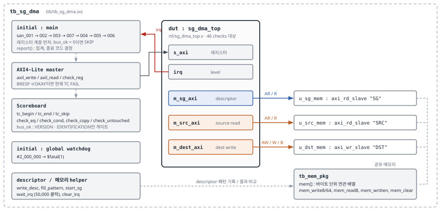

# SG DMA Sanity Test

*회귀 게이트 · TC 7개 / 체크 46개 · tb_sg_dma*

| 항목 | 내용 |
|---|---|
| 문서 ID | SGDMA-SANITY-rel-v2.0.0 |
| 날짜 | 2026-10-19 |
| 작성자 | 조혜린 (hrcho) |
| 대상 DUT | `rtl/sg_dma_top.v` (module `sg_dma_top`) |
| 구현 | `tb/tb_sg_dma.sv`, `tb/axi_mem_slave.sv`, `tb/tb_mem_pkg.sv` |
| 구성 | TC 7개 / 체크 46개 |
| 최종 실행 | 2026-10-19 — 46/46 PASS (6,305 ns, Vivado xsim 2024.2) |
| 이전 판 | SGDMA-SANITY-rel-v1.1.0 (2026-10-16, 정리 전 RTL 기준) |

# 문서 안내

## 관련 문서

| 문서 | 역할 |
|---|---|
| `SGDMA-SFR-rel-v2.0.0` | 레지스터 사양. 이 문서의 모든 기대값 근거. SFR 절 번호(예: §4.1.1)는 이 판 기준 |
| `SGDMA-SOR-rel-v2.0.0` | 검증 요구사항 — 테스트 15개(T-01 ~ T-15). 이 문서의 SOR 연결은 이 판 기준 |
| `SG_DMA_Architecture_Specification` (SGDMA-ARCH-rel-v2.0.0) | 구조, 데이터 경로, SAN-005 실측 타이밍 |

> **[주의]** **46/46 PASS는 이 46개 체크가 통과했다는 뜻입니다.** 레지스터와 DMA 기능 전체가 검증되었다는 뜻이 아닙니다. 예를 들어 SAN-003은 리셋값 10개만 봅니다. Sanity가 보지 않는 항목과 그것을 맡은 SOR 테스트는 5장에 정리했습니다.

## 용어

| 용어 | 정의 |
|---|---|
| TC / 체크 | Sanity 테스트 케이스(SAN-001 ~ SAN-007) / TC 안의 비교 1회. 모두 46개 |
| 회귀 게이트 | RTL을 고칠 때마다 실행해 다음 단계 진행 여부를 판정하는 자동 테스트 |
| SKIP | TC를 실행하지 않고 건너뜀 (2.3) |
| watchdog | 정해진 시뮬레이션 시간이 지나면 `$fatal`로 종료하는 감시 블록 |
| guard (tail) | 목적지 끝 바로 뒤 16바이트. 쓰이면 범위 초과 쓰기 |
| gather / scatter | 여러 소스 → 연속 목적지 / 연속 소스 → 여러 목적지. Sanity는 gather만 봄 |
| 구현 특성 체크 | ADI가 문서로 보장하지 않은, 현재 RTL의 동작을 확인하는 체크. 이 문서에서는 `DESCRIPTOR_ID` 완료 후 값 2개 (3.8) |
| 근거 등급 M / P / R | SFR §2.5. M = Sanity 측정, P = 일회성 측정, R = RTL 분석 |
| SOT / EOT | `IRQ_SOURCE` 비트0(요청 수락) / 비트1(전송 완료) |

## v1.1.0 대비 바뀐 점

**체크 46개, TC별 체크 수, 실행 순서, 기대값, 판정 규칙은 바뀌지 않았습니다.** RTL 정리(2026-10-17) 후에도 로그의 체크 결과와 AXI 트랜잭션 시각이 정리 전과 같습니다.

| # | 바뀐 점 | 위치 |
|---|---|---|
| 1 | 대상과 경로: `rtl/sg_dma/sgdma_top.v` → `rtl/sg_dma_top.v`, `tb/sg_dma/tb_sg_dma.sv` → `tb/tb_sg_dma.sv`, `tb/common/*` → `tb/*`. RTL은 `rtl/` 18개 파일 | 머리말, 4장, 6장 |
| 2 | `tb_sg_dma.sv`의 주석과 배너만 고쳤습니다(문서 판 번호, 0x450·AXCACHE 설명, 미구현 기능 표기). 체크 로직·기대값·체크 이름은 같습니다. 2026-10-19 다시 실행해 46/46을 확인했습니다 | 부록 A, 부록 C |
| 3 | `0x450`은 정리 후 미구현(읽기 0, 부작용 없음)이므로 "읽기 금지" 규칙을 해제했습니다. SAN-007은 TB를 바꾸지 않아 여전히 읽지 않습니다 | 3.4, 5.5 |
| 4 | SAN-003이 보지 않는 리셋값을 SFR v2.0.0이 일회성으로 측정했습니다(P). Sanity 범위는 그대로입니다 | 5.2 |
| 5 | 파라미터 변경 시 고칠 기대값을 `sg_dma_top`의 9개 파라미터 기준으로 다시 정리했습니다. 2D·framelock·cyclic은 파라미터가 아니라 RTL에서 제거된 기능입니다 | 7.1 |
| 6 | 메모리 모델의 제약(outstanding 1개, 항상 OKAY, 지연 없음)을 명시했습니다 | 6.4 |
| 7 | 비유 표현을 빼고 용어를 그대로 썼습니다. descriptor 수는 "개"로 셉니다 | 전체 |

## 목차

- 1 개요
  - 1.1 Sanity의 역할
  - 1.2 Sanity가 하지 않는 것
  - 1.3 SOR과의 관계
- 2 구성
  - 2.1 TC 목록
  - 2.2 실행 순서
  - 2.3 판정 규칙
- 3 TC 상세
  - 3.1 SAN-001 Register identity (5 checks)
  - 3.2 SAN-002 Scratch R/W (3 checks)
  - 3.3 SAN-003 Reset defaults (10 checks)
  - 3.4 SAN-007 Parameter-masked bits (11 checks)
  - 3.5 SAN-004 Single descriptor copy (4 checks)
  - 3.6 SAN-005 3-descriptor chain, gather (6 checks)
  - 3.7 SAN-006 IRQ & status (7 checks)
  - 3.8 구현 특성 체크 — DESCRIPTOR_ID 완료 후 값
- 4 실행 방법
  - 4.1 환경과 명령
  - 4.2 판정
  - 4.3 실패 시 확인 순서
- 5 커버 범위와 한계
  - 5.1 커버하는 것
  - 5.2 커버하지 않는 것 — 리셋값
  - 5.3 커버하지 않는 것 — 기능
  - 5.4 SOR 연계 — Sanity TC → SOR v2.0.0 테스트
  - 5.5 읽기·비교 규칙
- 6 TB 구조
  - 6.1 전체 구성
  - 6.2 Scoreboard
  - 6.3 AXI4-Lite master
  - 6.4 메모리 모델의 제약
- 7 유지보수
  - 7.1 파라미터를 바꿨을 때
  - 7.2 체크를 추가할 때
  - 7.3 문서 동기화
- 부록 A 실측 로그 전문
- 부록 B 체크 ↔ SFR 근거
- 부록 C 이력
  - C.1 설계 결정 반영 (2026-10-06)과 현재 상태
  - C.2 결정 7 재조정
  - C.3 TB 수정 이력

# 1 개요

## 1.1 Sanity의 역할

Sanity는 RTL을 고칠 때마다 실행하는 회귀 게이트입니다. 목적은 레지스터 경로와 SG 기본 전송이 깨졌는지를 수 초 안에 판정하는 것이며, 기능을 넓게 검증하는 것이 아닙니다. 기능 검증은 SOR의 테스트 15개(T-01 ~ T-15)가 맡습니다. Sanity가 통과해도 SOR 테스트는 따로 실행하고, Sanity가 실패하면 SOR 테스트보다 먼저 원인을 해결합니다.

| 조건 | 구현 | 이유 |
|---|---|---|
| 짧은 실행 시간 | 시뮬레이션 6,305 ns, 실행 수 초 | 매 수정마다 실행하기 위함 |
| 자동 판정 | 체크마다 `[ ok ]` / `[FAIL]`, 요약에서 집계 | 로그를 사람이 해석하지 않아도 됨 |
| 종료 코드 | 실패 시 `$fatal(1)` | 스크립트·CI가 종료 코드로 판정 |
| watchdog | 전역 `#2_000_000` 후 `$fatal(1)` | handshake가 멈춰도 회귀가 끝나도록 |

```
// global watchdog - a hung handshake must not hang the regression    (tb_sg_dma.sv:716~721)
initial begin
  #2_000_000;
  $display("\n[FAIL] GLOBAL TIMEOUT - simulation did not finish");
  $fatal(1, "global watchdog");
end
```

전송 하나를 기다릴 때는 `wait_irq`에 별도 타임아웃(기본 50,000 클럭, tb_sg_dma.sv:366)이 있습니다. 이 타임아웃은 해당 TC의 FAIL 체크로 기록되어 어느 TC에서 멈췄는지 로그에 남습니다.

## 1.2 Sanity가 하지 않는 것

| 항목 | 설명 | 담당 |
|---|---|---|
| 커버리지 측정 | 코드·기능 커버리지를 측정하지 않음 | SOR에서도 제외 (COV-001) |
| 전수 검사 | 레지스터 전체를 읽지 않음 (5.2) | SFR 부록 A (일회성 P 측정) |
| 기능 검증 | 경계 조건, 에러 응답, 무작위 조합, backpressure | SOR T-05 ~ T-15 |
| 성능 측정 | 대역폭·지연 | — |

이 범위는 2026-10-06 팀 결정입니다. 리셋값 체크를 Sanity에 추가하는 안이 논의되었으나 Sanity는 회귀 게이트 역할로 한정했습니다(부록 C.2).

## 1.3 SOR과의 관계

|  | Sanity (이 문서) | SOR (`SGDMA-SOR-rel-v2.0.0`) |
|---|---|---|
| 목적 | 레지스터 경로·SG 기본 전송의 회귀 판정 | 요구사항별 검증 |
| 규모 | TC 7개 / 체크 46개 | 테스트 15개 (원래 요구사항 58건 흡수) |
| 실행 시점 | RTL 수정마다 | 검증 단계 |
| 상태 | TB 구현 완료, 46/46 PASS | TB 보강(B1 ~ B6)이 필요한 테스트 있음 |

> **[주의]** **Sanity 통과는 연결된 SOR 테스트의 통과가 아닙니다.** SOR 테스트는 같은 동작을 더 넓게 봅니다. 예를 들어 SAN-004는 T-03의 일부(데이터·guard·완료 비트)만 판정하고, descriptor 읽기 burst 형태(`ARLEN = 5`)는 로그에 출력만 합니다. SOR은 T-01 ~ T-04, T-09를 Sanity 재확인 단계로 따로 실행합니다.

# 2 구성

## 2.1 TC 목록

| TC | 이름 | 체크 | 계층 | 목적 | 관련 SOR |
|---|---|---|---|---|---|
| SAN-001 | Register identity | 5 | 레지스터 | 버스·주소 디코드 동작, 구성 상수 확인 | T-01 |
| SAN-002 | Scratch R/W | 3 | 레지스터 | 쓰기 경로 확인 | T-01 |
| SAN-003 | Reset defaults | 10 | 레지스터 | 리셋 직후 값 | T-09 (IRQ_MASK) |
| SAN-007 | Parameter-masked bits | 11 | 레지스터 | 미구현 비트·레지스터를 결함으로 오판하지 않도록 기대값 고정 | T-02 |
| SAN-004 | Single descriptor copy | 4 | 전송 | descriptor 1개 SG 전송 | T-03 |
| SAN-005 | 3-descriptor chain, gather | 6 | 전송 | 체인 따라가기 | T-04 |
| SAN-006 | IRQ & status | 7 | 전송 | 인터럽트 경로 | T-09 |
|  | **합계** | **46** |  |  |  |

TC별 SOR 연결의 상세(일부 겹침 포함)는 5.4에 있습니다.

## 2.2 실행 순서

```
SAN-001 -> SAN-002 -> SAN-003 -> SAN-007 -> SAN-004 -> SAN-005 -> SAN-006
|------------- 레지스터 계층 -------------|   |--------- 전송 계층 ---------|
```

| 규칙 | 이유 |
|---|---|
| 레지스터 계층을 먼저 | 버스가 동작하지 않는 상태에서 전송을 돌리면 "전송 실패"와 "레지스터 접근 실패"를 구분할 수 없음 |
| SAN-003은 SAN-007보다 앞 | SAN-007이 `0xFFFF_FFFF`를 쓰므로 뒤에 두면 리셋값을 볼 수 없음 |
| SAN-002는 SAN-003보다 앞이어도 됨 | `SCRATCH`는 SAN-003의 확인 대상이 아님 |
| SAN-007은 원복 후 종료 | `CONTROL`을 0으로 되돌리지 않으면 SAN-004가 ENABLE = 1 상태로 시작함 |

전송 계층에 들어가기 전에 공통 설정을 합니다 (tb_sg_dma.sv:706~707). SOR 표준 순서 2·3번과 같습니다.

```
axil_write(REG_IRQ_MASK, 32'h1);   // SOT 마스크, EOT 허용
axil_write(REG_CONTROL,  32'h5);   // ENABLE | HWDESC
```

## 2.3 판정 규칙

| 상황 | 동작 |
|---|---|
| 체크 통과 | `[ ok ]` 출력, TC pass +1 |
| 체크 실패 | `[FAIL]` + 기대값·측정값 출력, TC fail +1 |
| TC 안에서 fail ≥ 1 | 그 TC는 FAIL. 이후 TC는 계속 실행 |
| `VERSION` 또는 `IDENTIFICATION` 불일치 | 나머지 6개 TC를 SKIP하고 종료 |
| FAIL 또는 SKIP이 1건 이상 | `*** SANITY FAILED ***` + `$fatal(1)` |
| 모두 통과 | `*** SANITY PASSED ***` + `$finish` |

**중단 조건을 VERSION / IDENTIFICATION 둘로 한정한 이유.** 초기 구현은 SAN-001의 체크가 하나라도 틀리면 나머지를 모두 SKIP했고, `INTERFACE_DESCRIPTION_2` 기대값이 틀렸을 때 정상 RTL인데도 TC 6개가 SKIP되었습니다(부록 C.3). `INTERFACE_DESCRIPTION_1/2`와 `PERIPHERAL_ID`는 구성 상수이므로, 값이 틀리면 버스 고장보다 기대값 오류일 가능성이 큽니다. 그래서 `bus_ok` 플래그(tb_sg_dma.sv:197)를 따로 두고 두 레지스터만 게이트로 씁니다. 구성 레지스터가 틀리면 다음 안내를 출력합니다.

```
note : build-configuration register mismatch - confirm the
       expected value before treating it as an RTL defect.
```

> **[주의]** **체크별 예외는 없습니다.** 3.8의 구현 특성 체크 2개도 다른 체크와 똑같이 집계되므로, 틀리면 `*** SANITY FAILED ***`가 됩니다. 문서가 정하는 것은 실패의 해석입니다.

# 3 TC 상세

각 TC는 목적 → 절차·구성 → 체크 → 주의 → SOR 연결 순서입니다. "실패 시 확인" 열은 그 체크가 FAIL했을 때 먼저 볼 곳입니다. 기대값의 근거는 부록 B와 SFR v2.0.0에 있습니다.

## 3.1 SAN-001 Register identity (5 checks)

**목적**: AXI4-Lite 접근과 주소 디코드가 동작하는지, 의도한 파라미터로 만들어졌는지 확인합니다.

| # | 체크 | 기대값 | SFR | 실패 시 확인 |
|---|---|---|---|---|
| 1 | `VERSION` (0x000) | `0x0004_0565` | 4.1.1 | 버스·디코드 고장. 나머지 TC SKIP |
| 2 | `IDENTIFICATION` (0x00C) | `0x444D_4143` | 4.1.4 | 위와 같음 |
| 3 | `PERIPHERAL_ID` (0x004) | `0x0000_0000` | 4.1.2 | `ID` 파라미터 변경 또는 기대값 오류 |
| 4 | `INTERFACE_DESCRIPTION_1` (0x010) | `0x3807_0303` | 4.1.5 | `DATA_WIDTH` / `MAX_BYTES_PER_BURST` 변경, 기대값 미갱신 |
| 5 | `INTERFACE_DESCRIPTION_2` (0x014) | `0x0000_0000` | 4.1.6 | `AXI_AXCACHE` / `AXI_AXPROT` 변경. 기대값부터 확인 |

체크 4는 beat 크기(8바이트), burst 크기(128바이트), 소스·목적지 타입(둘 다 AXI-MM)을 한 번에 확인합니다. 비트 배치는 SFR §4.1.5에 있습니다.

> **[주의]** **체크 5의 이력.** 정리 전 `axi_dmac_regmap.v`의 모듈 기본값 `AXI_AXCACHE = 4'b0011`을 보고 기대값을 `0x30`으로 계산한 문서가 두 건 있었고 둘 다 틀렸습니다. 실제 값은 상위 모듈이 넘기는 파라미터로 정해집니다. 현재는 `sg_dma_top` 파라미터가 `4'b0000`이고 regmap 기본값도 `4'b0000`입니다. 기대값은 항상 `sg_dma_top` 파라미터에서 계산합니다.

**SOR 연결**: T-01 (REG-001, REG-002, REG-004, REG-005, REG-020) — 같은 5개 값, 같은 SKIP 규칙. T-14 (AXI-007) — 체크 5는 레지스터 값만 보며, 세 포트의 실제 AxCACHE/AxPROT 출력은 T-14가 봅니다.

## 3.2 SAN-002 Scratch R/W (3 checks)

**목적**: 쓰기 경로를 확인합니다. `SCRATCH`(0x008)는 기능이 없어 써도 부작용이 없습니다.

| # | 쓰는 값 | 읽기 기대값 | 실패 시 확인 |
|---|---|---|---|
| 1 | `0xA5A5_5A5A` | 같은 값 | 쓰기 경로 고장 또는 stuck-at 비트 |
| 2 | `0x5A5A_A5A5` | 같은 값 | 1과 비교하면 어느 비트가 고착인지 보임 |
| 3 | `0x0000_0000` | 같은 값 | stuck-at-1. 원복 실패 |

반전 패턴 두 개를 써야 32비트 각각이 0과 1 양쪽으로 동작하는지 확인됩니다. 마지막 0 쓰기는 원복입니다.

**SOR 연결**: T-01 (REG-003). WSTRB 동작은 T-02 (REG-023).

## 3.3 SAN-003 Reset defaults (10 checks)

**목적**: HW 리셋 해제 직후의 레지스터 값을 확인합니다.

| # | 레지스터 | 기대값 | 비고 | 실패 시 확인 |
|---|---|---|---|---|
| 1 | `CONTROL` (0x400) | 0x0000_0000 | HWDESC도 0 | 리셋 경로 또는 초기값 변경 |
| 2 | `IRQ_MASK` (0x080) | **0x0000_0003** | 0이 아님 | 초기값 변경 |
| 3 | `IRQ_PENDING` (0x084) | 0x0000_0000 |  | 리셋 직후 인터럽트 대기 중 |
| 4 | `IRQ_SOURCE` (0x088) | 0x0000_0000 |  | 리셋 직후 이벤트 기록됨 |
| 5 | `FLAGS` (0x40C) | **0x0000_0002** | 0이 아님 | 초기값 변경 |
| 6 | `TRANSFER_DONE` (0x428) | 0x0000_0000 |  | 리셋 직후 완료 비트 |
| 7 | `TRANSFER_ID` (0x404) | 0x0000_0000 |  | ID 초기값 변경 |
| 8 | `DEST_ADDRESS` (0x410) | 0x0000_0000 |  | 주소 레지스터 리셋 누락 |
| 9 | `SRC_ADDRESS` (0x414) | 0x0000_0000 |  | 위와 같음 |
| 10 | `SG_ADDRESS` (0x47C) | 0x0000_0000 |  | 위와 같음 |

> **[주의]** **0이 아닌 리셋값은 `IRQ_MASK = 0x3`, `FLAGS = 0x2` 두 개입니다.** "리셋 후 전부 0"을 가정한 테스트는 이 두 곳에서 FAIL합니다. `CONTROL.HWDESC`의 리셋값도 0이므로 SG 모드는 드라이버가 `CONTROL ← 0x5`를 써야 동작합니다.

이 TC는 리셋값 10개만 봅니다. 나머지는 5.2에 있으며, SFR v2.0.0 부록 A에 일회성 측정값(P)이 있습니다.

**SOR 연결**: T-09 (IRQ-003) 1단계가 리셋 직후 `IRQ_MASK = 0x3`을 다시 봅니다. 나머지 9개는 SOR에 대응 테스트가 없으므로(5.3), 회귀로 확인되는 리셋값의 근거는 이 TC뿐입니다.

## 3.4 SAN-007 Parameter-masked bits (11 checks)

**목적은 결함 검출이 아니라 오판 방지입니다.** RTL에서 제거된 기능의 비트와 레지스터는 써도 바뀌지 않습니다. 이것을 모르고 "RW 레지스터 write/read-back" 테스트를 만들면 정상 동작을 결함으로 보고합니다. 기대값을 문서와 TB 양쪽에 고정합니다.

| # | 동작 | 기대값 | 이유 | 실패 시 확인 |
|---|---|---|---|---|
| 1 | `W(0x400, 0xFFFF_FFFF)` → R | 0x0000_0007 | CONTROL[3] framelock 미구현 | regmap 읽기 비트 구성 변경 |
| 2 | `W(0x40C, 0xFFFF_FFFF)` → R | 0x0000_0006 | FLAGS[0] cyclic 미구현 | 위와 같음 |
| 3 | `W(0x410, 0xFFFF_FFFF)` → R | 0xFFFF_FFF8 | 64비트 데이터 → 8바이트 정렬 | `DATA_WIDTH` 변경 또는 정렬 마스크 변경 |
| 4 | `W(0x414, 0xFFFF_FFFF)` → R | 0xFFFF_FFF8 | 위와 같음 | 위와 같음 |
| 5 | `W(0x47C, 0xFFFF_FFFF)` → R | 0xFFFF_FFF8 | SG 포트 64비트 | 위와 같음 |
| 6 | `W(0x490, 0xFFFF_FFFF)` → R | 0x0000_0000 | `ADDR_WIDTH = 32` | `ADDR_WIDTH`가 64로 바뀜 (7.1) |
| 7 | `W(0x494, 0xFFFF_FFFF)` → R | 0x0000_0000 | 위와 같음 | 위와 같음 |
| 8 | `W(0x4BC, 0xFFFF_FFFF)` → R | 0x0000_0000 | 위와 같음 | 위와 같음 |
| 9 | `R(0x41C)` Y_LENGTH | 0x0000_0000 | 2D 미구현 | 주소 디코드 변경 |
| 10 | `R(0x458)` FRAMELOCK_CONFIG | 0x0000_0000 | framelock 미구현 | 위와 같음 |
| 11 | `R(0x0F0)`, `R(0x600)` | 둘 다 0x0000_0000 | 미정의 주소 | **주소 디코드 오류** |

로그의 체크 이름은 정리 전 표기를 유지합니다(`CONTROL[3] masked (FRAMELOCK=0)`, `FLAGS[0] masked (DMA_CYCLIC=0)`, `Y_LENGTH tied 0 (2D=0)`). 정리 전에는 파라미터로 꺼진 기능이었고, 정리 후에는 RTL에서 제거된 기능입니다. 기대값은 같습니다.

**체크 6~8**: `*_ADDRESS_HIGH`는 `if (HAS_ADDR_HIGH)` 조건 때문에 쓰기 로직이 만들어지지 않습니다. **체크 11**: 이 IP는 미정의 주소에도 에러 응답을 내지 않으므로(BRESP/RRESP 항상 OKAY), readback 비교가 주소 디코드 오류를 잡는 유일한 방법입니다.

> **[참고]** **`0x450`(PARTIAL_TRANSFER_ID)은 읽지 않습니다.** 정리 전 RTL에서는 이 주소를 읽으면 내부 partial FIFO가 pop되었습니다. 정리 후에는 레지스터가 없어 읽어도 0이고 부작용이 없습니다(SFR §4.5.5, P). TB는 이전 동작을 그대로 두어 이 주소를 읽지 않으며, SOR T-02가 0x44C/0x450 읽기를 맡습니다.

이 TC는 건드린 레지스터를 모두 되돌린 뒤 끝납니다 (tb_sg_dma.sv:507~514).

```
axil_write(REG_CONTROL,      32'h0000_0000);   // 안 하면 SAN-004가 ENABLE=1로 시작
axil_write(REG_FLAGS,        EXP_FLAGS_RESET);
axil_write(REG_DEST_ADDRESS, 32'h0000_0000);
axil_write(REG_SRC_ADDRESS,  32'h0000_0000);
axil_write(REG_SG_ADDRESS,   32'h0000_0000);
```

**SOR 연결**: T-02 (REG-021, REG-022) — 같은 11개 동작에 더해 `0x420`, `0x424`, `0x44C`, `0x450`, `0x45C` 읽기, RO 레지스터 쓰기(REG-019), WSTRB 무시(REG-023). T-13 (DESC-008) — 체크 5는 레지스터가 하위 3비트를 버리는 것만 보며, 실제 descriptor 읽기 주소는 T-13이 봅니다.

## 3.5 SAN-004 Single descriptor copy (4 checks)

**목적**: descriptor 1개를 읽고 MM→MM 전송을 끝내는지 확인합니다.

| 항목 | 값 |
|---|---|
| descriptor | `0x0000_1000`, `id = 0xA0`, `flags = 0b11` (LAST \| EOT_IRQ) |
| 전송 | `0x0001_0000` → `0x0002_0000`, 256바이트 (`x_len = 255`) |

| # | 체크 | 내용 | 실패 시 확인 |
|---|---|---|---|
| 1 | `irq asserted` | EOT 인터럽트 (타임아웃 50,000 클럭) | 전송 미완료 또는 인터럽트 경로 고장 (4.3) |
| 2 | `data` | 256바이트 바이트 단위 일치 | descriptor 해석(주소·길이) 또는 데이터 경로 |
| 3 | `tail` | 목적지 뒤 16바이트가 쓰이지 않음 | 범위 초과 쓰기 — 길이 해석이 1 이상 큼 |
| 4 | `TRANSFER_DONE bit set` | `[3:0]` 중 하나 이상 1 | 완료 비트 경로 |

**체크 3이 필요한 이유**: 데이터 비교만으로는 범위 밖에 쓰는 결함을 잡지 못합니다. 메모리 모델이 바이트마다 쓰였는지 기록하므로(`mem_written()`) 목적지 뒤 16바이트가 쓰이지 않았는지 확인합니다.

#### 관측된 버스 동작

```
[3195000]   SG AR  addr=0x00001000 beats=6 size=8B     <- descriptor fetch, 48 B
[3315000]  SRC AR  addr=0x00010000 beats=16 size=8B    <- 128 B
[3495000]  DST AW  addr=0x00020000 beats=16 size=8B
[3495000]  SRC AR  addr=0x00010080 beats=16 size=8B    <- 128 B (분할)
[3705000]  DST AW  addr=0x00020080 beats=16 size=8B
```

- descriptor 읽기는 6 beat × 64비트 = 48바이트 INCR burst 1개입니다 (`ARLEN = 5`, `ARSIZE = 3`).
- 256바이트 전송은 `MAX_BYTES_PER_BURST = 128`에 따라 burst 2개로 나뉩니다.

> **[주의]** **위 버스 동작은 출력만 하고 판정하지 않습니다.** descriptor 읽기 형태는 SOR T-03 (AXI-001, DESC-001), 128바이트 분할은 T-07 (FUNC-006), "소스 burst를 다 읽은 뒤 쓰기"는 T-07 (FUNC-007)이 판정합니다.

**SOR 연결**: T-03 (REG-007, REG-015, DESC-001~003, DESC-007, FUNC-001, FUNC-009, AXI-001) — 같은 descriptor·주소·길이에 더해 버스 요청 형태, `SG_ADDRESS` readback, `DESCRIPTOR_ID = 0xA0`(참고 체크)를 봅니다. Sanity는 이 TC에서 `DESCRIPTOR_ID`를 읽지 않습니다. T-07 (FUNC-006, FUNC-007) — 위 3,315 ns → 3,495 ns를 참고 측정값으로 씁니다. T-10 (REG-013) — 체크 4는 완료 시 세트만 보며, 재제출 시 clear는 T-10이 봅니다.

## 3.6 SAN-005 3-descriptor chain, gather (6 checks)

**목적**: `next_sg_addr`를 따라 체인을 처리하는지 확인합니다. 흩어진 소스 3곳을 연속된 목적지에 모읍니다.

| # | descriptor 주소 | id | flags | 소스 | 목적지 | 길이 |
|---|---|---|---|---|---|---|
| 0 | 0x0000_1100 | 0xB0 | 0b00 | 0x0001_1000 | 0x0002_1000 | 128 |
| 1 | 0x0000_1140 | 0xB1 | 0b00 | 0x0001_3000 | 0x0002_1080 | 256 |
| 2 | 0x0000_1180 | 0xB2 | **0b11** | 0x0001_5000 | 0x0002_1180 | 64 |

**SG_ADDRESS를 한 번 쓰면 descriptor 3개를 따라가며 조각 3개를 모은다**


*Figure 1. SAN-005 descriptor chain. 파란 상자는 메모리의 descriptor, 주황 상자는 데이터 영역입니다.*

마지막 descriptor에만 `flags = 0b11`을 둡니다. 이렇게 하면 `TRANSFER_ID`와 `TRANSFER_DONE`이 1:1로 맞고 인터럽트도 체인당 1회입니다. 모든 descriptor에 `flags[1]`을 켜면 두 값이 어긋납니다 (SFR §6.2).

| # | 체크 | 내용 | 실패 시 확인 |
|---|---|---|---|
| 1 | `irq asserted` | 체인 전체 완료 후 1회 | 체인을 끝까지 따라가지 못함, 또는 LAST에서 멈추지 않음 |
| 2~4 | `seg0` / `seg1` / `seg2` | 구간별 바이트 일치 | 해당 descriptor의 해석 또는 `next_sg_addr` 처리 |
| 5 | `tail` | 448바이트 뒤 16바이트 미기입 | 마지막 구간 범위 초과 |
| 6 | `DESCRIPTOR_ID = last of chain` | `0x0000_00B2` | **구현 특성 체크** (3.8) |

#### 관측된 prefetch

```
[4215000]   SG AR  addr=0x00001100    <- descriptor 0
[4295000]   SG AR  addr=0x00001140    <- descriptor 1
[4335000]  SRC AR  addr=0x00011000    <- 첫 데이터 읽기
[4375000]   SG AR  addr=0x00001180    <- descriptor 2
[4515000]  DST AW  addr=0x00021000    <- 첫 데이터 쓰기
```

descriptor 3개가 첫 목적지 쓰기 전에 모두 읽힙니다. descriptor fetch와 데이터 전송이 겹쳐 진행된다는 측정 결과이며, 판정은 SOR T-04 (DESC-009)가 합니다. 전체 타이밍은 Architecture Spec Figure 10에 있습니다.

**SOR 연결**: T-04 (DESC-004, DESC-009, FUNC-002) — 같은 체인으로 descriptor 읽기 순서·횟수, prefetch, irq 횟수, `TRANSFER_ID` 증가를 판정. T-06 (FUNC-004) — Sanity는 체인 길이 3만 봄. T-08 (DESC-005, DESC-006, REG-016) — Sanity는 마지막 descriptor 인터럽트만 보며, 체크 6은 T-08의 `DESCRIPTOR_ID` 관측과 겹치고 SOR에서도 참고 체크입니다.

## 3.7 SAN-006 IRQ & status (7 checks)

**목적**: 인터럽트 경로 전체(이벤트 래치 → 마스크 → `irq` → W1C)를 확인합니다. 구성: descriptor 1개(`id = 0xC5`, 64바이트), `IRQ_MASK = 0x1`.

| # | 체크 | 기대값 | 확인 내용 | 실패 시 확인 |
|---|---|---|---|---|
| 1 | `IRQ_MASK = 0x1` | 0x0000_0001 | 앞서 쓴 마스크 유지 | 마스크 레지스터 쓰기·유지 |
| 2 | `irq asserted` | — | 전송 완료 후 irq | 전송 미완료 또는 EOT가 irq까지 전달되지 않음 |
| 3 | `IRQ_PENDING[1] set` | [1] = 1 | EOT가 pending에 반영 | 마스크 게이트 로직 |
| 4 | `IRQ_PENDING cleared` | 0x0000_0000 | W1C 후 | W1C 동작 |
| 5 | `IRQ_SOURCE[0] survives W1C` | **0x0000_0001** | 마스크된 SOT가 SOURCE에 남음 | 마스크가 이벤트 래치까지 막도록 바뀜, 또는 W1C가 쓰지 않은 비트까지 지움 |
| 6 | `irq de-asserted after W1C` | irq = 0 | level 신호 해제 | clear 후에도 irq 유지 |
| 7 | `DESCRIPTOR_ID` | 0x0000_00C5 | 완료 후 값 | **구현 특성 체크** (3.8) |

**체크 5**는 `IRQ_MASK`가 이벤트 기록을 막지 않는다는 것을 확인합니다. 마스크된 SOT도 `IRQ_SOURCE[0]`에 기록되고 `IRQ_PENDING`에만 보이지 않습니다. 따라서 W1C로 [1]만 지우면 `IRQ_SOURCE`에 `0x1`이 남습니다.

> **[주의]** **마스크를 풀면 쌓여 있던 이벤트가 바로 인터럽트로 나갑니다.** 마스크를 풀기 전에 `IRQ_PENDING`에 `0x3`을 써서 비웁니다. `IRQ_PENDING`에 쓰면 실제로 지워지는 것은 `IRQ_SOURCE`입니다 (SFR §4.2.2).

**SOR 연결**: T-09 (IRQ-002~005) — Sanity는 마스크 `0x1`만 보며, T-09는 `0x3`, `0x2`, `0x1`, `0x0`과 "비우지 않고 마스크 해제"를 봅니다. T-08 (IRQ-001, REG-016, DESC-006) — 체크 2는 EOT 인터럽트의 가장 단순한 경우이고, 체크 7은 T-08의 관측과 겹치며 SOR에서도 참고 체크입니다.

## 3.8 구현 특성 체크 — DESCRIPTOR_ID 완료 후 값

| 체크 | 기대값 | 부록 B 번호 |
|---|---|---|
| SAN-005 #6 `DESCRIPTOR_ID = last of chain` | 0x0000_00B2 | 39 |
| SAN-006 #7 `DESCRIPTOR_ID` | 0x0000_00C5 | 46 |

#### 구현 특성인 이유

전송이 끝난 뒤 `DESCRIPTOR_ID`가 마지막 descriptor의 id를 계속 보여 주는 것은 `util_axis_fifo`의 구현 특성이며 ADI가 문서로 보장한 동작이 아닙니다. `dmac_sg`는 descriptor가 완료될 때마다 ID FIFO에서 하나를 꺼내고(dmac_sg.v:278~289), FIFO가 비면 출력이 갱신되지 않아 마지막 값이 남습니다. 선행 문서에는 "이전 전송의 stale 값이 보일 수 있다"는 경고가 있었으나, SAN-005가 앞선 SAN-004의 `0xA0`이 아니라 자기 체인의 `0xB2`를 읽어 이를 반증했습니다.

정리 후 확인된 추가 동작(SFR §4.6.2, P): HWDESC = 1이고 완료된 descriptor가 없으면 값이 정의되지 않고(시뮬레이션 X), HWDESC = 0이면 0입니다. Sanity는 두 경우 모두 읽지 않습니다.

#### 해석 규칙 (SOR v2.0.0 §2.1과 같음)

SOR은 판정을 판정 / 참고 체크 / 관찰 기록 / 관측 후 확정으로 나누고, "`DESCRIPTOR_ID`의 전송 완료 후 값은 항상 참고 체크"로 정했습니다. 이 두 체크는 그 규칙의 대상입니다.

> **[주의]** **이 체크가 FAIL하면 RTL 결함보다 "구현이 바뀌었다"는 신호로 먼저 봅니다.**
>
> 1. `dmac_sg.v`와 `util_axis_fifo.v`가 바뀌었는지 확인합니다.
> 2. 바뀌었고 나머지 44개 체크가 통과했다면 구현 특성의 변화입니다. 기대값과 이 문서를 고칩니다.
> 3. 바뀐 것이 없는데 FAIL하면 RTL 문제로 조사합니다.
>
> 드라이버는 이 값을 완료 판정에 쓰지 않습니다. 완료는 EOT 인터럽트나 `TRANSFER_DONE`으로 확인합니다 (SFR §4.6.2).

**현재 TB 처리**: 2.3의 판정 규칙에 체크별 예외가 없으므로 이 두 체크도 게이트 판정에 들어갑니다. 향후 TB에서 두 체크를 경고(WARN)로 낮춰 게이트에서 빼는 것을 권장합니다. 바꿀 경우 체크 수 집계와 요약 형식이 달라질 수 있으므로 7.2 규칙대로 TB 헤더·이 문서·부록 B를 함께 고칩니다.

# 4 실행 방법

## 4.1 환경과 명령

| 경로 | 내용 |
|---|---|
| `rtl/` | DUT RTL 18개 파일 (`sg_dma_top.v` 외) |
| `tb/` | `tb_sg_dma.sv` (top TB), `axi_mem_slave.sv` (AXI slave 모델), `tb_mem_pkg.sv` (공유 메모리) |
| `filelists/rtl.f`, `tb.f` | 컴파일 목록 (`-i ../rtl`로 `inc_id.vh` 포함) |
| `xsim/` | `Makefile`, `sourceme` (Vivado 환경), `xsim_run.tcl` (파형 덤프용) |

```
cd xsim
source sourceme          # Vivado 2024.2 환경 (이미 설정되어 있으면 생략)
make clean && make sim
```

| 타깃 | 동작 |
|---|---|
| `make sim` | 컴파일 + elaborate + batch 실행. 회귀 게이트 |
| `make wave` | 전체 신호를 `dump/tb_sg_dma_snap.wdb`로 기록하며 실행 |
| `make view` | `make wave`가 만든 `.wdb`를 GUI로 열기 |
| `make gui` | snapshot을 GUI로 열기 (신호 추가 후 `run all`) |
| `make clean` | 시뮬레이션 산출물 삭제 |

> **[주의]** **`make clean`을 생략하지 않습니다.** `xelab`은 소스가 아니라 컴파일된 라이브러리(`xsim.dir/work/`)를 읽으므로, RTL을 고친 뒤 `make sim`만 하면 이전 코드로 실행될 수 있습니다. 파일·모듈 이름을 바꾼 경우 특히 주의합니다.

## 4.2 판정

```
SANITY: 7 PASS / 0 FAIL / 0 SKIP     (46/46 checks)
*** SANITY PASSED ***
```

| 종료 | 의미 |
|---|---|
| `*** SANITY PASSED ***` + `$finish` | 통과. 종료 코드 0 |
| `*** SANITY FAILED ***` + `$fatal(1)` | 실패. 종료 코드 0이 아님 |
| `GLOBAL TIMEOUT` | handshake 정지. `$fatal(1)` |

스크립트는 종료 코드만 보면 되며 로그를 파싱할 필요가 없습니다.

## 4.3 실패 시 확인 순서

| 증상 | 먼저 볼 것 |
|---|---|
| SAN-001 VERSION / IDENTIFICATION FAIL | 버스 또는 주소 디코드 고장. 나머지는 SKIP되므로 이것부터 |
| 구성 레지스터 (SAN-001 #3~5) FAIL | 기대값 오류 가능성이 먼저. 파라미터를 바꿨다면 7.1 |
| SAN-003 FAIL | 리셋 경로 또는 레지스터 초기값 |
| SAN-007 FAIL | regmap 읽기 비트 구성이나 파라미터 변경. 의도한 변경이면 기대값도 고침 |
| `irq asserted` 타임아웃 | 전송 미완료. `make wave`로 `m_sg_axi` / `m_src_axi` / `m_dest_axi`, `dut.i_transfer.i_dmac_sg.hwdesc_state`, `DBG_STATUS` 확인 (Architecture Spec 13장) |
| `data` mismatch | 처음 4개 불일치 주소·값이 출력됨. 주소 패턴으로 정렬 문제인지 길이 문제인지 구분 |
| DESCRIPTOR_ID FAIL (SAN-005 #6, SAN-006 #7) | 구현 특성 체크. `dmac_sg.v` / `util_axis_fifo.v` 변경 여부부터 (3.8) |
| `GLOBAL TIMEOUT` | 바로 앞 출력으로 멈춘 TC 확인 |

# 5 커버 범위와 한계

> **[주의]** SOR v2.0.0에는 리셋값 전용 테스트가 없습니다(T-01, T-09가 일부만 읽음). 회귀로 계속 확인되는 리셋값의 근거는 이 TB입니다. 무엇을 확인했는지와 함께 무엇을 확인하지 않았는지를 이 장에 적습니다.

## 5.1 커버하는 것

| 영역 | 내용 | TC | SOR에서 더 보는 곳 |
|---|---|---|---|
| 버스 동작 | AXI4-Lite 읽기·쓰기 | SAN-001, 002 | T-01 |
| 구성 상수 | 의도한 파라미터로 만들어짐 | SAN-001 | T-01 |
| 리셋값 | 레지스터 10개 | SAN-003 | T-09 (IRQ_MASK) |
| 미구현 비트 | 8종 + 미정의 주소 | SAN-007 | T-02 |
| SG 기본 전송 | descriptor fetch → MM→MM 전송 | SAN-004 | T-03 |
| 체인 | `next_sg_addr` 3단 + prefetch(관측) | **SAN-005** | T-04, T-06 |
| descriptor 형식 | flags, id, 주소, `x_len` 해석 | SAN-004, 005 | T-03, T-04 |
| burst 분할 | 128바이트 단위 (관측만) | SAN-004 | T-07 |
| 인터럽트 경로 | 래치 → 마스크 → pending → W1C → 해제 (마스크 0x1만) | SAN-006 | T-09 |
| 범위 초과 쓰기 | 목적지 뒤 16바이트 미기입 | SAN-004, 005 | 모든 전송 테스트 (C3) |

## 5.2 커버하지 않는 것 — 리셋값

SAN-003이 보지 않는 리셋값입니다. "SFR v2.0.0" 열은 일회성 측정 결과(P)입니다. 이 값들은 회귀에 포함되지 않으므로 RTL을 바꾸면 다시 확인해야 합니다.

| 레지스터 | SFR v2.0.0 | SOR v2.0.0에서 |
|---|---|---|
| `0x408` TRANSFER_SUBMIT | P = 0 | T-10이 ENABLE = 0에서 쓴 뒤 읽음 (리셋값 아님) |
| `0x418` X_LENGTH | P = 0 (upstream 문서는 7) | 없음 |
| `0x420` / `0x424` *_STRIDE | P = 0 | T-02가 쓰기 후 0 판정 |
| `0x42C` ACTIVE_TRANSFER_ID | P = 0 | T-10, T-11이 전송 중·끈 뒤 값을 판정 |
| `0x430` STATUS | P = 0 (저장 소자 없음) | 없음 |
| `0x448` TRANSFER_PROGRESS | P = 0 | T-12가 전송 중·후 값을 판정 |
| `0x44C` / `0x450` PARTIAL_* | P = 0 (미구현) | T-02가 0 판정 |
| `0x454` DESCRIPTOR_ID | P = 0 (HWDESC = 0) | T-08이 SG 모드를 끈 뒤 0을 참고 체크 |
| `0x45C` FRAMELOCK_STRIDE | P = 0 | T-02가 쓰기 후 0 판정 |
| `0x498` / `0x49C` CURRENT_*_HIGH | P = 0 | 없음 |
| `0x434` ~ `0x444` 디버그 | 비교 제외 (측정값만 기록) | 관찰 기록 (T-11, T-12가 DBG_STATUS 기록) |

## 5.3 커버하지 않는 것 — 기능

`[B번호]`는 SOR v2.0.0 §2.6의 testbench 보강 목록이며, 보강 전에는 해당 판정이 보류됩니다.

| 영역 | Sanity에서 빠진 내용 | 담당 SOR 테스트 (원래 ID) |
|---|---|---|
| Scatter | gather만 확인. scatter 미검증 | T-05 (FUNC-003) |
| 체인 길이 | 3만 확인 | T-06 (FUNC-004) |
| TRANSFER_DONE 4개 초과 | 미확인 | SOR에도 판정 없음 (T-10은 4개 이내, ID 재사용 때 clear만 확인) |
| 전송 길이 | 64 / 128 / 256바이트만. 8의 배수가 아닌 길이 미확인 | T-07 (FUNC-005~007, AXI-002, AXI-003) [B1] |
| 주소 정렬 | 8바이트 정렬만 | T-13 (FUNC-010, DESC-008) |
| 4 KiB 경계 | 미확인 | T-13 (AXI-004) [B1] |
| 연속 전송 | 예약, TRANSFER_SUBMIT self-clear 타이밍 | T-10 (REG-009~014, FUNC-008) |
| ENABLE = 0에서 제출 | 무시되는지 미확인 | T-10 1단계 (REG-011) |
| descriptor별 인터럽트 | 중간 descriptor의 `flags[1]` | T-08 (DESC-005, IRQ-001) |
| DESCRIPTOR_ID 전송 중 추적 | 완료 후 값만 봄 | T-08 (DESC-006, REG-016) [B6] |
| 마스크 조합 | `IRQ_MASK = 0x1`만 | T-09 (IRQ-002~005) |
| ENABLE = 0 (전송 도중) | 지워지는 값과 남는 값 | T-11 (REG-006, REG-024) [B6] |
| PAUSE | 멈춘 자리부터 재개, 체인 PAUSE 제약 | T-12 (REG-008, REG-018) [B6] |
| 전송 중 관측 | TRANSFER_PROGRESS | T-12 (REG-018) |
| 전송 중 관측 | CURRENT_*_ADDRESS | SOR에서도 제외 (REG-017) |
| 전송 중 관측 | DBG_STATUS | T-11, T-12 — 관찰 기록 (REG-024) |
| RO 쓰기 · WSTRB | RO 레지스터 쓰기, 부분 바이트 쓰기 | T-02 (REG-019, REG-023) |
| backpressure | 메모리 모델이 지연 없이 응답 (6.4) | T-14 (AXI-005) [B4] |
| AXI 규칙 | assertion 없음. AxCACHE 출력 미확인 | T-14 (AXI-007) + 공통 조건 C5 [B1] |
| 다중 outstanding | 메모리 모델이 1개만 받음 | SOR에서도 제외 (AXI-006) |
| 에러 응답 | RRESP/BRESP 에러, 잘못된 descriptor | T-15 (ERR-001~004) [B3] |
| 커버리지 | 측정 안 함 | SOR에서도 제외 (COV-001) |

> **[참고]** **T-07(전송 길이)은 이 구성에서 특히 중요합니다.** 소스와 목적지가 모두 AXI-MM일 때만 1바이트 단위 길이가 가능하며, ADI 공식 testbench는 이 조합을 검증하지 않습니다(두 구성 모두 한쪽이 AXI-Stream).
>
> **리셋 관련은 Sanity와 SOR 어느 쪽에도 추가하지 않습니다**(2026-10-06 팀 결정). v1.0.0 SOR의 [3-1 Reset / Clock]은 "Sanity Test에서 커버됨 · 해당 사항 없음"으로 정리되었고 RST 요구사항 6건은 삭제되었습니다. 5.2의 값은 SFR v2.0.0에서 일회성으로 측정해 확정했지만, 회귀에는 없습니다.

## 5.4 SOR 연계 — Sanity TC → SOR v2.0.0 테스트

"같은 동작"은 Sanity와 SOR 테스트가 같은 값을 보는 경우, "일부 겹침"은 Sanity가 SOR 테스트의 일부만 보는 경우입니다.

| TC | 같은 동작 (원래 ID) | 일부 겹침 (원래 ID) |
|---|---|---|
| SAN-001 | T-01 (REG-001, 002, 004, 005, 020) | T-14 — 레지스터 값만, 버스 신호 아님 (AXI-007) |
| SAN-002 | T-01 (REG-003) | — |
| SAN-003 | — | T-09 — IRQ_MASK 리셋값만 (IRQ-003). 나머지 9개는 SOR에 없음 |
| SAN-007 | T-02 (REG-021, REG-022) | T-13 — SG_ADDRESS 레지스터 하위 3비트만 (DESC-008) |
| SAN-004 | T-03 (REG-007, 015, DESC-001~003, 007, FUNC-001, 009; AXI-001은 관측만) | T-07 — 128바이트 분할·순서 관측 (FUNC-006, 007) · T-10 — 완료 비트 세트만 (REG-013) |
| SAN-005 | T-04 (DESC-004, FUNC-002; DESC-009는 관측만) | T-06 — 체인 길이 3만 (FUNC-004) · T-08 — 마지막 descriptor 인터럽트, 완료 후 DESCRIPTOR_ID (DESC-005, 006, REG-016) |
| SAN-006 | — | T-09 — 마스크 0x1만 (IRQ-002~005) · T-08 — EOT 이벤트, 완료 후 DESCRIPTOR_ID (IRQ-001, DESC-006, REG-016) |

Sanity와 겹치지 않는 SOR 테스트: T-05, T-07(판정 부분), T-10(규칙·예약 부분), T-11, T-12, T-14(버스 신호), T-15. 이 테스트들은 Sanity 결과와 관계없이 처음부터 검증합니다.

> **[주의]** **Sanity 결과를 SOR 테스트의 통과 근거로 쓰지 않습니다.** 위 표는 같은 확인을 한 번 해 보았다는 참고 정보입니다.

## 5.5 읽기·비교 규칙

| 주소 | 레지스터 | 규칙 | 이유 |
|---|---|---|---|
| 0x434 ~ 0x444 | CURRENT_DEST_ADDRESS, CURRENT_SRC_ADDRESS, DBG_STATUS, DBG_IDS0/1 | 기대값 비교 금지 | 고정 리셋값을 보장하지 않고, 값이 버스 handshake 타이밍에 따라 달라지며, DBG_IDS는 Gray 인코딩 (SFR §4.7) |
| 0x450 | PARTIAL_TRANSFER_ID | **제약 해제** | 정리 후 미구현, 읽기 부작용 없음 (SFR §4.5.5). 정리 전 RTL에서는 읽기가 FIFO를 pop했으므로, 정리 전 RTL에 같은 테스트를 돌릴 때는 읽지 않음 |

Sanity는 두 영역을 읽지 않습니다. SOR v2.0.0은 디버그 레지스터를 관찰 기록으로만 읽고(SOR §2.1), `0x44C`/`0x450`은 T-02에서 0을 판정합니다.

# 6 TB 구조

## 6.1 전체 구성

**세 메모리 모델이 같은 메모리 배열을 공유해 MM→MM 경로 전체를 TB 안에서 검증한다**



*Figure 2. Sanity testbench 구성. 파랑 = descriptor 경로, 주황 = 데이터 경로, 빨강 = 인터럽트, 점선 = task 호출과 공유 메모리 접근.*

세 메모리 모델은 `tb_mem_pkg`의 같은 연관 배열(주소 → 바이트)을 씁니다. TB가 `mem_write64()`로 쓴 descriptor는 SG 포트로 읽히고, 소스에 쓴 패턴은 SRC 포트로 읽히며, DST 포트가 쓴 데이터는 TB가 `mem_read8()`로 비교합니다. 별도 BFM 없이 MM→MM 경로 전체를 확인할 수 있습니다. `mem_written()`은 그 주소가 한 번이라도 쓰였는지를 돌려주므로, 초기화되지 않은 영역이 우연히 기대값과 같은 경우와 실제로 쓰인 경우를 구분합니다. guard 체크가 이 기능에 의존합니다.

## 6.2 Scoreboard

| task / function | 역할 |
|---|---|
| `tc_begin(name, desc)` | TC 시작, 카운터 초기화 |
| `tc_end()` | TC 결과를 큐에 저장 |
| `tc_skip(name, desc, why)` | SKIP 기록 |
| `check_eq(name, got, exp)` | 32비트 값 비교 (`===`, X도 불일치) |
| `check_cond(name, cond, detail)` | 조건 판정 |
| `check_reg(name, addr, exp)` | 읽기 + 비교 |
| `check_copy(src, dst, len, tag)` | 바이트 비교. 목적지가 쓰이지 않았으면 불일치 |
| `check_untouched(addr, len, tag)` | guard 영역 미기입 확인 |
| `report()` | 요약 출력, 종료 코드 결정 |

`pad()`(tb_sg_dma.sv:200~204)는 xsim이 `string`에 `%-Ns` 좌측 정렬을 적용하지 않아 출력 열을 맞추기 위해 둔 함수입니다.

## 6.3 AXI4-Lite master

`axil_write`(tb_sg_dma.sv:261)는 AW와 W를 동시에 구동하고 두 handshake가 끝날 때까지 기다린 뒤 B를 받습니다. `BRESP`가 OKAY가 아니면 현재 TC의 FAIL로 기록합니다. 이 IP는 에러 응답을 내지 않으므로 평소에는 동작하지 않는 검사이며, 레지스터 접근에서 에러 응답이 나오기 시작하면 바로 드러나게 하는 장치입니다. WSTRB는 항상 `4'hF`입니다.

```
if (s_axi_bresp !== 2'b00) begin
  cur_fail++;
  $display("    [FAIL] AXI-Lite write resp : addr=0x%03h bresp=%0d", addr, s_axi_bresp);
end
```

## 6.4 메모리 모델의 제약

| 항목 | 현재 동작 (`tb/axi_mem_slave.sv`) | 영향을 받는 SOR |
|---|---|---|
| outstanding | 포트당 1개 | AXI-006 제외 사유 |
| burst 형식 | INCR만 | — |
| 응답 | RRESP/BRESP 항상 OKAY | T-15 [B3] |
| 지연 | READY 지연 없음 | T-14 [B4] |
| 읽지 않은 주소 | `mem_read8()`는 0 반환 | T-15 (0 descriptor) |
| 초기화 | `mem_clear()` 함수는 있으나 Sanity는 호출하지 않음 | [B5] 반복 시험 |

# 7 유지보수

## 7.1 파라미터를 바꿨을 때

| sg_dma_top 파라미터 | 고칠 기대값·코드 |
|---|---|
| `ADDR_WIDTH` 32 → 64 | SAN-007 체크 6~8 (HIGH 레지스터가 RW가 됨), TB `AW` localparam (SFR §10) |
| `AXI_AXCACHE` / `AXI_AXPROT` | `EXP_INTERFACE_DESCRIPTION_2` |
| `DATA_WIDTH` | `EXP_INTERFACE_DESCRIPTION_1`, SAN-007 정렬 체크, burst beat 수, TB `DW`. **64 이외는 검증되지 않음** (32에서 AXI 위반, SFR §11 #3) |
| `MAX_BYTES_PER_BURST` | `EXP_INTERFACE_DESCRIPTION_1`, burst 분할 로그 |
| `LENGTH_WIDTH` | Sanity 기대값 변경 없음 (X_LENGTH 폭은 SOR T-02/T-07) |
| `FIFO_SIZE` | `ID_WIDTH` → 디버그 레지스터 폭 (Sanity 체크 없음) |
| `ID` | `EXP_PERIPHERAL_ID` |
| `AXI_ID_WIDTH` | TB `IDW` localparam |

SAN-007 체크 1, 2, 9, 10(framelock, cyclic, 2D)은 파라미터가 아니라 RTL에서 제거된 기능을 보므로 파라미터 변경으로 바뀌지 않습니다. 그 기능을 RTL에 다시 넣으면 해당 체크를 고칩니다. `INTERFACE_DESCRIPTION_1`은 `DATA_WIDTH`와 `MAX_BYTES_PER_BURST` 변경을 반영하므로, 바꿨는데 값이 그대로면 빌드에 반영되지 않은 것입니다. 파라미터를 바꾸면 SOR v2.0.0의 기대값(T-01, T-02, T-03 등)도 함께 고칩니다.

## 7.2 체크를 추가할 때

| 규칙 | 이유 |
|---|---|
| 리셋값 체크는 SAN-003에만 | 쓰기가 일어나기 전에 실행되도록 순서가 고정됨 |
| 디버그 레지스터(`0x434` ~ `0x444`) 기대값 비교 금지 | 5.5 |
| ADI가 보장하지 않은 동작을 체크하면 "구현 특성 체크"로 표시 | 실패 시 RTL 결함으로 오해하지 않도록 (3.8) |
| 여러 단계의 시퀀스가 필요한 확인은 SOR 테스트로 | 실행 시간과 자동 판정 조건 |
| TB 헤더 주석의 체크 수를 함께 수정 | 문서·로그와 불일치 방지 (과거에 실제로 어긋남) |

TB 헤더(tb_sg_dma.sv:5~13)에 TC별 체크 수와 합계가 있습니다. 로그의 `(46/46 checks)`와 비교하면 누락을 바로 알 수 있습니다.

## 7.3 문서 동기화

| 변경 | 같이 고칠 것 |
|---|---|
| 기대값 | SFR v2.0.0 §3 · §4 · 부록 A, 해당 SOR 테스트의 통과 기준 |
| 체크 추가·삭제 | 이 문서 2.1 · 3장 · 부록 B, TB 헤더 |
| 커버 범위 변화 | 이 문서 5장, SOR v2.0.0 3장 "관련 Sanity" 열 |
| 구현 특성 체크 처리 방식 | 이 문서 2.3 · 3.8 · 4.3 · 부록 B, TB 헤더 |
| 레지스터 명칭 | SFR, TB localparam, 체크 문자열 |
| RTL 파일·경로 | `filelists/rtl.f`, 이 문서 4.1, SFR 부록 C |

# 부록 A 실측 로그 전문

2026-10-19 `make clean && make sim` 실행 결과(`xsim/xsim.log`)입니다. 첫 줄 배너만 정리 전과 다르고, 체크 결과와 버스 트랜잭션 시각은 2026-10-06 로그와 같습니다.

```
==========================================================
  SG DMA sanity test   (SGDMA-SANITY-rel-v2.0.0)
==========================================================

[SAN-001] Register identity
    [ ok ] VERSION                              0x00040565
    [ ok ] IDENTIFICATION                       0x444d4143
    [ ok ] PERIPHERAL_ID                        0x00000000
    [ ok ] INTERFACE_DESCRIPTION_1              0x38070303
    [ ok ] INTERFACE_DESCRIPTION_2              0x00000000

[SAN-002] Scratch R/W
    [ ok ] SCRATCH = 0xA5A55A5A                 0xa5a55a5a
    [ ok ] SCRATCH = 0x5A5AA5A5                 0x5a5aa5a5
    [ ok ] SCRATCH = 0x00000000                 0x00000000

[SAN-003] Reset defaults
    [ ok ] CONTROL                              0x00000000
    [ ok ] IRQ_MASK                             0x00000003
    [ ok ] IRQ_PENDING                          0x00000000
    [ ok ] IRQ_SOURCE                           0x00000000
    [ ok ] FLAGS                                0x00000002
    [ ok ] TRANSFER_DONE                        0x00000000
    [ ok ] TRANSFER_ID                          0x00000000
    [ ok ] DEST_ADDRESS                         0x00000000
    [ ok ] SRC_ADDRESS                          0x00000000
    [ ok ] SG_ADDRESS                           0x00000000

[SAN-007] Parameter-masked bits
    [ ok ] CONTROL[3] masked (FRAMELOCK=0)      0x00000007
    [ ok ] FLAGS[0] masked (DMA_CYCLIC=0)       0x00000006
    [ ok ] DEST_ADDRESS 8B aligned              0xfffffff8
    [ ok ] SRC_ADDRESS 8B aligned               0xfffffff8
    [ ok ] SG_ADDRESS 8B aligned                0xfffffff8
    [ ok ] DEST_ADDRESS_HIGH tied 0             0x00000000
    [ ok ] SRC_ADDRESS_HIGH tied 0              0x00000000
    [ ok ] SG_ADDRESS_HIGH tied 0               0x00000000
    [ ok ] Y_LENGTH tied 0 (2D=0)               0x00000000
    [ ok ] FRAMELOCK_CONFIG tied 0              0x00000000
    [ ok ] unmapped reads return 0
    restored CONTROL / FLAGS / address registers

[SAN-004] Single descriptor copy (256 B)
    desc @0x00001000 : id=0xa0 flags=11 src=0x00010000 dst=0x00020000 len=256 next=0x00000000
[3195000]   SG AR  addr=0x00001000 beats=6 size=8B
[3315000]  SRC AR  addr=0x00010000 beats=16 size=8B
[3495000]  DST AW  addr=0x00020000 beats=16 size=8B
[3495000]  SRC AR  addr=0x00010080 beats=16 size=8B
[3705000]  DST AW  addr=0x00020080 beats=16 size=8B
    [ ok ] SAN-004 : irq asserted
    [ ok ] data : 256 bytes 0x00010000 -> 0x00020000
    [ ok ] tail : no overrun past 0x00020100
    [ ok ] TRANSFER_DONE bit set

[SAN-005] 3-descriptor chain, gather
    desc @0x00001100 : id=0xb0 flags=00 src=0x00011000 dst=0x00021000 len=128 next=0x00001140
    desc @0x00001140 : id=0xb1 flags=00 src=0x00013000 dst=0x00021080 len=256 next=0x00001180
    desc @0x00001180 : id=0xb2 flags=11 src=0x00015000 dst=0x00021180 len=64 next=0x00000000
[4215000]   SG AR  addr=0x00001100 beats=6 size=8B
[4295000]   SG AR  addr=0x00001140 beats=6 size=8B
[4335000]  SRC AR  addr=0x00011000 beats=16 size=8B
[4375000]   SG AR  addr=0x00001180 beats=6 size=8B
[4515000]  DST AW  addr=0x00021000 beats=16 size=8B
[4515000]  SRC AR  addr=0x00013000 beats=16 size=8B
[4695000]  SRC AR  addr=0x00013080 beats=16 size=8B
[4725000]  DST AW  addr=0x00021080 beats=16 size=8B
[4875000]  SRC AR  addr=0x00015000 beats=8 size=8B
[4915000]  DST AW  addr=0x00021100 beats=16 size=8B
[5105000]  DST AW  addr=0x00021180 beats=8 size=8B
    [ ok ] SAN-005 : irq asserted
    [ ok ] seg0 : 128 bytes 0x00011000 -> 0x00021000
    [ ok ] seg1 : 256 bytes 0x00013000 -> 0x00021080
    [ ok ] seg2 : 64 bytes 0x00015000 -> 0x00021180
    [ ok ] tail : no overrun past 0x000211c0
    [ ok ] DESCRIPTOR_ID = last of chain        0x000000b2

[SAN-006] IRQ & status
    desc @0x00001200 : id=0xc5 flags=11 src=0x00018000 dst=0x00028000 len=64 next=0x00000000
    [ ok ] IRQ_MASK = 0x1 (EOT unmasked)        0x00000001
[5595000]   SG AR  addr=0x00001200 beats=6 size=8B
[5715000]  SRC AR  addr=0x00018000 beats=8 size=8B
[5815000]  DST AW  addr=0x00028000 beats=8 size=8B
    [ ok ] SAN-006 : irq asserted
    [ ok ] IRQ_PENDING[1] set
    [ ok ] IRQ_PENDING cleared                  0x00000000
    [ ok ] IRQ_SOURCE[0] survives W1C           0x00000001
    [ ok ] irq de-asserted after W1C
    [ ok ] DESCRIPTOR_ID                        0x000000c5

==========================================================
  SANITY SUMMARY
==========================================================
  SAN-001  Register identity                PASS  (5/5)
  SAN-002  Scratch R/W                      PASS  (3/3)
  SAN-003  Reset defaults                   PASS  (10/10)
  SAN-007  Parameter-masked bits            PASS  (11/11)
  SAN-004  Single descriptor copy (256 B)   PASS  (4/4)
  SAN-005  3-descriptor chain, gather       PASS  (6/6)
  SAN-006  IRQ & status                     PASS  (7/7)
----------------------------------------------------------
  SANITY: 7 PASS / 0 FAIL / 0 SKIP     (46/46 checks)
==========================================================
*** SANITY PASSED ***
$finish called at time : 6305 ns : File "/home/hrsc/Workspace/pro-a-sgdma-hrcho/tb/tb_sg_dma.sv" Line 669
```

# 부록 B 체크 ↔ SFR 근거

46개 체크의 기대값 근거입니다. 기대값을 고칠 때는 양쪽을 같이 고칩니다. SFR 절 번호는 SFR rel-v2.0.0 기준이며 v1.1.0과 같습니다.

| TC | # | 체크 | 기대값 | SFR | 구분 |
|---|---|---|---|---|---|
| SAN-001 | 1 | VERSION | 0x0004_0565 | 4.1.1 | 게이트 (bus_ok) |
|  | 2 | IDENTIFICATION | 0x444D_4143 | 4.1.4 | 게이트 (bus_ok) |
|  | 3 | PERIPHERAL_ID | 0x0000_0000 | 4.1.2 | 구성 상수 |
|  | 4 | INTERFACE_DESCRIPTION_1 | 0x3807_0303 | 4.1.5 | 구성 상수 |
|  | 5 | INTERFACE_DESCRIPTION_2 | 0x0000_0000 | 4.1.6 | 구성 상수 |
| SAN-002 | 6~8 | SCRATCH 3회 | 쓴 값 | 4.1.3 |  |
| SAN-003 | 9 | CONTROL | 0x0000_0000 | 4.3.1 |  |
|  | 10 | IRQ_MASK | **0x0000_0003** | 4.2.1 |  |
|  | 11 | IRQ_PENDING | 0x0000_0000 | 4.2.2 |  |
|  | 12 | IRQ_SOURCE | 0x0000_0000 | 4.2.3 |  |
|  | 13 | FLAGS | **0x0000_0002** | 4.4.3 |  |
|  | 14 | TRANSFER_DONE | 0x0000_0000 | 4.5.1 |  |
|  | 15 | TRANSFER_ID | 0x0000_0000 | 4.4.1 |  |
|  | 16 | DEST_ADDRESS | 0x0000_0000 | 4.4.4 |  |
|  | 17 | SRC_ADDRESS | 0x0000_0000 | 4.4.5 |  |
|  | 18 | SG_ADDRESS | 0x0000_0000 | 4.6.1 |  |
| SAN-007 | 19 | CONTROL[3] | 0x0000_0007 | 4.3.1 / 4.8 |  |
|  | 20 | FLAGS[0] | 0x0000_0006 | 4.4.3 / 4.8 |  |
|  | 21~23 | 주소 3개 8바이트 정렬 | 0xFFFF_FFF8 | 4.4.4 / 4.6.1 |  |
|  | 24~26 | *_ADDRESS_HIGH 3개 | 0x0000_0000 | 4.8 / §10 |  |
|  | 27 | Y_LENGTH | 0x0000_0000 | 4.8 |  |
|  | 28 | FRAMELOCK_CONFIG | 0x0000_0000 | 4.8 |  |
|  | 29 | 미정의 주소 2개 | 0x0000_0000 | 2.1 |  |
| SAN-004 | 30 | irq asserted | — | §6 |  |
|  | 31 | data 256 B | 바이트 일치 | §5 |  |
|  | 32 | tail | 미기입 | — |  |
|  | 33 | TRANSFER_DONE 비트 | [3:0] ≠ 0 | 4.5.1 |  |
| SAN-005 | 34 | irq asserted | — | 6.2 |  |
|  | 35~37 | seg0 / seg1 / seg2 | 바이트 일치 | §5 |  |
|  | 38 | tail | 미기입 | — |  |
|  | 39 | DESCRIPTOR_ID | 0x0000_00B2 | **4.6.2** | **구현 특성** |
| SAN-006 | 40 | IRQ_MASK | 0x0000_0001 | 4.2.1 |  |
|  | 41 | irq asserted | — | 6.1 |  |
|  | 42 | IRQ_PENDING[1] | [1] = 1 | 4.2.2 |  |
|  | 43 | IRQ_PENDING clear | 0x0000_0000 | 4.2.2 |  |
|  | 44 | IRQ_SOURCE[0] 잔존 | **0x0000_0001** | **4.2.3** |  |
|  | 45 | irq 해제 | irq = 0 | 6.1 |  |
|  | 46 | DESCRIPTOR_ID | 0x0000_00C5 | 4.6.2 | **구현 특성** |

SFR의 근거 등급 M은 이 46개로 확인되는 값입니다. 39·46번은 측정값이지만 ADI가 보장한 동작이 아니므로 RTL이 바뀌면 같다는 보장이 없습니다.

# 부록 C 이력

## C.1 설계 결정 반영 (2026-10-06)과 현재 상태

| # | 결정 | TB 영향 | 2026-10-19 현재 |
|---|---|---|---|
| 1 | AXI_AXCACHE = 4'b0000 명시 | 기대값 불변 (46/46 + AXI 타임스탬프 19개 동일) | `sg_dma_top` 파라미터 |
| 2 | ADDR_WIDTH = 32 확정 | `AW` localparam, SAN-007 체크 6~8 | 유지 |
| 3 | 모듈명 통일 | DUT 인스턴스 1줄 | `sg_dma_top` (2026-10-17) |
| 4 | 래퍼 파라미터 전부 명시 | 기대값 불변 | top 병합으로 파라미터 9개 |
| 5 | AXI ID / LOCK 포트 노출 | 신호 선언 추가, 입력은 0 고정 | 유지 |
| 6 | 레지스터 명칭 upstream 통일 | localparam · 체크 문자열 | 유지 |
| 7 | Sanity 보강 2건 | 재조정 (C.2) | 유지 (46 checks) |

## C.2 결정 7 재조정

원안은 `X_LENGTH`(0x418), `ACTIVE_TRANSFER_ID`(0x42C) 리셋값 체크를 SAN-003에 추가(46 → 48)하는 것이었습니다. 후속 논의에서 Sanity는 회귀 게이트 역할로 한정해 46 checks를 유지하고, SOR에서도 RST 요구사항 6건을 삭제했습니다. 2026-10-19 SFR v2.0.0이 두 값을 일회성으로 측정했습니다(둘 다 0, P). 회귀에는 추가하지 않았습니다.

## C.3 TB 수정 이력

| 날짜 | 내용 |
|---|---|
| 2026-10-01 | 초기 45 checks. `INTERFACE_DESCRIPTION_2` 기대값 `0x30`으로 FAIL → 측정값 `0x0`으로 정정 |
| 2026-10-01 | SKIP 로직 수정 — 구성 레지스터 불일치가 전체 TC를 SKIP시키던 문제. `bus_ok` 도입 |
| 2026-10-01 | `pad()` 추가 — xsim의 `string` 좌측 정렬 미지원 |
| 2026-10-02 | SAN-005에 DESCRIPTOR_ID 체크 추가 (45 → 46). AXI ID / LOCK 포트 신호 추가 |
| 2026-10-06 | 모듈명 · 레지스터 명칭 · 주석 정리 |
| 2026-10-17 | DUT `sg_dma_top`, `tb/` 평탄화. RTL 정리 후 46/46, 로그 동일 |
| 2026-10-19 | 주석·배너 갱신 (문서 판 번호, 0x450·AXCACHE 설명, 미구현 기능 표기). 체크 로직 변경 없음 |

2026-10-01의 두 사건이 이 TB의 설계 판단 두 가지를 만들었습니다. 기대값 오류가 전체 SKIP을 일으킨 일에서 `bus_ok` 게이트가 나왔고, 두 정적 분석이 같은 틀린 값에 도달한 일에서 SFR의 근거 등급 체계가 나왔습니다.

# 개정 이력

| 판 | 날짜 | 내용 |
|---|---|---|
| v0.2 | 2026-10-01 | 항목 정의서 — TC 7개 / 45 checks |
| rel-v1.0.0 | 2026-10-06 | 검증팀 인계본 — 46 checks 확정, 실측 로그, 커버 범위와 한계(5장), TB 구조·유지보수 |
| rel-v1.1.0 | 2026-10-16 | SOR(테스트 15개) 기준으로 연결 재정리, 구현 특성 체크 정의, 읽기·비교 금지 규칙 정리 (문서 내부 표기는 rel-v2.0.0이었으나 파일명 기준 v1.1.0으로 정리) |
| **rel-v2.0.0** | **2026-10-19** | 정리된 RTL(`rtl/sg_dma_top.v`)·TB 경로 기준으로 다시 작성. 2026-10-19 실행 로그, 0x450 제약 해제, 리셋값 P 측정 반영, 파라미터 유지보수 표를 top 파라미터 9개 기준으로 갱신, 메모리 모델 제약 명시, TB 구조 그림 갱신. 비유 표현 삭제. TB는 주석·배너만 수정 |
