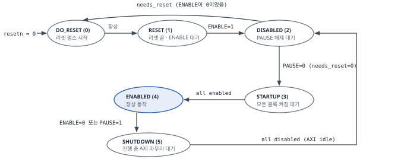
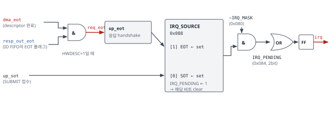

# SG DMA SFR (Register) Map

*sg_dma_top 레지스터 사양 · descriptor 형식 · 인터럽트 · ENABLE/PAUSE 영향*

| 항목 | 내용 |
|---|---|
| 문서 ID | SGDMA-SFR-rel-v2.0.0 |
| 날짜 | 2026-10-19 |
| 작성자 | 조혜린 (hrcho) |
| 대상 DUT | `rtl/sg_dma_top.v` (module `sg_dma_top`) |
| 기준 RTL | `rtl/` 18개 파일 — ADI axi_dmac `hdl_2026_r1` / `b62abeff`에서 SG·MM→MM·단일 클럭 구성만 남긴 RTL |
| 기준 TB | `tb/tb_sg_dma.sv` (Sanity 46/46 PASS, 2026-10-19) |
| DUT 버전 | `VERSION = 0x0004_0565` |
| 이전 판 | SGDMA-SFR-rel-v1.1.0 (2026-10-16, 정리 전 RTL 기준) |

# 문서 안내

## 관련 문서

| 문서 | 역할 |
|---|---|
| `SG_DMA_Architecture_Specification` (SGDMA-ARCH-rel-v2.0.0) | 구조, 모듈, 데이터 경로, 디버그 신호. 이 문서의 RTL 위치는 같은 RTL을 기준으로 함 |
| `SGDMA-SOR-rel-v2.0.0` | 검증 요구사항 — 테스트 15개(T-01 ~ T-15). 이 문서의 SOR 연결은 모두 이 판 기준 (§9.4) |
| `SGDMA-SANITY-rel-v2.0.0` | 회귀 게이트 46 checks. 근거 등급 M의 출처 |

> **[참고]** **절 번호는 v1.1.0과 같습니다.** SANITY와 SOR가 이 문서의 절 번호(예: §4.6.2, §4.7.3, §8)를 참조하므로 번호를 유지했습니다. 정리 후 의미가 없어진 내용은 그 절 안에서 "정리 후 변경"으로 표시했습니다.

## 먼저 확인할 사항

| # | 위치 | 내용 |
|---|---|---|
| 1 | §2.5 근거 등급 | 모든 값에 출처를 표시했습니다. **M** = Sanity 회귀로 매번 확인, **P** = 일회성 시뮬레이션 실측(2026-10-19 probe), **R** = RTL 분석(미측정). R은 측정 전까지 확정값이 아닙니다. |
| 2 | 부록 A | 리셋 직후 0이 아닌 값은 `FLAGS = 0x2`, `IRQ_MASK = 0x3` 두 개입니다(디버그 레지스터 `DBG_STATUS` 제외). "리셋 후 전부 0"을 가정한 테스트는 이 두 곳에서 FAIL합니다. |
| 3 | §4.8 | 정리 과정에서 RTL에서 제거된 기능의 레지스터 목록. 주소는 남아 있고 읽으면 0, 쓰기는 무시됩니다. write/read-back 테스트에서 이것을 결함으로 판정하지 않도록 합니다. |
| 4 | §4.6.2, §6.4 | 완료 판정은 EOT 인터럽트(`IRQ_PENDING[1]`) 또는 `TRANSFER_DONE` 으로만 합니다. `DESCRIPTOR_ID` 나 SOT(`IRQ_PENDING[0]`)로 판정하지 않습니다. |
| 5 | §4.7 | 디버그 레지스터(`0x434` ~ `0x444`)는 관찰 기록 전용입니다. 합격 기준에 쓰지 않습니다. |

SG 전용 레지스터는 `SG_ADDRESS`(0x47C)와 `DESCRIPTOR_ID`(0x454) 두 개입니다. SG 전송의 주소·길이·체인 정보는 레지스터가 아니라 메모리의 descriptor(§5)에 있습니다.

## 용어

| 용어 | 정의 |
|---|---|
| Offset | 레지스터 바이트 주소. 드라이버·TB가 쓰는 값 (예: `0x400`) |
| Word | RTL `case` 문의 9비트 word 주소 `up_waddr` / `up_raddr`. Offset ÷ 4 (§2.1) |
| RO / RW / RW1C / RW1S-SC | 접근 유형 (§2.2) |
| M / P / R | 근거 등급 (§2.5) |
| 미구현 (not built) | 정리 과정에서 RTL에서 제거된 기능. 해당 주소·비트는 저장 소자가 없어 읽기 0, 쓰기 무시 (§2.4, §4.8) |
| descriptor | SG 전송 1건의 파라미터(flags, id, dest, src, next, x_len)를 담은 메모리 상의 48바이트 구조 (§5) |
| chain | `next_sg_addr`로 연결된 descriptor 목록. `flags[0]` (LAST)가 1인 descriptor에서 끝남 |
| SOT / EOT | Start / End Of Transfer. 레지스터 쪽 내부 신호 `up_sot` / `up_eot`, `IRQ_SOURCE` 비트0 / 비트1 |
| beat / burst | AXI 데이터 1회 전송(이 구성은 8바이트) / 한 주소로 보내는 beat 묶음(이 구성은 최대 16 beat = 128바이트) |
| Gray 코드 | 인접 값이 1비트만 다른 부호. 내부 burst ID와 `DBG_IDS0/1`에 쓰임 (부록 B) |
| T-xx / SAN-xxx | SOR v2.0.0 테스트 번호 / Sanity TC 번호 |

## v1.1.0 대비 바뀐 점

레지스터 주소, 비트 위치, 접근 유형, 리셋값은 바뀌지 않았습니다. 정리 전 RTL과 정리 후 RTL을 같은 입력으로 동시에 돌려 모든 출력 포트를 매 클럭 비교했고 차이가 없었습니다(Architecture Spec §4.4). 바뀐 것은 RTL의 위치·구조와, 그에 따른 설명·근거입니다.

| # | 바뀐 점 | 위치 |
|---|---|---|
| 1 | DUT가 `rtl/sg_dma/sgdma_top.v` → `rtl/sg_dma_top.v` (module `sg_dma_top`)로 바뀌었습니다. RTL은 `rtl/third_party/adi_hdl/...` 대신 `rtl/` 아래 18개 파일입니다. RTL 위치(파일:행)를 모두 새 파일 기준으로 고쳤습니다. | 전체, 부록 C |
| 2 | `axi_dmac.v`가 `sg_dma_top.v`에 합쳐져 top 파라미터가 38개 → 9개가 되었습니다. 제거된 기능의 파라미터(DMA_TYPE, 2D, CYCLIC, FRAMELOCK 등)는 없어졌고, 관련 레지스터 비트는 RTL에 상수로 고정되었습니다. | §1.1, §1.2 |
| 3 | partial transfer 기능이 제거되어 `0x44C`, `0x450`, `TRANSFER_DONE[31]`이 항상 0입니다. **`0x450`을 읽어도 부작용이 없습니다** (P). v1.1.0의 "0x450 읽기 금지" 규칙은 해제합니다. | §4.5.5, §4.8 |
| 4 | `FLAGS[1]` (TLAST), `FLAGS[2]`는 저장만 되는 RW 비트이며 데이터 경로와 연결되어 있지 않습니다. | §4.4.3 |
| 5 | 내부 리셋이 `dma_resetn` 하나로 통합되어 `DBG_STATUS[10:7]` 네 비트는 항상 같은 값입니다. | §4.7.3 |
| 6 | v1.1.0에서 R(미측정)이었던 리셋값을 일회성 시뮬레이션으로 측정했습니다(등급 P). `X_LENGTH` 리셋값은 **0** 입니다(upstream 문서의 7과 다름 — 미해결 항목 종료). | §2.5, §9.3, 부록 A |
| 7 | §8 ENABLE=0 / PAUSE=1 영향 매트릭스를 idle 상태에서 측정했습니다(P). 전송 도중 조작은 여전히 SOR T-11/T-12에서 측정합니다. | §8 |
| 8 | `m_src_axi_rresp`, `m_dest_axi_bresp`, `m_sg_axi_rresp` 입력은 포트만 있고 내부에 연결되지 않습니다. 세 포트 모두 AXI 에러 응답을 검출하지 않습니다(정리 전 ADI RTL도 결과에 반영하지 않음). | §4.6.3 |
| 9 | `DESCRIPTOR_ID`: HWDESC=1이고 완료된 descriptor가 아직 없으면 시뮬레이션에서 X(초기화되지 않은 FIFO 메모리)가 읽힙니다. ENABLE=0 후에도 값이 유지됩니다(P). | §4.6.2, §8 |
| 10 | `0x430 STATUS`는 저장 소자가 없는 주소(기본 분기 0)로 확인되어 미확정 항목에서 뺐습니다. `DATA_WIDTH ≠ 64` 구성의 AXI 위반을 새 미확정 항목으로 넣었습니다. | §4.5.3, §11 |
| 11 | 설명 방식: 비유를 빼고 용어를 그대로 썼습니다. descriptor 수는 "개"로 셉니다. | 전체 |

## 목차

- 1 기준 구성
  - 1.1 Top 파라미터
  - 1.2 파생 localparam
  - 1.3 레지스터 맵에 영향이 없는 구성 사항
- 2 레지스터 인터페이스 공통 사양
  - 2.1 버스와 주소 체계
  - 2.2 접근 유형
  - 2.3 리셋 체계
  - 2.4 레지스터 상태 분류
  - 2.5 근거 등급
- 3 레지스터 맵 요약
- 4 레지스터 상세
  - 4.1 식별 · 구성 정보 (0x000 ~ 0x014)
    - 4.1.1 VERSION (0x000)
    - 4.1.2 PERIPHERAL_ID (0x004)
    - 4.1.3 SCRATCH (0x008)
    - 4.1.4 IDENTIFICATION (0x00C)
    - 4.1.5 INTERFACE_DESCRIPTION_1 (0x010)
    - 4.1.6 INTERFACE_DESCRIPTION_2 (0x014)
  - 4.2 인터럽트 (0x080 ~ 0x088)
    - 4.2.1 IRQ_MASK (0x080)
    - 4.2.2 IRQ_PENDING (0x084)
    - 4.2.3 IRQ_SOURCE (0x088)
  - 4.3 채널 제어 (0x400)
    - 4.3.1 CONTROL (0x400)
  - 4.4 전송 요청 (0x404 ~ 0x424)
    - 4.4.1 TRANSFER_ID (0x404)
    - 4.4.2 TRANSFER_SUBMIT (0x408)
    - 4.4.3 FLAGS (0x40C)
    - 4.4.4 DEST_ADDRESS (0x410)
    - 4.4.5 SRC_ADDRESS (0x414)
    - 4.4.6 X_LENGTH (0x418)
  - 4.5 전송 상태 (0x428 ~ 0x430, 0x448 ~ 0x450)
    - 4.5.1 TRANSFER_DONE (0x428)
    - 4.5.2 ACTIVE_TRANSFER_ID (0x42C)
    - 4.5.3 STATUS (0x430)
    - 4.5.4 TRANSFER_PROGRESS (0x448)
    - 4.5.5 PARTIAL_TRANSFER_LENGTH (0x44C) / PARTIAL_TRANSFER_ID (0x450)
  - 4.6 Scatter-Gather (0x454, 0x47C)
    - 4.6.1 SG_ADDRESS (0x47C)
    - 4.6.2 DESCRIPTOR_ID (0x454)
    - 4.6.3 SG 모드 동작 요약
  - 4.7 디버그 (0x434 ~ 0x444)
    - 4.7.1 CURRENT_DEST_ADDRESS (0x434)
    - 4.7.2 CURRENT_SRC_ADDRESS (0x438)
    - 4.7.3 DBG_STATUS (0x43C)
    - 4.7.4 DBG_IDS0 (0x440) / DBG_IDS1 (0x444)
  - 4.8 미구현 레지스터 · 비트
- 5 SG Descriptor 메모리 형식
- 6 인터럽트 동작
  - 6.1 신호 경로
  - 6.2 SG 모드(HWDESC = 1)에서의 이벤트
  - 6.3 인터럽트 처리 순서
  - 6.4 IRQ_MASK = 0x0일 때의 SOT 인터럽트
- 7 프로그래밍 시퀀스
  - 7.1 초기화 확인
  - 7.2 SG 전송 (표준 순서)
  - 7.3 연속 전송
- 8 리셋 · ENABLE · PAUSE 영향 매트릭스
- 9 Sanity Test 연계
  - 9.1 TC ↔ 레지스터
  - 9.2 SAN-007 기대값
  - 9.3 Sanity 범위 밖의 항목
  - 9.4 SOR v2.0.0 테스트 ↔ 레지스터
- 10 ADDR_WIDTH = 64 전환 시 영향
- 11 미확정 항목
- 부록 A 리셋 직후 readback 기대값
- 부록 B Gray 코드 변환표 (ID_WIDTH = 4)
- 부록 C RTL 소스 위치
- 부록 D 결정 및 충돌 해소 이력
  - D.1 설계 결정 (2026-10-06)과 현재 상태
  - D.2 통합 시 해소된 충돌 (2026-10-02)
  - D.3 결정 7 재조정 (2026-10-06)
  - D.4 v1.1.0 문서 정정 (2026-10-16)
- 부록 E 코드 반영 현황
  - E.1 RTL·TB 변경 이력
  - E.2 레지스터 명칭 반영 (2026-10-06)

# 1 기준 구성

같은 axi_dmac 계열 RTL이라도 파라미터가 다르면 레지스터의 필드 폭, 리셋값, 쓰기 가능 여부가 달라집니다. 이 장에서 이 문서가 전제로 하는 구성을 고정합니다.

## 1.1 Top 파라미터

`sg_dma_top`(`sg_dma_top.v` 43~53행)의 파라미터는 9개입니다. TB는 `ADDR_WIDTH`, `DATA_WIDTH`, `AXI_ID_WIDTH`를 기본값과 같은 값으로 넘깁니다.

| 파라미터 | 값 | 레지스터 맵 영향 |
|---|---|---|
| `ID` | 0 | `PERIPHERAL_ID` (0x004) 읽기값 |
| `ADDR_WIDTH` | 32 | 32이면 `*_HIGH` 레지스터가 만들어지지 않음 (HAS_ADDR_HIGH = 0, §10) |
| `DATA_WIDTH` | 64 | 주소 레지스터 하위 3비트 무시, `INTERFACE_DESCRIPTION_1`의 beat 크기 필드. **64만 검증됨** (§11 #3) |
| `LENGTH_WIDTH` | 24 | `X_LENGTH`, descriptor `x_len`, `TRANSFER_PROGRESS`의 유효 폭 |
| `MAX_BYTES_PER_BURST` | 128 | burst 분할 크기, `INTERFACE_DESCRIPTION_1[19:16]` = 7 |
| `FIFO_SIZE` | 8 | burst 버퍼 슬롯 수. `ID_WIDTH` = 4 → `DBG_IDS0/1` 필드 폭 |
| `AXI_ID_WIDTH` | 1 | 없음 (AXI ID 포트 폭. ID는 0 고정) |
| `AXI_AXCACHE` | 4'b0000 | `INTERFACE_DESCRIPTION_2[7:4]`, 세 master 포트의 AxCACHE 출력 |
| `AXI_AXPROT` | 3'b000 | `INTERFACE_DESCRIPTION_2[10:8]`, 세 master 포트의 AxPROT 출력 |

정리 전 `axi_dmac`에 있던 기능 선택 파라미터(`DMA_TYPE_SRC/DEST`, `DMA_2D_TRANSFER`, `CYCLIC`, `FRAMELOCK`, `AUTORUN`, `USE_EXT_SYNC`, `CACHE_COHERENT`, `ASYNC_CLK_*`, `DISABLE_DEBUG_REGISTERS` 등)는 해당 코드와 함께 제거되었습니다. 이 기능들은 바꿀 수 없으며, 레지스터에 보이는 값은 RTL 상수입니다(§4.1.5, §4.8).

## 1.2 파생 localparam

| localparam | 정의 (파일:행) | 값 | 쓰이는 곳 |
|---|---|---|---|
| `BYTES_PER_BEAT_WIDTH` | `$clog2(DATA_WIDTH/8)` (sg_dma_top.v:149) | 3 | 주소 레지스터 쓰기 가능 비트 [31:3], IF_DESC_1 [11:8]/[3:0] |
| `ID_WIDTH` | `$clog2(FIFO_SIZE*2)` (:152) | 4 | 내부 burst ID 폭, `DBG_IDS0/1` 필드 |
| `DBG_ID_PADDING` | `8 − ID_WIDTH` (:153) | 4 | `DBG_IDS0/1` 각 바이트 상위 패딩 |
| `REAL_MAX_BYTES_PER_BURST` | `min(256×8, 128)` (:157) | 128 | burst 분할 |
| `BYTES_PER_BURST_WIDTH` | `$clog2(128)` (:160) | 7 | IF_DESC_1 [19:16], `TRANSFER_PROGRESS` 누적 단위 |
| `HAS_ADDR_HIGH` | `ADDR_WIDTH > 32` (axi_dmac_regmap.v:113) | 0 | `*_HIGH` 레지스터 비활성 |
| `ADDR_LOW_MSB` | (regmap.v:114) | 31 | 주소 레지스터 폭 |
| `PCORE_VERSION` | 상수 (regmap.v:112) | 0x0004_0565 | `VERSION` |

> **[주의]** **길이 단위.** 소스와 목적지가 모두 AXI-MM이라 길이 정렬 제약이 없습니다. `X_LENGTH`와 descriptor `x_len`은 1바이트 단위로 지정됩니다. 정리 전 RTL에서는 이 성질이 `DMA_LENGTH_ALIGN = 0`으로 계산되었고, 정리 후에는 이 localparam 없이 [23:0] 전체를 쓰는 코드로 고정되었습니다(regmap_request.v:147). ADI 공식 testbench는 이 조합(양쪽 MM)을 검증하지 않으므로 SOR T-07이 이 경로를 맡습니다.

## 1.3 레지스터 맵에 영향이 없는 구성 사항

| 항목 | 내용 |
|---|---|
| 모듈명 | `sg_dma_top` (2026-10-17 `sgdma_top`에서 변경) |
| AXI ID / LOCK 포트 | `m_*_axi_arid/awid` = 0, `a*lock` = 0 고정 출력 (sg_dma_top.v:356~362). 입력 `*_rid`, `*_bid`는 사용하지 않음. 레지스터 맵 영향 없음 |
| 클럭 / 리셋 | `clk`, `resetn` 각 1개. 레지스터 맵과 데이터 경로가 같은 클럭 |
| AXI 에러 응답 입력 | `*_rresp`, `*_bresp`는 포트만 있고 내부 미연결 (§4.6.3) |

# 2 레지스터 인터페이스 공통 사양

## 2.1 버스와 주소 체계

| 항목 | 사양 | 근거 |
|---|---|---|
| 버스 | AXI4-Lite slave (`s_axi_*`), 32비트 데이터. `up_axi.v` (ADI 원본, 수정 없음)가 내부 `up_*` 인터페이스로 변환 | R |
| 주소 폭 | 11비트 → 2 KiB (0x000 ~ 0x7FF) | R |
| 내부 주소 | `up_waddr` / `up_raddr` = `s_axi_*addr[10:2]` (9비트 word 주소) | R |
| Offset 환산 | `Offset = Word × 4` (예: 9'h100 → 0x400, 9'h11F → 0x47C) | R |
| 클럭 / 리셋 | `clk` / `resetn` (active-low, 동기) | R |
| WSTRB | 무시. 모든 쓰기는 32비트 전체 쓰기 | R |
| BRESP / RRESP | 항상 OKAY (up_axi.v:112, :179). 미정의 주소도 에러 없음 | R |
| 미정의 주소 읽기 | `0x0000_0000` (regmap.v:238 → regmap_request.v:182 기본 분기) | M |
| 미정의 주소 쓰기 | 무시. 부작용 없음 | R |
| AxPROT (`s_axi_*prot`) | 무시 | R |

> **[주의]** **부분 쓰기 금지.** WSTRB가 무시되므로 byte/halfword 쓰기는 나머지 바이트를 버스에 실린 값으로 덮어씁니다. 드라이버는 항상 32비트 단위로 접근합니다. SOR T-02가 이 동작(1바이트 쓰기 → `0x0000_00FF`)을 확인합니다.
>
> **에러 응답 없음.** 잘못된 주소 접근이 SLVERR로 드러나지 않으므로, 주소 디코드 오류는 readback 값 비교로만 검출합니다(SAN-007, T-02).

## 2.2 접근 유형

| 표기 | 의미 |
|---|---|
| RO | 읽기 전용. 쓰기 무시, 응답 OKAY |
| RW | 읽기/쓰기. 쓴 값이 읽힘 (필드별 쓰기 가능 비트 범위 적용) |
| RW1C | 1을 쓰면 해당 비트의 **원천 상태** 가 지워짐. 0 쓰기는 효과 없음 |
| RW1S-SC | 1을 쓰면 세트, 하드웨어 조건이 성립하면 자동으로 0. 0 쓰기는 효과 없음 |
| RO-C | 읽기 전용 상수 (파라미터 또는 RTL 상수) |
| — | 미구현. 쓰기 무시, 읽기 0 |

*v1.1.0의 RO-RS(읽기 부작용 있음, `0x450`)는 해당 레지스터가 제거되어 더 이상 쓰지 않습니다.*

## 2.3 리셋 체계

| 조건 | 트리거 | 지워지는 대상 |
|---|---|---|
| HW 리셋 | `resetn = 0` | 모든 RW 설정 레지스터(`SCRATCH`, `IRQ_MASK`, `IRQ_SOURCE`, `CONTROL`, `FLAGS`, 주소, 길이, `SG_ADDRESS`)와 reset manager. reset manager가 내부 리셋 `dma_resetn`을 만들어 데이터 경로와 SG 엔진도 리셋 |
| 채널 비활성 | `CONTROL.ENABLE = 0` | 전송 추적 상태(`TRANSFER_ID`, `ACTIVE_TRANSFER_ID`, `TRANSFER_DONE`, `TRANSFER_SUBMIT`, `TRANSFER_PROGRESS`)를 즉시 지움. reset manager가 진행 중인 AXI를 마무리한 뒤 `dma_resetn` 펄스로 데이터 경로·SG 엔진을 리셋 |

ENABLE=0은 설정 레지스터와 `IRQ_SOURCE`를 지우지 않습니다. 상세와 실측은 §8에 있습니다.

## 2.4 레지스터 상태 분류

| 분류 | 의미 |
|---|---|
| Active | 이 구성에서 기능함 |
| Active (HWDESC=0) | 레지스터 모드에서만 의미. SG 모드에서는 값이 무시됨 |
| Active (HWDESC=1) | SG 모드 전용 |
| Const | 파라미터 또는 RTL 상수 |
| Debug | 관찰용. 판정에 쓰지 않음 (§4.7) |
| No effect | 저장·readback은 되지만 데이터 경로와 연결되지 않음 (`FLAGS[2:1]`) |
| Not built | RTL에서 제거된 기능 또는 `ADDR_WIDTH = 32`로 만들어지지 않은 레지스터. 쓰기 무시, 읽기 0 |

## 2.5 근거 등급

| 등급 | 의미 | 신뢰도 |
|---|---|---|
| **M** | Sanity 회귀(46 checks)로 측정. RTL을 고칠 때마다 다시 확인됨 | 가장 높음 |
| **P** | 일회성 시뮬레이션 측정 (2026-10-19, `tb_sg_dma`와 같은 DUT·메모리 모델을 쓰는 probe). 측정 시점의 RTL에서는 사실이나 회귀에 포함되지 않음 | 높음 (RTL 변경 시 재확인 필요) |
| **R** | RTL 분석. 시뮬레이션 미확인 | 보통 |

> **[참고]** **등급을 나누는 이유.** 2026-10-02 통합 때, 독립된 두 문서가 RTL을 읽고 `INTERFACE_DESCRIPTION_2` 리셋값을 똑같이 `0x30`으로 계산했지만 실측값은 `0x0`이었습니다(부록 D.2 ①). 정적 분석만으로는 이런 오류를 걸러낼 수 없으므로 각 값이 측정되었는지를 문서에 표시합니다.
>
> **P 등급을 둔 이유.** v1.1.0에서 R이던 리셋값과 §8 매트릭스는 Sanity·SOR 어느 쪽에도 측정 계획이 없었습니다(2026-10-06 팀 결정, 부록 D.3). 이번 판에서는 회귀를 늘리지 않고 한 번 측정해 값을 확정했습니다. 회귀가 아니므로 RTL을 바꾸면 다시 측정해야 합니다.

# 3 레지스터 맵 요약

| Offset | Word | 이름 | 접근 | 리셋값 | 근거 | 상태 | 상세 | 요약 |
|---|---|---|---|---|---|---|---|---|
| 0x000 | 0x000 | VERSION | RO-C | 0x0004_0565 | M | Const | 4.1.1 | IP 버전 |
| 0x004 | 0x001 | PERIPHERAL_ID | RO-C | 0x0000_0000 | M | Const | 4.1.2 | `ID` 파라미터 |
| 0x008 | 0x002 | SCRATCH | RW | 0x0000_0000 | M | Active | 4.1.3 | 기능 없는 R/W 레지스터 |
| 0x00C | 0x003 | IDENTIFICATION | RO-C | 0x444D_4143 | M | Const | 4.1.4 | ASCII "DMAC" |
| 0x010 | 0x004 | INTERFACE_DESCRIPTION_1 | RO-C | 0x3807_0303 | M | Const | 4.1.5 | 구성 요약 (beat·burst·타입) |
| 0x014 | 0x005 | INTERFACE_DESCRIPTION_2 | RO-C | 0x0000_0000 | M | Const | 4.1.6 | AxCACHE / AxPROT 설정 |
| 0x080 | 0x020 | IRQ_MASK | RW | **0x0000_0003** | M | Active | 4.2.1 | 인터럽트 마스크 (1 = 막음) |
| 0x084 | 0x021 | IRQ_PENDING | RW1C | 0x0000_0000 | M | Active | 4.2.2 | `SOURCE & ~MASK`. 1 쓰기 → SOURCE clear |
| 0x088 | 0x022 | IRQ_SOURCE | RO | 0x0000_0000 | M | Active | 4.2.3 | 마스크와 무관한 이벤트 래치 |
| 0x400 | 0x100 | CONTROL | RW | 0x0000_0000 | M | Active | 4.3.1 | ENABLE / PAUSE / HWDESC |
| 0x404 | 0x101 | TRANSFER_ID | RO | 0x0000_0000 | M | Active | 4.4.1 | 다음 제출에 붙을 ID (0~3) |
| 0x408 | 0x102 | TRANSFER_SUBMIT | RW1S-SC | 0x0000_0000 | P | Active | 4.4.2 | 전송 요청 |
| 0x40C | 0x103 | FLAGS | RW | **0x0000_0002** | M | No effect | 4.4.3 | [1] TLAST, [2] 저장만 됨 |
| 0x410 | 0x104 | DEST_ADDRESS | RW | 0x0000_0000 | M | Active (HWDESC=0) | 4.4.4 | 레지스터 모드 목적지 주소 |
| 0x414 | 0x105 | SRC_ADDRESS | RW | 0x0000_0000 | M | Active (HWDESC=0) | 4.4.5 | 레지스터 모드 소스 주소 |
| 0x418 | 0x106 | X_LENGTH | RW | 0x0000_0000 | P | Active (HWDESC=0) | 4.4.6 | 바이트 수 − 1 |
| 0x41C | 0x107 | Y_LENGTH | — | 0x0000_0000 | M | Not built | 4.8 | 2D |
| 0x420 | 0x108 | DEST_STRIDE | — | 0x0000_0000 | P | Not built | 4.8 | 2D |
| 0x424 | 0x109 | SRC_STRIDE | — | 0x0000_0000 | P | Not built | 4.8 | 2D |
| 0x428 | 0x10A | TRANSFER_DONE | RO | 0x0000_0000 | M | Active | 4.5.1 | ID별 완료 비트 [3:0] |
| 0x42C | 0x10B | ACTIVE_TRANSFER_ID | RO | 0x0000_0000 | P | Active | 4.5.2 | 다음에 완료될 ID |
| 0x430 | 0x10C | STATUS | — | 0x0000_0000 | P | Not built | 4.5.3 | 저장 소자 없음 |
| 0x434 | 0x10D | CURRENT_DEST_ADDRESS | RO | 0x0000_0000 ¹ | P | Debug | 4.7.1 | `m_dest_axi_awaddr` |
| 0x438 | 0x10E | CURRENT_SRC_ADDRESS | RO | 0x0000_0000 ¹ | P | Debug | 4.7.2 | `m_src_axi_araddr` |
| 0x43C | 0x10F | DBG_STATUS | RO | 0x0000_0781 ¹ | P | Debug | 4.7.3 | reset manager 상태 |
| 0x440 | 0x110 | DBG_IDS0 | RO | 0x0000_0000 ¹ | P | Debug (Gray) | 4.7.4 | dest 쪽 burst ID |
| 0x444 | 0x111 | DBG_IDS1 | RO | 0x0000_0000 ¹ | P | Debug (Gray) | 4.7.4 | src 쪽 burst ID |
| 0x448 | 0x112 | TRANSFER_PROGRESS | RO | 0x0000_0000 | P | Active | 4.5.4 | 완료된 바이트 누적 |
| 0x44C | 0x113 | PARTIAL_TRANSFER_LENGTH | — | 0x0000_0000 | P | Not built | 4.5.5 | partial transfer |
| 0x450 | 0x114 | PARTIAL_TRANSFER_ID | — | 0x0000_0000 | P | Not built | 4.5.5 | partial transfer. 읽기 부작용 없음 |
| 0x454 | 0x115 | DESCRIPTOR_ID | RO | 0x0000_0000 ² | P | Active (HWDESC=1) | 4.6.2 | ID FIFO head의 descriptor id |
| 0x458 | 0x116 | FRAMELOCK_CONFIG | — | 0x0000_0000 | M | Not built | 4.8 | framelock |
| 0x45C | 0x117 | FRAMELOCK_STRIDE | — | 0x0000_0000 | P | Not built | 4.8 | framelock |
| 0x47C | 0x11F | SG_ADDRESS | RW | 0x0000_0000 | M | Active (HWDESC=1) | 4.6.1 | 첫 descriptor 주소 |
| 0x490 | 0x124 | DEST_ADDRESS_HIGH | — | 0x0000_0000 | M | Not built | §10 | ADDR_WIDTH = 32 |
| 0x494 | 0x125 | SRC_ADDRESS_HIGH | — | 0x0000_0000 | M | Not built | §10 | ADDR_WIDTH = 32 |
| 0x498 | 0x126 | CURRENT_DEST_ADDRESS_HIGH | RO | 0x0000_0000 | P | Not built | §10 | ADDR_WIDTH = 32 |
| 0x49C | 0x127 | CURRENT_SRC_ADDRESS_HIGH | RO | 0x0000_0000 | P | Not built | §10 | ADDR_WIDTH = 32 |
| 0x4BC | 0x12F | SG_ADDRESS_HIGH | — | 0x0000_0000 | M | Not built | §10 | ADDR_WIDTH = 32 |
| 그 외 | — | (미정의) | — | 0x0000_0000 | M | — | §2.1 | 읽기 0, 에러 없음 |

*¹ 디버그 레지스터의 리셋 직후 측정값입니다. 고정 리셋값으로 보장하지 않으며 리셋값 비교에 쓰지 않습니다(§4.7). `DBG_STATUS = 0x781`은 reset manager가 RESET 상태(1)에 머무는 값입니다. ² `CONTROL.HWDESC = 0`일 때의 값입니다. HWDESC = 1이고 완료된 descriptor가 없으면 정의되지 않습니다(§4.6.2).*

# 4 레지스터 상세

각 레지스터는 요약 → 비트 필드 → 동작 → RTL 위치 → 측정 → 주의·검증 포인트 순서로 적었습니다. 파일명은 `rtl/` 기준이며, `regmap.v` = `axi_dmac_regmap.v`, `regmap_request.v` = `axi_dmac_regmap_request.v`입니다. "SOR T-xx" 뒤 괄호는 흡수된 원래 요구사항 ID입니다.

## 4.1 식별 · 구성 정보 (0x000 ~ 0x014)

값이 고정된 레지스터입니다. 버스 동작 확인과 의도한 구성으로 만들어졌는지 확인하는 데 씁니다.

### 4.1.1 VERSION (0x000)

| Bits | Field | 접근 | 값 | 설명 |
|---|---|---|---|---|
| [31:16] | VERSION_MAJOR | RO-C | 0x0004 | 4 |
| [15:8] | VERSION_MINOR | RO-C | 0x05 | 5 |
| [7:0] | VERSION_PATCH | RO-C | 0x65 | "e" |

- **RTL**: `regmap.v:112` `PCORE_VERSION = 'h00040565`, 읽기 `:221`.
- **측정 (M)**: `0x0004_0565` — SAN-001 #1. 쓰기 후에도 그대로 (P).
- **검증 포인트**: Sanity의 첫 readback입니다. 틀리면 버스나 주소 디코드가 깨진 것이므로 TB는 나머지 TC를 SKIP합니다. SOR T-01(REG-001)도 같은 규칙입니다. 정리 후에도 ADI의 버전 값을 유지했습니다.

### 4.1.2 PERIPHERAL_ID (0x004)

| Bits | Field | 접근 | 값 | 설명 |
|---|---|---|---|---|
| [31:0] | PERIPHERAL_ID | RO-C | `ID` | 같은 IP 여러 개를 구분하는 번호 |

- **RTL**: `regmap.v:222`, 값은 `sg_dma_top` 파라미터 `ID`(sg_dma_top.v:44 → :212).
- **측정 (M)**: `0x0000_0000` — SAN-001 #3.
- **주의**: 값이 틀리면 버스 고장보다 파라미터 변경(기대값 불일치)을 먼저 확인합니다 (SOR T-01).

### 4.1.3 SCRATCH (0x008)

| Bits | Field | 접근 | 리셋 | 설명 |
|---|---|---|---|---|
| [31:0] | SCRATCH | RW | 0x0000_0000 | 기능 없음. 버스 쓰기 경로 확인용 |

- **RTL**: 선언 `regmap.v:143`, 리셋 `:186`, 쓰기 `:193~195`, 읽기 `:223`.
- **측정 (M)**: `0xA5A5_5A5A` / `0x5A5A_A5A5` / `0x0000_0000` write-readback 일치 — SAN-002. ENABLE=0, PAUSE 후 유지 (P).
- **검증 포인트**: 반전 패턴 두 개를 써야 stuck-at 비트를 잡습니다. WSTRB 무시 동작의 기대값은 SOR T-02(REG-023)에 있습니다.

### 4.1.4 IDENTIFICATION (0x00C)

| Bits | Field | 접근 | 값 | 설명 |
|---|---|---|---|---|
| [31:0] | IDENTIFICATION | RO-C | 0x444D_4143 | ASCII "DMAC" |

- **RTL**: `regmap.v:224`. **측정 (M)**: SAN-001 #2. `VERSION`과 함께 버스 동작 판정 기준입니다.

### 4.1.5 INTERFACE_DESCRIPTION_1 (0x010)

구성 정보를 한 워드로 모은 상수입니다. 한 번 읽어 beat 크기, burst 크기, 소스/목적지 타입을 확인할 수 있습니다.

```
 31    27 26 25 24 23  20 19   16 15 14 13 12 11    8 7  6 5  4 3     0
+--------+--+--+--+------+-------+-----+-----+-------+----+----+-------+
|  7     |0 |0 |0 |  0   |   7   |  0  |  0  |   3   | 0  | 0  |   3   |  = 0x3807_0303
+--------+--+--+--+------+-------+-----+-----+-------+----+----+-------+
 MAX_NUM  2D EX AR  rsvd  BPBRST  rsvd  TYPE   BPB    rsvd TYPE   BPB
 FRAMES-1 TL SY UN        _WIDTH        SRC    SRC         DEST   DEST
```

| Bits | Field | 접근 | 값 | 설명 |
|---|---|---|---|---|
| [31:27] | MAX_NUM_FRAMES − 1 | RO-C | 7 | RTL 상수. framelock이 없으므로 의미 없음. 정리 전 값과 같게 유지 |
| [26] | DMA_2D_TLAST_MODE | RO-C | 0 | RTL 상수 (2D 미구현) |
| [25] | USE_EXT_SYNC | RO-C | 0 | RTL 상수 (외부 sync 미구현) |
| [24] | HAS_AUTORUN | RO-C | 0 | RTL 상수 (autorun 미구현) |
| [23:20] | — | RO | 0 | 예약 |
| [19:16] | BYTES_PER_BURST_WIDTH | RO-C | 7 | `log2(128)` |
| [15:14] | — | RO | 0 | 예약 |
| [13:12] | DMA_TYPE_SRC | RO-C | 0 | 0 = AXI-MM (RTL 상수) |
| [11:8] | BYTES_PER_BEAT_SRC_LOG2 | RO-C | 3 | `log2(64/8)` |
| [7:6] | — | RO | 0 | 예약 |
| [5:4] | DMA_TYPE_DEST | RO-C | 0 | 0 = AXI-MM (RTL 상수) |
| [3:0] | BYTES_PER_BEAT_DEST_LOG2 | RO-C | 3 | `log2(64/8)` |

- **RTL**: localparam `regmap.v:122~125`, 읽기 `:225`. 파라미터에서 오는 필드는 [19:16], [11:8], [3:0]뿐이고 나머지는 상수입니다.
- **측정 (M)**: `0x3807_0303` — SAN-001 #4.
- **검증 포인트**: `DATA_WIDTH`나 `MAX_BYTES_PER_BURST`를 바꾸면 이 값이 바뀝니다. 파라미터를 바꿨는데 값이 그대로면 빌드에 반영되지 않은 것입니다.

### 4.1.6 INTERFACE_DESCRIPTION_2 (0x014)

| Bits | Field | 접근 | 값 | 설명 |
|---|---|---|---|---|
| [31:11] | — | RO | 0 | 예약 |
| [10:8] | AXI_AXPROT | RO-C | 3'b000 | 세 master 포트의 AxPROT 출력값 |
| [7:4] | AXI_AXCACHE | RO-C | 4'b0000 | 세 master 포트의 AxCACHE 출력값 |
| [3:0] | CACHE_COHERENT 등 | RO | 0 | RTL 상수 0 |

- **RTL**: localparam `regmap.v:128`, 읽기 `:226`. 값은 `sg_dma_top` 파라미터 `AXI_AXCACHE`/`AXI_AXPROT`(sg_dma_top.v:51~52 → :217~218).
- **측정 (M)**: `0x0000_0000` — SAN-001 #5.
- **AxCACHE = 4'b0000의 의미**: Device Non-bufferable. IP DV에서는 메모리 모델 응답 순서가 고정되어 사이클 단위 비교가 가능합니다. MM→MM 목적지가 Normal memory인 SoC에서는 보통 `4'b0011`을 쓰며, `0000`은 interconnect가 write를 직렬화해 대역폭이 떨어질 수 있습니다(§11 #1).
- **이력**: 정리 전 `axi_dmac_regmap.v`의 모듈 기본값은 `4'b0011`이었고, 두 문서가 이 값을 보고 `0x30`을 잘못 계산했습니다(부록 D.2 ①). 정리 후 regmap의 기본값은 `4'b0000`(regmap.v:51)이고 top에서 값을 넘기므로 이 혼동은 없어졌습니다.

> **[주의]** **레지스터 값 ≠ 버스 출력.** 이 레지스터는 파라미터를 그대로 보여 줄 뿐입니다. `m_src_axi_arcache` / `m_dest_axi_awcache` / `m_sg_axi_arcache`가 실제로 `4'b0000`을 내는지는 AXI 모니터로 따로 확인합니다 — SOR T-14 (AXI-007).

## 4.2 인터럽트 (0x080 ~ 0x088)

세 레지스터가 하나의 경로를 이룹니다: 이벤트 → `IRQ_SOURCE`(래치) → `~IRQ_MASK`로 게이트 → `IRQ_PENDING` → OR → 1-FF → `irq`. 전체 경로는 §6.1 Figure 3에 있습니다.

| Bit | 이벤트 | 내부 신호 | 발생 조건 |
|---|---|---|---|
| [0] | TRANSFER_QUEUED (SOT) | `up_sot` | 제출된 요청이 데이터 경로(SG 모드는 `i_sg_addr_fifo`)에 수락됨 (regmap_request.v:186) |
| [1] | TRANSFER_COMPLETED (EOT) | `up_eot` | 전송 완료. SG 모드에서는 `flags[1]` (EOT_IRQ) = 1인 descriptor가 끝날 때 (regmap_request.v:187, transfer.v:203) |

> **[주의]** **비트0(SOT)은 완료가 아닙니다.** 요청이 수락되었다는 뜻이며 데이터는 아직 옮겨지지 않았습니다. 완료는 비트1입니다 (§6.4).

### 4.2.1 IRQ_MASK (0x080)

| Bits | Field | 접근 | 리셋 | 설명 |
|---|---|---|---|---|
| [31:2] | — | RO | 0 | 예약 |
| [1] | TRANSFER_COMPLETED | RW | 1 | 1 = 마스크, 0 = 허용 |
| [0] | TRANSFER_QUEUED | RW | 1 | 1 = 마스크, 0 = 허용 |

- **RTL**: 선언 `regmap.v:150` (`= 2'h3`), 리셋 `:185`, 쓰기 `:196~198`, 읽기 `:227`.
- **측정 (M)**: 리셋값 `0x3` — SAN-003 #2. ENABLE=0, PAUSE 후 유지 (P).
- **주의**
   - 마스크는 `IRQ_SOURCE` 래치를 막지 않습니다. 마스크된 동안에도 이벤트가 기록되고, 마스크를 푸는 순간 `irq`가 올라갑니다. 마스크를 풀기 전에 `IRQ_PENDING`에 `0x3`을 써서 비웁니다.
   - `IRQ_MASK = 0x0`이면 제출 직후 SOT 인터럽트가 먼저 옵니다. 표준 설정은 `0x1`(SOT 막음, EOT 허용)입니다 (§6.4).
   - `0x3`, `0x2`에서는 EOT 인터럽트가 오지 않으므로 완료는 `TRANSFER_DONE` polling으로 기다립니다 (SOR T-09).

### 4.2.2 IRQ_PENDING (0x084)

| Bits | Field | 접근 | 리셋 | 설명 |
|---|---|---|---|---|
| [31:2] | — | RO | 0 | 예약 |
| [1] | TRANSFER_COMPLETED | RW1C | 0 | 읽기: `SOURCE[1] & ~MASK[1]`. 1 쓰기: `IRQ_SOURCE[1]` clear |
| [0] | TRANSFER_QUEUED | RW1C | 0 | 읽기: `SOURCE[0] & ~MASK[0]`. 1 쓰기: `IRQ_SOURCE[0]` clear |

```
assign up_irq_pending      = ~up_irq_mask & up_irq_source;                          // regmap.v:158
assign up_irq_source_clear = (up_wreq && up_waddr == 9'h021) ? up_wdata[1:0] : 2'b00;  // :160
up_irq_source <= up_irq_trigger | (up_irq_source & ~up_irq_source_clear);          // :174
```

- **측정 (M)**: 리셋값 0 (SAN-003), 전송 후 [1] = 1 → W1C → 0 (SAN-006).
- **동작**: `IRQ_PENDING`은 저장 소자가 아니라 조합 결과입니다. 1 쓰기는 마스크와 무관하게 `IRQ_SOURCE`를 지웁니다. 같은 클럭에 새 이벤트와 clear가 겹치면 이벤트가 남습니다(trigger가 OR로 우선).

> **[주의]** **이름과 동작이 다릅니다.** PENDING 주소에 쓰지만 지워지는 것은 SOURCE입니다. 시나리오의 기대값을 쓸 때 구분합니다 (SOR T-09 3단계).

### 4.2.3 IRQ_SOURCE (0x088)

| Bits | Field | 접근 | 리셋 | 설명 |
|---|---|---|---|---|
| [31:2] | — | RO | 0 | 예약 |
| [1] | TRANSFER_COMPLETED | RO | 0 | `up_eot`에서 세트. `IRQ_PENDING[1]`에 1을 써야 지워짐 |
| [0] | TRANSFER_QUEUED | RO | 0 | `up_sot`에서 세트. `IRQ_PENDING[0]`에 1을 써야 지워짐 |

- **RTL**: `regmap.v:170~176`, 읽기 `:229`.
- **측정 (M)**: 리셋값 0 (SAN-003). 마스크 `0x1`에서 W1C로 [1]만 지운 뒤 `0x1` (SAN-006 #5) — 마스크된 SOT가 기록된다는 직접 증거. 직접 써도 바뀌지 않음, ENABLE=0 후 유지 (P).
- **검증 포인트**: 마스크와 무관하게 기록되므로 polling 테스트에서도 SOT/EOT 발생을 확인할 수 있습니다. `IRQ_PENDING`에 쓰면 함께 지워지므로 지우기 전에 읽습니다 (SOR 공통 조건 C4).

## 4.3 채널 제어 (0x400)

### 4.3.1 CONTROL (0x400)

| Bits | Field | 접근 | 리셋 | 동작 |
|---|---|---|---|---|
| [31:4] | — | RO | 0 | 예약 |
| [3] | FRAMELOCK | — | 0 | 미구현. 항상 0 |
| [2] | HWDESC | RW | 0 | 1 = SG 모드 (요청을 descriptor에서 가져옴), 0 = 레지스터 모드 |
| [1] | PAUSE | RW | 0 | 1 = 일시정지 (리셋 없이 정지) |
| [0] | ENABLE | RW | 0 | 1 = 동작, 0 = 정지 + 추적 상태·데이터 경로 리셋 |

- **RTL**: 쓰기 `regmap.v:199~204`, 읽기 `:230` (`{28'b0, 1'b0, hwdesc, pause, enable}`).
- **측정 (M)**: 리셋값 0 (SAN-003). `0xFFFF_FFFF` 쓰기 → `0x0000_0007` (SAN-007).
- **동작**
   - **ENABLE 1 → 0**: 한 클럭이라도 0이 되면 reset manager의 `needs_reset`이 세트됩니다(reset_manager.v:141~147). 진행 중인 AXI 트랜잭션을 마무리한 뒤(SHUTDOWN) `dma_resetn` 펄스를 냅니다. regmap 쪽 추적 상태는 즉시 지워집니다 (§8).
   - **PAUSE = 1**: ENABLED → SHUTDOWN → DISABLED로 가고 리셋 펄스는 없습니다. 0으로 되돌리면 STARTUP을 거쳐 재개합니다. 단, descriptor를 다 읽기 전의 PAUSE는 남은 descriptor를 버립니다(§8 주의).
   - **HWDESC**: 요청 출처 선택. `axi_dmac_transfer.v:250~256`의 MUX가 이 비트로 SG 엔진 출력과 레지스터 값을 고릅니다.

| 쓰는 값 | 의미 | 쓰이는 곳 |
|---|---|---|
| `0x0` | 정지 | 테스트 시작 전 공통 준비 |
| `0x5` | ENABLE + HWDESC | 표준 순서 (§7.2) |
| `0x4` | ENABLE만 0, HWDESC 유지 | "hang 없음" 절차, T-11 |
| `0x7` | ENABLE + PAUSE + HWDESC | T-12 |

> **[주의]** **프로그래밍 규칙.** 세 비트는 한 번의 쓰기로 함께 갱신되므로 PAUSE만 바꿀 때도 HWDESC/ENABLE을 함께 씁니다(read-modify-write). HWDESC는 ENABLE과 같은 쓰기로 설정하고 전송 중에는 바꾸지 않습니다 — MUX가 즉시 전환되어 진행 중인 요청과 완료 응답의 매칭이 깨질 수 있으며, 이를 막는 로직은 없습니다. `0xFFFF_FFFF`를 쓴 상태(ENABLE+PAUSE+HWDESC)에서는 `TRANSFER_SUBMIT`을 쓰지 말고 먼저 되돌립니다(SOR T-02).

## 4.4 전송 요청 (0x404 ~ 0x424)

### 4.4.1 TRANSFER_ID (0x404)

| Bits | Field | 접근 | 리셋 | 설명 |
|---|---|---|---|---|
| [31:2] | — | RO | 0 | 예약 |
| [1:0] | TRANSFER_ID | RO | 0 | 다음에 제출될 전송의 ID (2비트, 0~3 순환) |

- **RTL**: 선언 `regmap_request.v:97`, 갱신 `:192~208`, 읽기 `:168`.
- **측정**: 리셋값 0 (M, SAN-003). 체인 1개 완료 후 1, ENABLE=0 후 0, PAUSE 후 유지 (P).
- **동작**: `up_sot`마다 +1. 제출 시 `TRANSFER_DONE[ID]`를 0으로 내립니다. 소프트웨어용 2비트 binary 카운터이며 내부 Gray burst ID와는 무관합니다. SG 모드에서는 **체인 1개 = ID 1개**입니다.
- **SOR**: 체인 하나에 +1 — T-04 (FUNC-002). 연속 예약 시 B = ID_A + 1, 두 체인 뒤 ID_A + 2 — T-10 (REG-012). ENABLE=0 후 0 — T-11 (REG-006).

### 4.4.2 TRANSFER_SUBMIT (0x408)

| Bits | Field | 접근 | 리셋 | 설명 |
|---|---|---|---|---|
| [31:1] | — | RO | 0 | 예약 |
| [0] | TRANSFER_SUBMIT | RW1S-SC | 0 | 1 쓰기 = 요청. 수락(`up_sot`)되면 0 |

```
if (ctrl_enable == 1'b1) begin                                     // regmap_request.v:129
  if (up_wreq == 1'b1 && up_waddr == 9'h102)
    up_dma_req_valid <= up_dma_req_valid | up_wdata[0];
  else if (up_sot == 1'b1)
    up_dma_req_valid <= 1'b0;
end else begin
  up_dma_req_valid <= 1'b0;                                       // ENABLE=0: 쓰기 무시
end                                                                // :137
```

- **측정 (P)**: 리셋값 0. 체인 완료 후 0.
- **동작**: ENABLE = 1일 때만 쓰기가 반영됩니다. ENABLE = 0에서의 쓰기는 무시되고 에러도 없습니다. 0 쓰기는 효과가 없고, 1인 상태에서 다시 1을 써도 요청이 추가되지 않습니다. 읽기값 1은 "아직 수락되지 않음"입니다.
- **SG 모드 수락 시점**: 수락 신호는 1단 FIFO `i_sg_addr_fifo`(dmac_sg.v:148)의 ready입니다. 첫 descriptor 주소가 SG 엔진에 들어간 시점에 0이 되며 체인 완료를 기다리지 않습니다. 앞 체인이 진행 중이어도 FIFO가 비어 있으면 바로 수락됩니다.
- **프로그래밍 규칙**: 새로 쓰기 전에 이 비트가 0인지 확인합니다.

> **[주의]** **"1인 동안 다시 쓰기" 시험.** 수락이 빨라 1인 구간이 보장되지 않습니다. 쓰기 직후 읽어 1일 때만 중복 요청을 판정하고, 0이면 그 회차는 무효로 기록합니다 (SOR T-10 3단계). ENABLE=0에서 무시되는 동작은 T-10 1단계(REG-011)가 측정합니다.

### 4.4.3 FLAGS (0x40C)

> **[주의]** **리셋값이 0이 아닙니다 (`0x2`).** "리셋 후 전부 0"을 가정한 테스트는 여기서 FAIL합니다.

| Bits | Field | 접근 | 리셋 | 동작 |
|---|---|---|---|---|
| [31:3] | — | RO | 0 | 예약 |
| [2] | PARTIAL_REPORTING_EN | RW | 0 | 저장만 됨. 데이터 경로와 연결 없음 |
| [1] | TLAST | RW | 1 | 저장만 됨. 데이터 경로와 연결 없음 |
| [0] | CYCLIC | — | 0 | 미구현. 항상 0 |

- **RTL**: 선언 `regmap_request.v:107~108`, 리셋 `:125~126`, 쓰기 `:141~144`, 읽기 `:170` (`{29'h0, tlen_reporting, last, 1'b0}`).
- **측정 (M)**: 리셋값 `0x2` (SAN-003 #5). `0xFFFF_FFFF` 쓰기 → `0x6` (SAN-007).
- **정리 후 변경**: TLAST와 PARTIAL_REPORTING_EN은 AXI-Stream 소스용 기능이라 MM→MM에서는 원래도 효과가 없었습니다. 정리 후에는 RTL에서 레지스터 값이 어디에도 연결되지 않습니다. 기존 소프트웨어·TB와의 호환을 위해 저장·readback과 리셋값 1만 유지했습니다.
- **주의**: `0xFFFF_FFFF`를 써 본 뒤에는 `0x2`로 되돌립니다 (SAN-007, SOR T-02 5단계).

### 4.4.4 DEST_ADDRESS (0x410)

| Bits | Field | 접근 | 리셋 | 설명 |
|---|---|---|---|---|
| [31:3] | DEST_ADDRESS[31:3] | RW | 0 | 레지스터 모드 목적지 시작 주소 |
| [2:0] | — | RO | 0 | beat 정렬. 쓰기 무시, 읽기 0 |

- **RTL**: 쓰기 `regmap_request.v:145`, 읽기 `:171`.
- **측정 (M)**: 리셋값 0 (SAN-003). `0xFFFF_FFFF` → `0xFFFF_FFF8` (SAN-007).
- **정렬**: 64비트 버스이므로 8바이트 정렬이며 하위 3비트는 버려집니다. 4 KiB 경계 처리는 address generator가 burst를 나누어 맞춥니다(SOR T-13에서 확인).
- **SG 모드**: HWDESC = 1이면 descriptor의 `dest_addr`가 쓰입니다(transfer.v:254). 이 레지스터 값이 무시되는지는 미측정입니다 (§11 #2).

### 4.4.5 SRC_ADDRESS (0x414)

`DEST_ADDRESS`와 같은 규칙입니다. 쓰기 `regmap_request.v:146`, 읽기 `:172`, SG 모드 MUX `transfer.v:255`. 측정 결과도 같습니다 (M).

### 4.4.6 X_LENGTH (0x418)

| Bits | Field | 접근 | 리셋 | 설명 |
|---|---|---|---|---|
| [31:24] | — | RO | 0 | 쓰기 무시 (`LENGTH_WIDTH = 24`) |
| [23:0] | X_LENGTH | RW | 0 | 전송 바이트 수 − 1 |

- **RTL**: 선언 `regmap_request.v:104`, 리셋 `:123`, 쓰기 `:147`, 읽기 `:173`.
- **측정 (P)**: 리셋값 `0x0000_0000`. `0xFFFF_FFFF` 쓰기 → `0x00FF_FFFF` (24비트 전부 쓰기 가능).

| 옮길 바이트 수 | X_LENGTH / x_len | 비고 |
|---|---|---|
| 1 | `0` | 최소 |
| 256 | `255` | SAN-004, T-03 |
| 4,096 | `4095` | T-12 |
| 16 MiB | `0xFF_FFFF` | 최대 |
| 0 | — | 표현 불가. 0은 이미 1바이트 |

> **[참고]** **리셋값 확정.** upstream 레지스터 문서는 `X_LENGTH` 리셋값을 `2**clog2(버스폭/8) − 1` = 7로 적습니다. 이는 길이 정렬 제약이 있는 구성(Stream 포함)의 값입니다. 이 구성은 v1.1.0까지 RTL 분석으로 0이라고만 적고 측정하지 않았는데, 이번 probe에서 **0**을 측정했습니다(P). 정리 후 RTL은 리셋값 0을 직접 씁니다(`:104`, `:123`).
>
> **길이 0 정정 (v1.1.0에서 반영).** v1.0.0 SOR의 ET-005 "길이 0 descriptor(x_length = 0xFFFFFF)"는 틀린 표현이었습니다. `0xFFFFFF`는 16 MiB입니다.

- **SOR**: 1바이트 단위 길이 전송 — T-07 (FUNC-005~007, AXI-002, AXI-003). 최대 길이 — T-15 3단계.

## 4.5 전송 상태 (0x428 ~ 0x430, 0x448 ~ 0x450)

### 4.5.1 TRANSFER_DONE (0x428)

| Bits | Field | 접근 | 리셋 | 설명 |
|---|---|---|---|---|
| [31] | PARTIAL_TRANSFER_DONE | — | 0 | 미구현. 항상 0 (정리 후 변경) |
| [30:4] | — | RO | 0 | 예약 |
| [3:0] | TRANSFER_n_DONE | RO | 0 | 전송 ID별 완료 비트 |

- **RTL**: 선언 `regmap_request.v:99`, 갱신 `:192~208`, 읽기 `:174`.
- **측정**: 리셋값 0, 전송 후 비트 세트 (M, SAN-003/004). ENABLE=0 후 0, PAUSE 후 유지 (P).
- **동작**: `up_sot` 때 `bit[TRANSFER_ID] ← 0`, `up_eot` 때 `bit[ACTIVE_TRANSFER_ID] ← 1`. 같은 ID로 다시 제출할 때까지 유지되며, 완료되지 않은 전송이 4개를 넘으면 구분할 수 없습니다.
- **SG 모드 주의**: `up_eot`는 EOT_IRQ = 1인 descriptor마다 발생하고 `TRANSFER_ID`는 체인마다 증가합니다. 한 체인에 EOT_IRQ = 1인 descriptor가 2개 이상이면 ID와 완료 비트의 1:1 대응이 깨집니다. 대응이 필요하면 마지막 descriptor에만 EOT_IRQ를 켭니다 (§6.2).
- **SOR**: 재제출 시 비트 clear와 두 체인 구분 — T-10 (REG-013, IRQ-006). 마스크된 설정에서 완료 대기 — T-09.

### 4.5.2 ACTIVE_TRANSFER_ID (0x42C)

| Bits | Field | 접근 | 리셋 | 설명 |
|---|---|---|---|---|
| [31:2] | — | RO | 0 | 예약 |
| [1:0] | ACTIVE_TRANSFER_ID | RO | 0 | 다음에 완료될 전송의 ID |

- **RTL**: 선언 `regmap_request.v:98`, 갱신 `:204`, 읽기 `:175`.
- **측정 (P)**: 리셋값 0, 체인 완료 후 1(= TRANSFER_ID), ENABLE=0 후 0, PAUSE 후 유지.
- **폭**: upstream 문서와 ADI TB 패키지는 [4:0]으로 적지만 RTL은 2비트입니다.
- **SOR**: 전송 중 값 — T-10, ENABLE=0 후 0 — T-11.

### 4.5.3 STATUS (0x430)

저장 소자가 없는 주소입니다. 읽기는 `regmap_request.v:182` 기본 분기의 0이며 미정의 주소와 같습니다 (P). v1.1.0의 미확정 항목 "0x430 용도 불명"은 이 RTL에서 의미가 없으므로 닫았습니다. 채널 상태는 `DBG_STATUS`(0x43C, 관찰용)로 봅니다.

### 4.5.4 TRANSFER_PROGRESS (0x448)

| Bits | Field | 접근 | 리셋 | 설명 |
|---|---|---|---|---|
| [31:24] | — | RO | 0 | 예약 |
| [23:0] | TRANSFER_PROGRESS | RO | 0 | 현재 전송에서 목적지 응답까지 끝난 누적 바이트 수 |

- **RTL**: 선언 `regmap_request.v:110`, 갱신 `:210~219`, clear 조건 `:231~236`, 읽기 `:176`.
- **측정 (P)**: 리셋값 0, 체인 완료 후 0, ENABLE=0 후 0.
- **동작**: 목적지 응답마다 `measured_burst_length + 1`을 더합니다. EOT가 실린 응답 다음 클럭에 0으로 지워지므로 완료 직후 읽으면 0이고, 전송 도중의 진행 관찰에만 의미가 있습니다.
- **SG 모드**: clear 조건의 EOT는 EOT_IRQ = 1인 descriptor에서만 발생합니다. 따라서 EOT_IRQ = 0인 descriptor의 바이트는 지워지지 않고 다음 descriptor로 누적됩니다 (R, T-12에서 관측 후 확정).
- **PAUSE 중 읽기**: PAUSE 직후에도 이미 나간 요청은 마무리되므로 값이 조금 더 늘 수 있습니다. 버스가 idle이 된 뒤 읽습니다 (T-12 4단계).

### 4.5.5 PARTIAL_TRANSFER_LENGTH (0x44C) / PARTIAL_TRANSFER_ID (0x450)

**정리 후 변경: 미구현.** partial transfer는 AXI-Stream 소스가 지정 길이보다 먼저 TLAST를 낼 때 길이를 기록하는 기능입니다. MM→MM 구성에서는 원래도 발생하지 않았고(v1.1.0에서 Unreachable), 정리 과정에서 FIFO와 함께 제거되었습니다.

| 레지스터 | 접근 | 현재 동작 (P) |
|---|---|---|
| `0x44C` PARTIAL_TRANSFER_LENGTH | — | 읽기 0, 쓰기 무시 |
| `0x450` PARTIAL_TRANSFER_ID | — | 읽기 0, 쓰기 무시, **읽기 부작용 없음** (연속 두 번 읽어 모두 0) |

> **[참고]** **"0x450 읽기 금지" 규칙 해제.** 정리 전 RTL에서는 0x450을 읽으면 partial FIFO가 pop되어 전수 덤프 테스트를 금지했습니다. 현재 RTL에는 FIFO가 없으므로 이 주소도 다른 미구현 레지스터처럼 읽어도 됩니다. Sanity SAN-007은 TB를 바꾸지 않았으므로 여전히 이 주소를 읽지 않습니다. SOR T-02는 이번 판부터 0x44C/0x450을 읽어 0을 확인합니다. **정리 전 ADI RTL에 같은 테스트를 돌릴 경우에는 이전 규칙이 다시 적용됩니다.**

## 4.6 Scatter-Gather (0x454, 0x47C)

### 4.6.1 SG_ADDRESS (0x47C)

| Bits | Field | 접근 | 리셋 | 설명 |
|---|---|---|---|---|
| [31:3] | SG_ADDRESS[31:3] | RW | 0 | 첫 descriptor 주소 |
| [2:0] | — | RO | 0 | 쓰기 무시, 읽기 0 |

- **RTL**: 선언 `regmap_request.v:103`, 쓰기 `:148`, 읽기 `:178`. SG 엔진 입력 `dmac_sg.v:148~159` (`i_sg_addr_fifo`).
- **측정 (M)**: 리셋값 0 (SAN-003), `0xFFFF_FFFF` → `0xFFFF_FFF8` (SAN-007). 체인 실행 후 값 유지, ENABLE=0·PAUSE 후 유지 (P).
- **정렬**: SG 포트가 64비트이므로 8바이트 정렬입니다. descriptor 하나를 48바이트 6-beat burst 한 번으로 읽으므로 4 KiB 경계를 넘지 않도록 64바이트 정렬을 권장합니다.
- **사용 범위**: 체인의 첫 descriptor만 이 레지스터로 지정하고 이후는 각 descriptor의 `next_sg_addr`를 따릅니다.
- **갱신 시점**: `TRANSFER_SUBMIT`이 수락될 때 FIFO로 들어가므로, 수락된 뒤에는 다음 체인을 위해 바로 바꿔도 됩니다 (T-10 연속 예약).
- **주의**: 레지스터가 하위 3비트를 버리는 것(SAN-007)과 실제 descriptor 읽기 주소(`dmac_sg.v:145`, 하위 3비트 0 고정)는 별개로 확인합니다. 4 KiB 경계에 걸친 descriptor는 SOR T-13 (DESC-008)에서 관측 후 확정합니다.

### 4.6.2 DESCRIPTOR_ID (0x454)

| Bits | Field | 접근 | 리셋 | 설명 |
|---|---|---|---|---|
| [31:0] | DESCRIPTOR_ID | RO | 표 참고 | SG ID FIFO head의 descriptor `id` |

```
assign fifo_in_data = {hwdesc_flags & MASK_EOT_IRQ ? 1'b1 : 1'b0, hwdesc_id};  // dmac_sg.v:272
assign resp_out_id  = fifo_out_data[31:0];                                    // :274
util_axis_fifo #(.DATA_WIDTH(33), .ADDRESS_WIDTH(2)) i_fifo ( ...             // :278
  .m_axis_ready(resp_in_valid), ...);         // resp_in_valid = dma_eot : descriptor 완료마다 pop
assign req_sg_desc_id = ctrl_hwdesc ? dma_sg_hwdesc_id : 'h00;               // transfer.v:204
9'h115: up_rdata <= response_sg_desc_id;                                      // regmap_request.v:177
```

- **동작**: SG 엔진은 descriptor를 읽을 때마다 `{EOT_IRQ, id}`를 최대 4 entry FIFO에 넣고, 그 descriptor의 마지막 B 응답(`dma_eot`)에서 하나씩 꺼냅니다. 레지스터는 FIFO head를 조합 논리로 보여 줍니다.

| 상황 | 읽히는 값 | 근거 | 취급 |
|---|---|---|---|
| HWDESC = 0 | 0 | P | — |
| HWDESC = 1, 완료된 descriptor 없음 (리셋 후 첫 체인 전) | 정의되지 않음 (시뮬레이션 X) | P | 읽지 않음. FIFO 메모리는 리셋되지 않음 |
| 전송 중 반복 읽기 | 처리 중인 descriptor의 id. 순서대로 증가(건너뛸 수 있음) | R | T-08: 순서 판정 |
| 중간 EOT 인터럽트 때 읽기 | 끝난 descriptor 또는 **다음** descriptor의 id | P ³ | T-08: 참고 체크 |
| 체인 완료 후 | 마지막 descriptor의 id (SAN-005 `0xB2`, SAN-006 `0xC5`) | M | 구현 특성 — 참고 체크 |
| 완료 후 `CONTROL ← 0x4` (ENABLE=0, HWDESC 유지) | 마지막 id 유지 (`0xB2`) | P | 구현 특성 |

*³ Architecture Spec Figure 10: SAN-005에서 `dma_eot`가 나는 클럭에 head가 다음 descriptor의 id로 바뀌는 것을 측정했습니다(4,735 ns B0 → B1, 5,115 ns B1 → B2).*

> **[주의]** **완료 후 값은 계약이 아닙니다.** FIFO가 비면 `util_axis_fifo`의 출력 레지스터가 갱신되지 않아 마지막 값이 남는 구현 특성입니다. 드라이버는 이 값으로 완료를 판정하지 않습니다. EOT 인터럽트 핸들러에서 읽은 값으로 "몇 번째 descriptor가 끝났는지" 판단하면 하나 앞서 갈 수 있으므로, descriptor 단위 진행이 필요하면 인터럽트 횟수를 세거나 목적지 메모리를 확인합니다. SAN-005 #6, SAN-006 #7은 이 값을 확인하는 구현 특성 체크입니다(SANITY §3.8).

### 4.6.3 SG 모드 동작 요약

| 항목 | 내용 |
|---|---|
| 활성 조건 | `CONTROL.HWDESC = 1` |
| 무시되는 레지스터 | `SRC_ADDRESS`, `DEST_ADDRESS`, `X_LENGTH` (MUX가 descriptor 값을 고름, transfer.v:254~256) |
| 그대로 쓰이는 레지스터 | `CONTROL`, `IRQ_*`, `TRANSFER_SUBMIT`, `SG_ADDRESS` |
| descriptor 읽기 버스 | `m_sg_axi` (AR/R만). `ARLEN = 5`, `ARSIZE = 3`, `ARBURST = INCR`, 주소 하위 3비트 0 (dmac_sg.v:140~145) |
| AXI 에러 응답 | `m_sg_axi_rresp`, `m_src_axi_rresp`, `m_dest_axi_bresp`는 포트만 있고 내부에 연결되지 않음 (sg_dma_top.v:98, :122, :141). 에러 응답이 와도 데이터를 그대로 사용하고 표시하는 레지스터가 없음 |

> **[주의]** **에러 응답 미검출은 이 IP의 알려진 특성입니다.** descriptor 영역에서 접근 권한 오류나 ECC 오류가 나면 에러 표시 없이 그 데이터를 descriptor로 해석해 전송이 진행될 수 있습니다. 정리 전 ADI RTL도 `rresp`/`bresp`를 내부 FIFO에 넣기만 하고 레지스터·인터럽트로 내보내지 않았습니다. SOR T-15 (ERR-001 ~ ERR-003)가 이 동작을 관측합니다.

## 4.7 디버그 (0x434 ~ 0x444)

> **[주의]** **디버그 레지스터 규칙** — 이 문서, SOR, SANITY 공통입니다.

| 규칙 | 내용 |
|---|---|
| 대상 | `0x434` CURRENT_DEST_ADDRESS, `0x438` CURRENT_SRC_ADDRESS, `0x43C` DBG_STATUS, `0x440` DBG_IDS0, `0x444` DBG_IDS1 |
| 용도 | 관찰 기록. 값을 로그에 남겨 동작 이해와 디버깅에 씀 |
| 금지 | 합격 기준(판정)과 리셋값 비교에 쓰지 않음 |
| 이유 | 값이 버스 handshake 타이밍에 따라 달라지고, `DBG_IDS0/1`은 Gray 인코딩이며, 고정 리셋값을 보장하지 않음 |
| 읽기 부작용 | 없음. 전송 중 반복해서 읽어도 됨 |

아래 절의 예상 값은 관찰할 때의 참고값입니다. 진행 상황을 판정할 때는 `TRANSFER_PROGRESS`(§4.5.4)나 `TRANSFER_DONE`을 씁니다.

### 4.7.1 CURRENT_DEST_ADDRESS (0x434)

`m_dest_axi_awaddr[31:0]`를 그대로 읽습니다 (sg_dma_top.v:260 → regmap.v:231). burst 단위로 바뀌므로 "가장 최근에 냈거나 낼 예정인 write burst의 시작 주소"입니다. 측정 (P): 리셋 후 0, SAN-005 형태 체인 후 `0x0002_1180`, ENABLE=0 후에도 `0x0002_1180` 유지.

### 4.7.2 CURRENT_SRC_ADDRESS (0x438)

`m_src_axi_araddr[31:0]` (sg_dma_top.v:261 → regmap.v:232). 측정 (P): 체인 후 `0x0001_5000`, ENABLE=0 후 0. 두 레지스터의 ENABLE=0 후 값이 다른 것은 address generator의 리셋 방식 차이이며 판정 대상이 아닙니다. 요구사항 REG-017은 SOR v2.0.0에서 제외되었습니다.

### 4.7.3 DBG_STATUS (0x43C)

reset manager의 상태와 블록별 리셋·활성 신호입니다 (reset_manager.v:94~98 → regmap.v:233). upstream 레지스터 문서에 없는 레지스터입니다.

| Bits | Field | 설명 |
|---|---|---|
| [31:12] | — | 0 |
| [11] | needs_reset | ENABLE = 0이 관측되어 리셋 시퀀스가 예약됨 |
| [10:7] | req / src / dest / sg resetn | **정리 후 변경** : 네 비트 모두 같은 `dma_resetn` (1 = 리셋 해제) |
| [6] | req_enabled | request 블록 활성 |
| [5] | src_enabled | source 블록 활성 |
| [4] | dest_enabled | destination 블록 활성 |
| [3] | sg_enabled | SG 엔진 활성 |
| [2:0] | state | reset manager 상태 (아래 표) |

| state | 이름 | 의미 |
|---|---|---|
| 0 | DO_RESET | 내부 리셋 펄스 시작 |
| 1 | RESET | 리셋 해제 대기. ENABLE = 0 동안 머무름 |
| 2 | DISABLED | PAUSE 해제 대기 |
| 3 | STARTUP | 모든 블록 활성 대기 |
| 4 | ENABLED | 정상 동작 |
| 5 | SHUTDOWN | 진행 중 AXI 트랜잭션 마무리 대기 |

**ENABLE=0은 SHUTDOWN을 거쳐 내부 리셋까지, PAUSE는 DISABLED에서 멈춘다**



*Figure 1. axi_dmac_reset_manager 상태 머신 (DBG_STATUS[2:0], reset_manager.v 149~193행). 2026-10-17 측정: 켜기 1 → 2 → 3 → 4, 끄기 4 → 5 → 2 → 0 → 1, 일시정지 4 → 5 → 2.*

| 상태 | 측정값 (P) | 해석 |
|---|---|---|
| 리셋 후 (ENABLE = 0) | `0x0000_0781` | resetn 4비트 = 1, enabled = 0, state = 1 |
| `CONTROL = 0x5` | `0x0000_07FC` | enabled 4비트 = 1, state = 4 |
| `CONTROL = 0x7` (PAUSE) | `0x0000_0782` | enabled = 0, state = 2 |
| `CONTROL = 0x4` (ENABLE = 0) 후 idle | `0x0000_0781` | state = 1 |

2026-10-17 측정한 상태 천이: 켜기 1 → 2 → 3 → 4, 끄기 4 → 5 → 2 → 0 → 1, 일시정지 4 → 5 → 2. `enabled_sg`는 HWDESC = 0이면 활성·비활성 판정에서 빠집니다(reset_manager.v:86~87).

**SOR 연결 (관찰 기록)**: T-11 (REG-024) 동작 중 4, idle 후 1 예상(5는 짧아 못 볼 수 있음). T-12 (REG-008) 일시정지 중 2 예상. 판정은 버스 활동과 §8의 레지스터 값으로 합니다.

### 4.7.4 DBG_IDS0 (0x440) / DBG_IDS1 (0x444)

```
DBG_IDS0 (dest), DBG_IDS1 (src)    각 바이트: [7:4] = 0 패딩, [3:0] = Gray ID
 31   28 27   24 23   20 19   16 15   12 11    8 7     4 3     0
+-------+-------+-------+-------+-------+-------+-------+-------+
| 0000  | resp  | 0000  | data  | 0000  | addr  | 0000  |  req  |
+-------+-------+-------+-------+-------+-------+-------+-------+
```

- **RTL**: sg_dma_top.v:194~206 → regmap.v:234~235.
- **인코딩**: 내부 burst 순번의 Gray 코드이며 AXI transaction ID가 아닙니다. ENABLE = 1 이후 burst N개를 처리하고 정지하면 네 필드 모두 `b2g(N mod 16)`입니다(부록 B). 두 필드의 거리는 `(g2b(x) − g2b(y)) mod 16`이며 Gray 값을 그대로 빼면 틀립니다. descriptor fetch는 이 ID를 쓰지 않습니다.
- **측정 (P)**: 리셋 후 0. SAN-005 형태 체인(데이터 burst 4개) 후 두 레지스터 모두 `0x0606_0606` (= b2g(4) = 6). ENABLE = 0 후 0, PAUSE 후 유지.
- 단일 클럭 구성에서 Gray 인코딩은 기능상 필요 없지만, 제거는 설계 정책 판단이라 유지합니다(2026-10-01 합의).

## 4.8 미구현 레지스터 · 비트

쓰기 무시, 읽기 0입니다. v1.1.0에서는 "파라미터로 비활성"이었지만 정리 후에는 `*_HIGH`를 제외하면 RTL에 코드 자체가 없습니다.

| Offset | 이름 | 이유 | RTL | 근거 |
|---|---|---|---|---|
| 0x41C | Y_LENGTH | 2D 전송 제거 | regmap_request.v:182 | M |
| 0x420 / 0x424 | DEST_STRIDE / SRC_STRIDE | 2D 전송 제거 | :182 | P |
| 0x44C / 0x450 | PARTIAL_TRANSFER_* | partial transfer 제거 | :182 | P |
| 0x458 | FRAMELOCK_CONFIG | framelock 제거 | :182 | M |
| 0x45C | FRAMELOCK_STRIDE | framelock 제거 | :182 | P |
| 0x430 | STATUS | 저장 소자 없음 | :182 | P |
| 0x490 / 0x494 / 0x4BC | *_ADDRESS_HIGH | `ADDR_WIDTH = 32` | :149~160 (`if (HAS_ADDR_HIGH)`) | M |
| 0x498 / 0x49C | CURRENT_*_ADDRESS_HIGH | `ADDR_WIDTH = 32` | regmap.v:236~237 | P |
| 0x400[3] | CONTROL.FRAMELOCK | framelock 제거 | regmap.v:230 | M |
| 0x40C[0] | FLAGS.CYCLIC | cyclic 제거 | regmap_request.v:170 | M |
| 0x428[31] | PARTIAL_TRANSFER_DONE | partial transfer 제거 | :174 | P |

이 표는 결함 검출이 아니라 오판 방지를 위한 것입니다. 모든 비트에 1을 쓴 뒤 0이 읽히면 해당 기능이 없다는 것을 레지스터 수준에서 확인한 것입니다. Sanity SAN-007과 SOR T-02 (REG-021, REG-022)가 이 목적의 테스트입니다.

# 5 SG Descriptor 메모리 형식

`CONTROL.HWDESC = 1`에서 SG 엔진(`dmac_sg.v`)이 `m_sg_axi`로 읽는 구조입니다. 해석은 `dmac_sg.v:184~194`의 `case (hwdesc_counter)`에서 합니다.

- **크기**: 48바이트 (64비트 × 6 beat, `ARLEN = 5`)
- **정렬**: 8바이트 필수, 64바이트 권장 (한 burst가 4 KiB 경계를 넘지 않도록)
- **엔디언**: little-endian

| Offset | beat | Field | 사용 비트 | 처리 |
|---|---|---|---|---|
| +0x00 | 0 [31:0] | `flags` | [1:0] | [0] LAST, [1] EOT_IRQ. [31:2] 무시 |
| +0x04 | 0 [63:32] | `id` | [31:0] | ID FIFO → `DESCRIPTOR_ID` |
| +0x08 | 1 | `dest_addr` | [31:3] | 상위 32비트·하위 3비트 무시 |
| +0x10 | 2 | `src_addr` | [31:3] | 같음 |
| +0x18 | 3 | `next_sg_addr` | [31:3] | `flags[0] = 0` 일 때 다음 descriptor 주소 |
| +0x20 | 4 [31:0] | `y_len` | — | 무시 (2D 미구현). 0 권장 |
| +0x24 | 4 [63:32] | `x_len` | [23:0] | 바이트 수 − 1. [31:24] 잘림 |
| +0x28 | 5 [31:0] | `src_stride` | — | 무시. 0 권장 |
| +0x2C | 5 [63:32] | `dst_stride` | — | 무시. 0 권장 |

#### flags

| Bit | 이름 | 의미 |
|---|---|---|
| [0] | LAST | 1 = 체인의 마지막. 이 descriptor를 넘긴 뒤 SG 엔진이 IDLE로 감. 0 = `next_sg_addr`를 이어서 읽음 (dmac_sg.v:227~231) |
| [1] | EOT_IRQ | 1 = 이 descriptor의 데이터 전송이 끝나면 EOT 이벤트(`IRQ_SOURCE[1]`) 발생 |

일반적인 설정은 마지막 descriptor `0x3`(LAST + EOT_IRQ), 중간 descriptor `0x0`입니다 (§6.2).

**SG_ADDRESS를 한 번 쓰면 descriptor 3개를 따라가며 조각 3개를 모은다**


*Figure 2. Descriptor chain 예 (TB SAN-005). 파란 상자는 메모리의 descriptor, 주황 상자는 데이터 영역입니다.*

> **[주의]** **길이 0 descriptor는 만들 수 없습니다.** `x_len = 0`은 1바이트입니다. `x_len = 0xFFFFFF`는 16 MiB입니다.
>
> **`x_len` 상위 비트.** 필드는 32비트지만 내부 레지스터가 24비트라 [31:24]가 잘립니다(dmac_sg.v:193). 16 MiB를 넘는 길이를 한 descriptor에 쓰면 길이가 틀어집니다.
>
> **LAST가 없는 체인.** LAST가 하나도 없는 순환 체인(예: `next_sg_addr`가 자기 주소)은 RTL이 막지 않으며 ENABLE = 0으로만 멈춥니다.
>
> **읽기 에러 미검출.** RRESP를 보지 않으므로 잘못된 주소의 descriptor도 에러 없이 해석됩니다 (§4.6.3).

#### "hang 없음"의 정의 (SOR §2.3과 같음)

자기 참조 체인과 16 MiB 전송은 원래 시간 안에 끝나지 않으므로, "시간 안에 끝나지 않음"을 hang으로 판정하지 않습니다.

| # | 조건 | 판정 |
|---|---|---|
| 1 | 시간 안에 스스로 끝남 | hang 아님 |
| 2 | 끝나지 않더라도, `CONTROL ← 0x4` 후 (가) 세 AXI master가 50,000 클럭 안에 idle로 돌아오고, (나) `CONTROL ← 0x5`로 다시 켜서 보낸 T-03 전송(descriptor 1개, 256바이트)이 정상 완료 | hang 아님 |
| 3 | (가) 또는 (나) 실패 | **hang** |

이 정의는 §4.3.1의 ENABLE 동작(진행 중 트랜잭션 마무리 후 리셋 펄스)과 §8에 기댑니다. descriptor가 0으로 읽혀 주소 0을 계속 따라가는 경우도 같은 기준으로 판정합니다 (SOR T-15).

**측정 (M)**: SAN-004(descriptor 1개), SAN-005(3개 체인), SAN-006(1개)에서 이 형식으로 정상 동작을 확인했습니다. SAN-005에서 descriptor 3개가 첫 목적지 쓰기(4,515 ns) 전에 모두 읽히는(4,375 ns) prefetch도 관측되었습니다 (판정은 SOR T-04, DESC-009).

**SOR 연결**: 형식 해석 T-03 (DESC-001~003, DESC-007), 체인 T-04 (DESC-004), 체인 길이 T-06, 바이트 단위 길이 T-07, 중간 EOT_IRQ T-08 (DESC-005), 정렬·4 KiB 경계 T-13 (DESC-008), 에러·극단값 T-15 (ERR-001~004).

# 6 인터럽트 동작

## 6.1 신호 경로

**dma_eot와 EOT 플래그가 AND되어야 IRQ_SOURCE[1]이 선다**



*Figure 3. 인터럽트 경로. SG 모드에서는 dma_eot와 ID FIFO의 EOT_IRQ 플래그가 AND되어 req_eot가 되고(axi_dmac_transfer.v 203행), up_eot가 IRQ_SOURCE[1]을 세웁니다(axi_dmac_regmap.v 174행). 마스크를 통과한 비트가 있으면 1클럭 뒤 irq = 1.*

- `irq`는 `|IRQ_PENDING`을 1클럭 레지스터로 낸 level 신호입니다(regmap.v:162~168). 원인을 지울 때까지 유지됩니다.
- edge 트리거 인터럽트 컨트롤러에 연결하면 한 이벤트 처리 중 다른 이벤트가 들어올 때 level이 내려가지 않아 두 번째 edge를 놓칠 수 있습니다. level 트리거로 연결합니다.
- **측정 (M)**: W1C 후 `irq` de-assert — SAN-006 #6. Architecture Spec Figure 10: D2 `dma_eot` 5,225 ns → `irq` 5,235 ns (1클럭).

## 6.2 SG 모드(HWDESC = 1)에서의 이벤트

| 이벤트 | HWDESC = 0 | HWDESC = 1 |
|---|---|---|
| TRANSFER_QUEUED (`up_sot`) | 레지스터 요청 수락 시 1회 | 체인 제출 1회당 1회 |
| TRANSFER_COMPLETED (`up_eot`) | 전송 완료 시 1회 | EOT_IRQ = 1인 descriptor가 끝날 때마다 1회 (`req_eot = dma_eot & EOT_IRQ`, transfer.v:203) |

| 목적 | flags 설정 | 결과 |
|---|---|---|
| 체인당 인터럽트 1회 (권장) | 마지막만 `0x3`, 나머지 `0x0` | `TRANSFER_ID` ↔ `TRANSFER_DONE` 1:1, 인터럽트 최소 |
| descriptor별 완료 통지 | 전부 `flags[1] = 1`, 마지막만 `flags[0] = 1` | descriptor마다 EOT. `TRANSFER_DONE` / `ACTIVE_TRANSFER_ID`가 체인 ID와 어긋남 |
| 인터럽트 없는 체인 | 전부 `flags[1] = 0` | EOT 없음. `TRANSFER_DONE` 미세트, `TRANSFER_PROGRESS` 미클리어. 완료는 메모리 polling으로만 확인 |

SAN-005는 첫 번째 방식을 씁니다. SOR에서 첫 번째 방식은 T-04("irq 1회"), 중간 EOT_IRQ는 T-08 (DESC-005, IRQ-001)이 확인합니다.

> **[주의]** **중간 EOT가 가까우면 하나로 보일 수 있습니다.** `irq`는 level 신호이므로 앞 인터럽트를 지우기 전에 다음 EOT가 오면 `irq`가 내려가지 않습니다. 횟수를 셀 때 고려합니다 (T-08은 그런 실행을 무효로 기록하고 다시 돌림).

## 6.3 인터럽트 처리 순서

1. `IRQ_PENDING`(0x084) 읽기
2. 같은 값을 `IRQ_PENDING`에 써서 clear (W1C)
3. 비트1(EOT)이면 `TRANSFER_DONE`(0x428)으로 완료된 ID 확인
4. 비트0(SOT)이면 다음 제출 가능. 완료가 아님

clear(2)를 상태 확인(3)보다 먼저 하는 이유: clear 이후 들어온 이벤트는 다시 래치되므로 잃지 않습니다. 순서를 바꾸면 그 사이에 들어온 이벤트까지 지울 수 있습니다.

## 6.4 IRQ_MASK = 0x0일 때의 SOT 인터럽트

| 순서 | 사건 | IRQ_PENDING | irq | 의미 |
|---|---|---|---|---|
| 1 | `TRANSFER_SUBMIT ← 1` 후 수락 (`up_sot`) | 0x1 | 1 | SOT. 데이터는 아직 |
| 2 | (비트0을 지우지 않았다면) 데이터 전송 진행 | 0x1 | 1 | — |
| 3 | 마지막 descriptor 완료 (`up_eot`) | 0x3 | 1 | EOT |

> **[주의]** **첫 `irq`는 완료가 아니라 SOT입니다.** 드라이버는 `IRQ_PENDING[1]`이 설 때까지 완료 처리를 하지 않습니다. 검증에서 마스크 조합을 시험할 때는 `TRANSFER_DONE`을 polling해 완료를 기다립니다(SOR T-09). 표준 순서는 `IRQ_MASK = 0x1`을 씁니다 (§7.2).

| IRQ_MASK | 발생하는 irq | IRQ_PENDING | IRQ_SOURCE |
|---|---|---|---|
| `0x3` | 없음 | 0x0 | 0x3 |
| `0x2` | SOT만 | 0x1 | 0x3 |
| `0x1` | EOT만 | 0x2 (P) | 0x3 (P) |
| `0x0` | 둘 다 (SOT가 먼저) | 0x3 | 0x3 |

*전송 완료 후 clear 전의 값. `0x1` 행은 측정(P), 나머지는 RTL(§4.2) 기반 기대값이며 SOR T-09의 통과 기준과 같습니다.*

# 7 프로그래밍 시퀀스

모든 접근은 32비트 단위입니다.

## 7.1 초기화 확인

| # | 동작 | 기대값 | Sanity |
|---|---|---|---|
| 1 | `R(0x000)` VERSION | `0x0004_0565` | SAN-001 |
| 2 | `R(0x00C)` IDENTIFICATION | `0x444D_4143` | SAN-001 |
| 3 | `R(0x010)` INTERFACE_DESCRIPTION_1 | `0x3807_0303` | SAN-001 |
| 4 | `R(0x014)` INTERFACE_DESCRIPTION_2 | `0x0000_0000` | SAN-001 |
| 5 | `W(0x008, 0xA5A5_5A5A)` / `R(0x008)` | 쓴 값 | SAN-002 |
| 6 | `R(0x400)` CONTROL | `0x0000_0000` | SAN-003 |
| 7 | `R(0x080)` IRQ_MASK | `0x0000_0003` | SAN-003 |
| 8 | `R(0x40C)` FLAGS | `0x0000_0002` | SAN-003 |

1번이나 2번이 틀리면 버스·디코딩 문제이므로 다음 단계로 가지 않습니다.

## 7.2 SG 전송 (표준 순서)

```
1. 메모리에 descriptor 체인 작성 (§5 형식, 8B 정렬, 64B 권장)
   마지막 descriptor만 flags = 0x3 (LAST | EOT_IRQ)
2. W(0x080, 0x1)                // IRQ_MASK : SOT 마스크, EOT 허용
3. W(0x400, 0x5)                // CONTROL  : ENABLE | HWDESC
4. W(0x47C, <첫 descriptor 주소>)
5. W(0x408, 0x1)                // TRANSFER_SUBMIT
6. irq 대기 (또는 R(0x428) TRANSFER_DONE polling)
7. R(0x084)                     // IRQ_PENDING
8. W(0x084, <7의 값>)           // W1C
9. R(0x428)                     // 완료된 전송 ID 확인
```

> **[주의]** **3번과 5번의 순서는 바꿀 수 없습니다.** ENABLE = 0에서 `TRANSFER_SUBMIT`을 쓰면 무시되고 에러도 없습니다(§4.4.2, SOR T-10 1단계).
>
> **2번을 `0x0`으로 하면** 6번의 첫 `irq`는 SOT입니다. 7번 값의 비트1을 확인한 뒤에만 완료로 처리합니다 (§6.4).
>
> **6번에서 `irq`를 기다릴 수 있는 것은** 2번에서 EOT를 허용했을 때뿐입니다. `0x3`, `0x2`에서는 `TRANSFER_DONE`을 polling합니다.

## 7.3 연속 전송

| # | 동작 | 비고 |
|---|---|---|
| 1 | `R(0x408)`이 0인지 확인 | 0이 아니면 이전 요청이 아직 수락되지 않음 |
| 2 | `R(0x404)` TRANSFER_ID 기록 | 이번 체인에 붙을 ID |
| 3 | `W(0x47C, <다음 체인 주소>)` |  |
| 4 | `W(0x408, 0x1)` |  |

완료 추적은 ID 4개(`TRANSFER_DONE[3:0]`)까지입니다. SOR T-10 (REG-012~014, FUNC-008, IRQ-006)이 체인 A가 도는 동안 체인 B를 예약하는 흐름을 검증합니다. SG 엔진이 앞 체인의 descriptor를 읽는 동안 뒤 체인의 첫 주소는 1단 `i_sg_addr_fifo`에서 기다리므로, 진행 중 체인 외에 바로 수락되는 예약은 1개입니다 (R).

# 8 리셋 · ENABLE · PAUSE 영향 매트릭스

HW 리셋은 전부 지우고, ENABLE = 0은 진행 상태만 지우고, PAUSE = 1은 아무것도 지우지 않습니다.

> **[참고]** **측정 조건 (P, 2026-10-19).** SAN-005와 같은 3개 체인을 완료한 idle 상태에서 `CONTROL ← 0x4`(ENABLE = 0) 후 100클럭, 또 다른 체인 완료 후 `CONTROL ← 0x7`(PAUSE) 후 100클럭에 모든 레지스터를 읽었습니다. **전송 도중** 조작했을 때의 값은 여전히 SOR T-11/T-12가 처음 측정합니다. idle 측정으로 확인할 수 없는 칸은 R로 남겼습니다.

| 레지스터 / 상태 | HW 리셋 | ENABLE = 0 | PAUSE = 1 |
|---|---|---|---|
| SCRATCH | 0 | 유지 (P) | 유지 (P) |
| IRQ_MASK | 0x3 | 유지 (P) | 유지 (P) |
| IRQ_SOURCE | 0 | **유지** (P) | 유지 (P) |
| IRQ_PENDING (조합) | 0 | SOURCE를 따름 | SOURCE를 따름 |
| FLAGS | 0x2 | 유지 (P) | 유지 (P) |
| DEST/SRC_ADDRESS, X_LENGTH | 0 | 유지 (P) | 유지 (P) |
| SG_ADDRESS | 0 | 유지 (P) | 유지 (P) |
| TRANSFER_ID | 0 | **0** (P) | 유지 (P) |
| ACTIVE_TRANSFER_ID | 0 | **0** (P) | 유지 (P) |
| TRANSFER_DONE | 0 | **0** (P) | 유지 (P) |
| TRANSFER_SUBMIT | 0 | **0** (R, regmap_request.v:136) | 유지 (R) |
| TRANSFER_PROGRESS | 0 | **0** (P) | 유지 (R) |
| DESCRIPTOR_ID | §4.6.2 표 | 유지 (P, HWDESC = 1). HWDESC = 0이면 0 | 유지 (P) |
| 데이터 경로 · SG 엔진 | 리셋 | AXI 마무리 후 리셋 펄스 | 정지 (상태 보존) |
| DBG_IDS0/1 (관찰) | 0 | 0 (P) | 유지 (P) |
| DBG_STATUS (관찰) | 0x781 | 0x781, state 1 (P) | 0x782, state 2 (P) |

> **[주의]** **PAUSE와 체인.** PAUSE도 `sg_enable`을 0으로 만들고, `dmac_sg`는 DESC_READY에서 `sg_enable = 0`이면 IDLE로 돌아갑니다(dmac_sg.v:224~225). 그래서 체인을 다 읽기 전에 PAUSE를 걸면 **남은 descriptor가 버려지고 EOT가 나지 않습니다**. 512B × 8개 체인에서 시작 60~300클럭 뒤 PAUSE는 3~7개만 복사하고 끝났고, 420클럭 이후(체인을 모두 읽은 뒤)는 정상 완료였습니다(2026-10-17 측정, 정리 전 RTL도 같음). 단일 descriptor 전송은 PAUSE 해제 후 이어서 완료됩니다. 체인 진행 중에는 PAUSE 대신 완료를 기다리거나 ENABLE = 0으로 끊고 다시 시작합니다.
>
> **PAUSE 직후 바로 읽지 않습니다.** 이미 나간 요청은 마무리되므로 `TRANSFER_PROGRESS` 등이 잠시 더 바뀔 수 있습니다. "유지"는 세 AXI master가 idle이 된 뒤의 값입니다.

#### SOR v2.0.0과의 연결

| 열 | 측정 테스트 (원래 ID) | 판정하는 행 | 비고 |
|---|---|---|---|
| ENABLE = 0 | T-11 (REG-006, REG-024) | 추적 레지스터 = 0, 설정 레지스터· `IRQ_SOURCE` = 끄기 전 값 | `CONTROL ← 0x4`. 전송 도중 끔. DBG 행은 관찰 기록 |
| PAUSE = 1 | T-12 (REG-008, REG-018) | 추적 값 유지, 멈춘 자리부터 재개 | `CONTROL ← 0x7`. 단일 descriptor. `TRANSFER_PROGRESS`는 버스 idle 후 읽음 |

이번 측정(idle)과 T-11/T-12(전송 도중)의 결과가 다르면, RTL 결함인지 이 표의 전제(조작 시점)가 틀렸는지를 먼저 가립니다.

# 9 Sanity Test 연계

상세는 `SGDMA-SANITY-rel-v2.0.0`에 있습니다.

| 항목 | 값 |
|---|---|
| 구현 | `tb/tb_sg_dma.sv` (메모리 모델 `tb/axi_mem_slave.sv`, `tb/tb_mem_pkg.sv`) |
| 실행 | `cd xsim; make clean && make sim` (Vivado xsim 2024.2) |
| 구성 | TC 7개 / 체크 46개 |
| 최종 실행 | 2026-10-19 — 46/46 PASS, 6,305 ns. 체크·기대값·AXI 타임스탬프는 정리 전 RTL 결과와 같음 |

## 9.1 TC ↔ 레지스터

| TC | 체크 | 확인 레지스터 | SOR |
|---|---|---|---|
| SAN-001 Register identity | 5 | `0x000`, `0x004`, `0x00C`, `0x010`, `0x014` | T-01 |
| SAN-002 Scratch R/W | 3 | `0x008` | T-01 |
| SAN-003 Reset defaults | 10 | `0x400`, `0x080`, `0x084`, `0x088`, `0x40C`, `0x428`, `0x404`, `0x410`, `0x414`, `0x47C` | T-09 (IRQ_MASK) |
| SAN-007 Parameter-masked bits | 11 | `0x400[3]`, `0x40C[0]`, `0x410/414/47C[2:0]`, `0x490/494/4BC`, `0x41C`, `0x458`, 미정의 주소 | T-02 |
| SAN-004 Single descriptor | 4 | `0x428` + 데이터 경로 | T-03 |
| SAN-005 3-descriptor gather | 6 | `0x454` + 데이터 경로 | T-04 |
| SAN-006 IRQ & status | 7 | `0x080`, `0x084`, `0x088`, `0x454`, `irq` | T-09 |

실행 순서는 SAN-001 → 002 → 003 → 007 → 004 → 005 → 006입니다. SAN-003은 해당 레지스터에 쓰기가 일어나기 전에 실행되어야 하므로 SAN-007(모든 비트 1 쓰기)보다 앞에 둡니다. `DESCRIPTOR_ID` 체크 2개(SAN-005 #6, SAN-006 #7)는 구현 특성 체크입니다 (§4.6.2).

## 9.2 SAN-007 기대값

| 동작 | 기대값 | 이유 |
|---|---|---|
| `W(0x400, 0xFFFF_FFFF)` → R | `0x0000_0007` | CONTROL[3] 미구현 |
| `W(0x40C, 0xFFFF_FFFF)` → R | `0x0000_0006` | FLAGS[0] 미구현 |
| `W(0x410 / 0x414 / 0x47C, 0xFFFF_FFFF)` → R | `0xFFFF_FFF8` | 8바이트 정렬 |
| `W(0x490 / 0x494 / 0x4BC, 0xFFFF_FFFF)` → R | `0x0000_0000` | ADDR_WIDTH = 32 |
| `R(0x41C)`, `R(0x458)` | `0x0000_0000` | 2D, framelock 미구현 |
| `R(0x0F0)`, `R(0x600)` | `0x0000_0000` | 미정의 주소, 에러 응답 없음 |

TB 로그의 체크 이름은 정리 전 표기(`FRAMELOCK=0`, `DMA_CYCLIC=0`)를 그대로 씁니다. 기대값은 같습니다. SAN-007은 건드린 레지스터를 모두 원래대로 돌린 뒤 끝납니다. SOR T-02는 여기에 더해 `0x420`, `0x424`, `0x44C`, `0x450`, `0x45C` 읽기, RO 레지스터 쓰기(REG-019), WSTRB 무시(REG-023)를 봅니다.

## 9.3 Sanity 범위 밖의 항목

Sanity는 회귀 게이트이며 커버리지 도구가 아닙니다. 아래는 의도적으로 Sanity에 넣지 않은 항목입니다.

#### 리셋값

| 레지스터 | v1.1.0 | v2.0.0 | SOR v2.0.0에서 |
|---|---|---|---|
| `0x418` X_LENGTH | R (7 vs 0) | P = 0 | 없음 |
| `0x408` TRANSFER_SUBMIT | R | P = 0 | T-10이 ENABLE = 0에서 쓴 뒤 읽음 |
| `0x42C` ACTIVE_TRANSFER_ID | R | P = 0 | T-10, T-11이 전송 중·끈 뒤 값을 판정 |
| `0x420` / `0x424` / `0x45C` | R | P = 0 | T-02가 쓰기 후 0을 판정 |
| `0x430` STATUS | R | P = 0 | 없음 |
| `0x448` TRANSFER_PROGRESS | R | P = 0 | T-12가 전송 중·후 값을 판정 |
| `0x44C` / `0x450` | R / 읽기 금지 | P = 0 | T-02가 0을 판정 |
| `0x454` DESCRIPTOR_ID | R | P (§4.6.2) | T-08이 SG 모드를 끈 뒤 0을 참고 체크 |
| `0x498` / `0x49C` | R | P = 0 | 없음 |
| `0x434` ~ `0x444` 디버그 | 비교 제외 | 비교 제외 | 관찰 기록만 (T-11, T-12) |

2026-10-06 팀 결정(부록 D.3)에 따라 리셋값은 Sanity·SOR 어디에도 추가하지 않았고, 이번 판의 P 측정도 회귀에 넣지 않았습니다. RTL을 바꾸면 P 값은 다시 확인해야 합니다. 나중에 회귀로 넣는다면 부록 A 전체를 읽는 sweep 하나로 충분하며, 디버그 레지스터(`0x434` ~ `0x444`)만 비교에서 뺍니다.

#### 기능

| 영역 | 담당 SOR 테스트 (원래 ID) |
|---|---|
| ENABLE / PAUSE를 전송 도중 조작 | T-11 (REG-006, REG-024), T-12 (REG-008) |
| TRANSFER_SUBMIT self-clear, ENABLE = 0 무시 | T-10 (REG-009 ~ REG-011) |
| TRANSFER_PROGRESS 누적·클리어 | T-12 (REG-018) |
| 디버그 레지스터 | DBG_STATUS는 T-11·T-12에서 관찰 기록. CURRENT_*_ADDRESS는 SOR에서도 제외 (REG-017) |
| SG 모드에서 0x410/0x414/0x418 무시 | 없음 (§11 #2) |
| scatter, 체인 길이, 바이트 단위 길이, 정렬·4 KiB, backpressure·AxCACHE, 에러 응답 | T-05, T-06, T-07, T-13, T-14, T-15 |

## 9.4 SOR v2.0.0 테스트 ↔ 레지스터

| 테스트 | 제목 (원래 ID) | 주로 쓰는 레지스터 | 근거 절 | 이 문서 기준 주의 |
|---|---|---|---|---|
| T-01 | 레지스터 버스와 기본 구성 (REG-001~005, REG-020) | 0x000, 0x004, 0x008, 0x00C, 0x010, 0x014 | §4.1 | VERSION/IDENTIFICATION이 틀리면 나머지 건너뜀 |
| T-02 | 미구현 비트와 접근 규칙 (REG-019, REG-021~023) | 0x400, 0x40C, 0x410/414/47C, *_HIGH, 0x41C/420/424/44C/450/458/45C, 0x000, 0x088, 0x008, 미정의 | §2.1, §4.8, §9.2 | 끝나면 원복. 0x450 읽기 허용 |
| T-03 | descriptor 1개 복사 (REG-007, REG-015, DESC-001~003, DESC-007, FUNC-001, FUNC-009, AXI-001) | 0x47C, 0x428, 0x454(참고) | §4.6, §5, §7.2 | DESCRIPTOR_ID는 참고 체크 |
| T-04 | 체인과 gather (DESC-004, DESC-009, FUNC-002) | 0x404, 0x454(참고) | §4.4.1, §5, §6.2 | 체인 1개 = TRANSFER_ID +1 |
| T-05 | scatter (FUNC-003) | — (데이터 경로) | §5 | — |
| T-06 | 체인 길이 1 ~ 32 (FUNC-004) | 0x454(참고) | §5 | — |
| T-07 | 1바이트 단위 길이 (FUNC-005~007, AXI-002, AXI-003) | descriptor `x_len` | §1.2, §4.4.6, §5 | `x_len` = 바이트 수 − 1 |
| T-08 | 중간 EOT와 DESCRIPTOR_ID (DESC-005, DESC-006, REG-016, IRQ-001) | 0x084, 0x454 | §4.6.2, §6.2 | 인터럽트 시점 값은 참고 체크 |
| T-09 | MASK와 W1C (IRQ-002~005) | 0x080, 0x084, 0x088, 0x428 | §4.2, §6.4 | 완료는 TRANSFER_DONE polling |
| T-10 | SUBMIT 규칙과 연속 예약 (REG-009~014, FUNC-008, IRQ-006) | 0x408, 0x404, 0x42C, 0x428, 0x47C | §4.4.1, §4.4.2, §4.5.1, §7.3 | 중복 요청은 1일 때만 판정 |
| T-11 | 전송 중 ENABLE = 0 (REG-006, REG-024) | 0x400, 추적·설정 레지스터, 0x43C(관찰) | §4.3.1, §8, §5 | §8 ENABLE = 0 열을 전송 도중 측정 |
| T-12 | PAUSE와 재개 (REG-008, REG-018) | 0x400, 0x448, 0x43C(관찰) | §4.5.4, §8 | 체인 PAUSE 제약(§8) |
| T-13 | 정렬과 4 KiB 경계 (AXI-004, DESC-008, FUNC-010) | 0x47C, descriptor 주소 필드 | §4.4.4, §4.6.1, §5 | descriptor 경계 걸침은 관측 후 확정 |
| T-14 | backpressure와 AXI 속성 (AXI-005, AXI-007) | — (AxCACHE/AxPROT 버스 신호) | §4.1.6 | 레지스터 값 ≠ 버스 출력 |
| T-15 | 에러 응답과 잘못된 descriptor (ERR-001~004) | 0x400, 0x088, 0x428 | §4.6.3, §5 | 판정은 "hang 없음"만 |

# 10 ADDR_WIDTH = 64 전환 시 영향

이 문서는 `ADDR_WIDTH = 32`(결정 2) 기준입니다. 64로 바꿀 경우의 영향 범위입니다.

| 항목 | = 32 (현재) | = 64 |
|---|---|---|
| `HAS_ADDR_HIGH` | 0 | 1 |
| `0x490` DEST_ADDRESS_HIGH | 미구현, 읽기 0 | RW, 목적지 주소 [63:32] |
| `0x494` SRC_ADDRESS_HIGH | 미구현, 읽기 0 | RW, 소스 주소 [63:32] |
| `0x4BC` SG_ADDRESS_HIGH | 미구현, 읽기 0 | RW, descriptor 주소 [63:32] |
| `0x498` / `0x49C` | 읽기 0 | 현재 주소 [63:32] |
| descriptor dest/src/next 상위 32비트 | 무시 | 유효 |
| `sg_dma_top` master 주소 포트 | 32비트 | 64비트 |

| 같이 고칠 대상 | 내용 |
|---|---|
| 이 문서 | §3 (HIGH 5개), §4.8, §9.2, 부록 A |
| SGDMA-SANITY-rel-v2.0.0 | SAN-007 체크 6~8 (HIGH 레지스터 기대값) |
| `tb/tb_sg_dma.sv` | `AW` localparam, SAN-007 HIGH 체크 |
| `rtl/sg_dma_top.v` | `ADDR_WIDTH` 파라미터 (포트 폭은 파라미터를 따름) |
| SGDMA-SOR-rel-v2.0.0 | T-02 통과 기준의 HIGH 행, T-07, §2.5 메모리 영역 |

판단 기준은 SoC 통합 시 주소 공간이 4 GiB를 넘는지입니다.

# 11 미확정 항목

| # | 항목 | 내용 | 해소 방법 | 담당 |
|---|---|---|---|---|
| 1 | AXI_AXCACHE 성능 영향 | IP DV는 `4'b0000` 확정(결정 1). Normal memory 목적지에서는 `4'b0011`이 통상값이며 `0000`은 write 직렬화로 대역폭이 떨어질 수 있음 | 실제 interconnect에서 대역폭 측정 후 재결정 | SoC DV |
| 2 | SG 모드에서 0x410/0x414/0x418 무시 | RTL상 MUX가 descriptor 값을 고름(transfer.v:254~256). 미측정 | T-03 변형(레지스터에 다른 값을 써 둔 채 SG 전송). SOR v2.0.0에는 없음 | IP DV |
| 3 | `DATA_WIDTH ≠ 64` | `DATA_WIDTH = 32`에서 AWLEN과 WLAST 위치가 맞지 않는 AXI 위반과 hang이 관측됨(2026-10-17, 정리 전 ADI RTL도 같음). 현재 검증 범위는 64뿐 | 다른 폭이 필요할 때 ADI upstream 수정 여부 확인 후 별도 검증 | IP DV (보류) |

#### 이번 판에서 닫은 항목

| 항목 | 해소 |
|---|---|
| X_LENGTH 리셋값 (7 vs 0) | P 측정 = 0 (§4.4.6) |
| 0x430 STATUS 용도 | 저장 소자 없는 주소 (§4.5.3) |
| §8 매트릭스 미측정 | idle 조건 P 측정. 전송 도중은 T-11/T-12 |

> **[참고]** **SOR의 "관측 후 확정" 항목**은 레지스터 사양이 아니라 아직 정해지지 않은 동작입니다: descriptor 4 KiB 경계 걸침(T-13), 비정렬 데이터 주소(T-13), 에러 응답(T-15), ENABLE = 0 시 남은 descriptor 처리(T-11), 인터럽트 시점의 DESCRIPTOR_ID(T-08), 체인에서 TRANSFER_PROGRESS 누적(T-12). 결과가 나오면 §4.5.4, §4.6.2, §4.6.3, §5에 반영합니다.

# 부록 A 리셋 직후 readback 기대값

HW 리셋 해제 직후, 아무 쓰기도 하기 전의 값입니다. M = Sanity, P = 2026-10-19 probe.

| Offset | 이름 | 기대값 | 근거 |
|---|---|---|---|
| 0x000 | VERSION | 0x0004_0565 | M |
| 0x004 | PERIPHERAL_ID | 0x0000_0000 | M |
| 0x008 | SCRATCH | 0x0000_0000 | P ⁴ |
| 0x00C | IDENTIFICATION | 0x444D_4143 | M |
| 0x010 | INTERFACE_DESCRIPTION_1 | 0x3807_0303 | M |
| 0x014 | INTERFACE_DESCRIPTION_2 | 0x0000_0000 | M |
| 0x080 | IRQ_MASK | **0x0000_0003** | M |
| 0x084 | IRQ_PENDING | 0x0000_0000 | M |
| 0x088 | IRQ_SOURCE | 0x0000_0000 | M |
| 0x400 | CONTROL | 0x0000_0000 | M |
| 0x404 | TRANSFER_ID | 0x0000_0000 | M |
| 0x408 | TRANSFER_SUBMIT | 0x0000_0000 | P |
| 0x40C | FLAGS | **0x0000_0002** | M |
| 0x410 / 0x414 | DEST_ADDRESS / SRC_ADDRESS | 0x0000_0000 | M |
| 0x418 | X_LENGTH | 0x0000_0000 | P |
| 0x41C | Y_LENGTH | 0x0000_0000 | M |
| 0x420 / 0x424 | *_STRIDE | 0x0000_0000 | P |
| 0x428 | TRANSFER_DONE | 0x0000_0000 | M |
| 0x42C | ACTIVE_TRANSFER_ID | 0x0000_0000 | P |
| 0x430 | STATUS | 0x0000_0000 | P |
| 0x434 ~ 0x444 | 디버그 레지스터 | 비교 제외 (측정값은 §3) | — |
| 0x448 | TRANSFER_PROGRESS | 0x0000_0000 | P |
| 0x44C / 0x450 | PARTIAL_TRANSFER_* | 0x0000_0000 | P |
| 0x454 | DESCRIPTOR_ID | 0x0000_0000 (HWDESC = 0) | P |
| 0x458 / 0x45C | FRAMELOCK_* | 0x0000_0000 | M / P |
| 0x47C | SG_ADDRESS | 0x0000_0000 | M |
| 0x490 / 0x494 / 0x4BC | *_ADDRESS_HIGH | 0x0000_0000 | M |
| 0x498 / 0x49C | CURRENT_*_ADDRESS_HIGH | 0x0000_0000 | P |
| 미정의 | — | 0x0000_0000 | M |

*⁴ SAN-002가 SAN-003보다 먼저 SCRATCH에 쓰므로 Sanity는 SCRATCH의 리셋값을 보지 않습니다. 0 쓰기 후 0은 M입니다.*

> **[주의]** **0이 아닌 리셋값은 `FLAGS = 0x2`와 `IRQ_MASK = 0x3` 두 개입니다.** "리셋 후 전부 0"을 가정한 테스트는 이 둘에서 FAIL합니다. 이 표의 전수 sweep은 디버그 레지스터만 빼면 모든 주소를 읽어도 됩니다(정리 후 `0x450` 읽기 부작용 없음).

# 부록 B Gray 코드 변환표 (ID_WIDTH = 4)

`DBG_IDS0/1` 해석용입니다(관찰용, §4.7). `b2g(n) = n ^ (n >> 1)`. 거리를 구하려면 먼저 binary로 바꿉니다.

| binary | Gray | binary | Gray | binary | Gray | binary | Gray |
|---|---|---|---|---|---|---|---|
| 0 | 0x0 | 4 | 0x6 | 8 | 0xC | 12 | 0xA |
| 1 | 0x1 | 5 | 0x7 | 9 | 0xD | 13 | 0xB |
| 2 | 0x3 | 6 | 0x5 | 10 | 0xF | 14 | 0x9 |
| 3 | 0x2 | 7 | 0x4 | 11 | 0xE | 15 | 0x8 |

**예**: SAN-005 형태 체인(128 + 256 + 64바이트 → 데이터 burst 4개) 후 정지 상태 → 모든 필드 `0x6` → `DBG_IDS0 = DBG_IDS1 = 0x0606_0606` (P).

# 부록 C RTL 소스 위치

모든 RTL은 `rtl/` 아래에 있고, 컴파일 목록은 `filelists/rtl.f`입니다.

| 파일 | 이 문서에서 인용한 내용 |
|---|---|
| `sg_dma_top.v` | top 파라미터(43~53), 미사용 응답 포트(98, 122, 141), localparam(149~160), DBG_IDS 구성(194~206), ID/LOCK 고정(356~362) |
| `axi_dmac_regmap.v` | 0x000 ~ 0x088, CONTROL, 디버그 레지스터, IRQ 경로(150~176) |
| `axi_dmac_regmap_request.v` | 0x404 ~ 0x4BC, TRANSFER_SUBMIT(128~137), ID/DONE(191~208), PROGRESS(210~219), 기본 분기(182) |
| `up_axi.v` | AXI4-Lite 변환, BRESP/RRESP = OKAY (ADI 원본, 수정 없음) |
| `axi_dmac_transfer.v` | 요청 게이팅(199), req_eot(203), DESCRIPTOR_ID 게이팅(204), HWDESC MUX(250~256) |
| `axi_dmac_reset_manager.v` | DBG_STATUS(94~98), needs_reset(141~147), 상태 머신(149~193) |
| `dmac_sg.v` | descriptor fetch(139~145), 해석(184~194), FSM(199~236), ID FIFO(272~289) |
| `util_axis_fifo.v` | SG 주소·descriptor·ID FIFO |
| `axi_dmac_burst_memory.v` | burst 버퍼. 0-replication 수정 지점은 정리 후 리셋값 0으로 단순화(127) |
| `request_arb.v`, `request_generator.v`, `src_axi_mm.v`, `dest_axi_mm.v`, `address_generator.v`, `response_handler.v`, `axi_dmac_response_manager.v`, `splitter.v`, `inc_id.vh` | 데이터 경로. 레지스터 맵과 직접 관련은 적음. 에러 응답 처리를 볼 때(T-15) `response_handler.v`, `axi_dmac_response_manager.v`, `src_axi_mm.v`, `dest_axi_mm.v`를 먼저 읽음 |

ADI 출처와 수정 내역은 `licenses/adi_hdl/README.md`에 있습니다.

# 부록 D 결정 및 충돌 해소 이력

## D.1 설계 결정 (2026-10-06)과 현재 상태

| # | 항목 | 결정 | 2026-10-19 현재 |
|---|---|---|---|
| 1 | AXI_AXCACHE | `4'b0000` 유지 + top에 명시 | `sg_dma_top` 파라미터로 유지 |
| 2 | DMA_AXI_ADDR_WIDTH | 32 확정 | `ADDR_WIDTH = 32` |
| 3 | 모듈명 | `sgdma_top`으로 통일 | 2026-10-17 `sg_dma_top`으로 변경 |
| 4 | 래퍼 파라미터 | 기본값과 같아도 전부 명시 (38개) | `axi_dmac.v`가 top에 합쳐져 의미 없어짐. top 파라미터 9개 |
| 5 | AXI ID/LOCK 포트 | 노출 유지 | 유지 (0 고정 출력) |
| 6 | 레지스터 명칭 4건 | upstream 명칭으로 통일 | 유지 (D.2 ⑤~⑧) |
| 7 | Sanity 보강 2건 | 재조정 — 46 checks 유지 (D.3) | 유지. 리셋값은 v2.0.0에서 P로 측정 |

## D.2 통합 시 해소된 충돌 (2026-10-02)

| # | 항목 | rev.001 (jsha) | v0.2 (hrcho) | 확정 | 근거 |
|---|---|---|---|---|---|
| ① | INTERFACE_DESCRIPTION_2 리셋값 | 0x30 | 0x30 | **0x0** | 실측. 두 문서 모두 regmap 모듈 기본값을 본 오류 |
| ② | DMA_AXI_ADDR_WIDTH | 64 | 32 | 32 | as-built + 결정 2 |
| ③ | DESCRIPTOR_ID 완료 후 값 | stale 값 가능 | 명시 없음 | 마지막 id 유지 (계약 아님) | 실측 0xB2 |
| ④ | TRANSFER_SUBMIT 접근 유형 | RW1S-SC | RW | RW1S-SC | RTL |
| ⑤ | 0x448 명칭 | TRANSFER_PROGRESS | TRANSFER_LENGTH | TRANSFER_PROGRESS | 완료 시 0으로 지워지는 동작 |
| ⑥ | 0x014 명칭 | INTERFACE_DESCRIPTION_2 | AXI_CONFIG | INTERFACE_DESCRIPTION_2 | upstream |
| ⑦ | 0x454 명칭 | DESCRIPTOR_ID | SG_DESCRIPTOR_ID | DESCRIPTOR_ID | upstream |
| ⑧ | 0x434/0x438 명칭 | CURRENT_*_ADDRESS | DBG_*_ADDR | CURRENT_*_ADDRESS | upstream |

①은 이 문서의 근거 등급 체계를 만든 사례입니다. 독립된 두 정적 분석이 같은 틀린 값에 도달했고, 측정 전에는 걸러지지 않았습니다.

## D.3 결정 7 재조정 (2026-10-06)

원안은 `X_LENGTH`, `ACTIVE_TRANSFER_ID` 리셋값 체크를 SAN-003에 추가(46 → 48)하는 것이었습니다. 후속 논의에서 Sanity는 회귀 게이트 역할로 한정해 46 checks를 유지하고, SOR에서도 RST 요구사항 6건을 삭제했습니다. 두 건만 추가해도 나머지 10여 건이 남아 완결성이 없다는 판단이었습니다.

**2026-10-19 갱신**: 이 결정은 유지합니다. 대신 일회성 probe로 리셋값을 측정해 P 등급으로 기록했습니다(§2.5, 부록 A). `X_LENGTH` 리셋값은 0으로 확정되었습니다.

## D.4 v1.1.0 문서 정정 (2026-10-16)

SOR 축소안 리뷰에서 반복된 오해를 원본 문서에서 바로잡은 기록입니다. 이번 판에서도 같은 정정을 유지합니다.

| # | 오해 | 정정 | 위치 |
|---|---|---|---|
| 1 | "길이 0 descriptor = x_len 0xFFFFFF" | 0xFFFFFF는 16 MiB. 길이 0은 표현 불가 | §4.4.6, §5 |
| 2 | DBG_STATUS를 합격 기준으로 씀 | 디버그 레지스터는 관찰 기록만 | §4.7, §4.7.3 |
| 3 | 자기 참조 체인을 "시간 안에 끝나야 hang 아님"으로 판정 | "hang 없음" = ENABLE = 0 후 버스 idle + 재시작 정상 | §5 |
| 5 | 완료 후 DESCRIPTOR_ID를 합격 기준으로 씀 | 구현 특성(계약 아님), 인터럽트 시점에는 다음 id 가능 | §4.6.2 |
| 6 | 마스크된 설정에서 irq 대기 / 0x0에서 첫 irq를 완료로 봄 | 완료는 TRANSFER_DONE polling, 0x0에서 첫 irq는 SOT | §4.2.1, §6.3, §6.4, §7.2 |

*번호는 SOR 통합 문서 2.2절의 번호입니다. #4, #7, #8은 testbench·절차 문제라 SOR에서만 다룹니다.*

# 부록 E 코드 반영 현황

## E.1 RTL·TB 변경 이력

| 날짜 | 변경 | 확인 |
|---|---|---|
| 2026-10-04 | `axi_dmac_burst_memory.v` 0-replication 수정 (xsim 컴파일 오류) | — |
| 2026-10-06 | 결정 1~6 반영: 모듈명, AXI_AXCACHE/AXPROT 명시, 레지스터 명칭 통일 | 46/46 + AXI 타임스탬프 19개 동일 |
| 2026-10-17 | 모듈명 `sg_dma_top`, `rtl/`· `tb/` 평탄화, SG·MM→MM·단일 클럭 구성으로 RTL 정리 (39 → 18 파일, `axi_dmac.v` 병합) | 46/46, 로그 동일, 정리 전 RTL과 lockstep 비교 0 mismatch (7개 구성) |
| 2026-10-19 | `tb_sg_dma.sv` 주석·배너 갱신 (문서 판 번호, 0x450·AXCACHE 설명). 체크·기대값 변경 없음 | 46/46, 6,305 ns |

## E.2 레지스터 명칭 반영 (2026-10-06)

| D.2 | 레지스터 | TB 조치 |
|---|---|---|
| ⑤ | 0x448 TRANSFER_PROGRESS | TB에 없음 — 조치 불필요 |
| ⑥ | 0x014 INTERFACE_DESCRIPTION_2 | `REG_AXI_CONFIG` → `REG_INTERFACE_DESCRIPTION_2` |
| ⑦ | 0x454 DESCRIPTOR_ID | SAN-006 출력 문자열 `SG_DESCRIPTOR_ID` → `DESCRIPTOR_ID` |
| ⑧ | 0x434/0x438 CURRENT_*_ADDRESS | TB에 없음 — 조치 불필요 |

# 개정 이력

| 판 | 날짜 | 작성 | 내용 |
|---|---|---|---|
| rev.001 | 2026-09-30 | jsha | RTL 정적 분석 기반 전체 사양 |
| v0.2 | 2026-10-01 | hrcho | 실측 기반 요약본 |
| rev.002 | 2026-10-02 | hrcho | 통합 — 근거 등급 신설, 충돌 8건 해소 |
| rel-v1.0.0 | 2026-10-06 | hrcho | 검증팀 인계본 — 설계 결정 7건, Sanity 범위 밖 항목, 코드 반영 현황 |
| rel-v1.1.0 | 2026-10-16 | hrcho | SOR(테스트 15개)·SANITY에 맞춘 문서 개정. RTL 사실 변경 없음 (문서 내부 표기는 rel-v2.0.0이었으나 파일명 기준 v1.1.0으로 정리) |
| **rel-v2.0.0** | **2026-10-19** | hrcho | 정리된 RTL(`rtl/sg_dma_top.v`, 18개 파일) 기준으로 다시 작성. RTL 위치 전면 갱신, top 파라미터 9개, 미구현 레지스터 정리(0x44C/0x450/TRANSFER_DONE[31], 0x450 읽기 제약 해제), FLAGS[2:1] 연결 없음, DBG_STATUS 단일 리셋, 에러 응답 포트 미연결, 근거 등급 P 신설과 리셋값·§8 측정, X_LENGTH 리셋값 0 확정, 미확정 항목 갱신. 비유 표현 삭제 |
