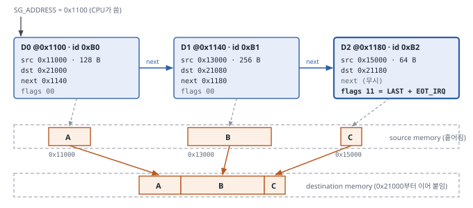

# SG DMA 검증 요구사항 (SOR)

*테스트 15개 (T-01 ~ T-15) · 원래 요구사항 61건 중 58건 흡수*

| 항목 | 내용 |
|---|---|
| 문서 ID | SGDMA-SOR-rel-v2.0.0 |
| 날짜 | 2026-10-19 |
| 작성자 | 조혜린 (hrcho) |
| 검증 대상 | `rtl/sg_dma_top.v` — ADI axi_dmac 기반, SG, 메모리 → 메모리, 클럭 1개, 32비트 주소, 64비트 데이터 |
| 기준 TB | `tb/tb_sg_dma.sv` (Sanity 46/46 PASS, 2026-10-19) |
| 이전 판 | SGDMA-SOR-rel-v1.1.0 (2026-10-16, 정리 전 RTL 기준, 테스트 15개) |

# 문서 안내

## 관련 문서

| 문서 | 역할 |
|---|---|
| `SGDMA-SFR-rel-v2.0.0` | 레지스터 사양. 이 문서의 기대값 근거. "SFR §x"는 이 판의 절 번호 |
| `SGDMA-SANITY-rel-v2.0.0` | 회귀 게이트 46 checks. "관련 Sanity" 열의 근거 |
| `SG_DMA_Architecture_Specification` (SGDMA-ARCH-rel-v2.0.0) | 구조, 데이터 경로, 디버그 신호, 실측 타이밍 |
| `SGDMA-SOR-INTEGRATION-v1.0` | rel-v1.0.0 61건을 테스트 15개로 줄인 통합 기록 (작성 Agent 5개안 → 리뷰 → 선택) |

## v1.1.0 대비 바뀐 점

테스트 15개의 구성, 흡수한 요구사항(58건), 제외한 요구사항(3건), 판정 종류는 바뀌지 않았습니다. 정리된 RTL에 맞춰 경로와 기대값의 근거를 고치고, 정리 과정에서 확인된 동작을 반영했습니다.

| # | 바뀐 점 | 위치 |
|---|---|---|
| 1 | 검증 대상과 TB 경로: `rtl/sg_dma/sgdma_top.v` → `rtl/sg_dma_top.v`, `tb/sg_dma/tb_sg_dma.sv` → `tb/tb_sg_dma.sv` | 머리말, §2.6 |
| 2 | T-02: `0x44C` / `0x450`이 정리 후 미구현(읽기 0, 부작용 없음)이므로 "0x450 절대 읽지 않음" 단계를 "읽어서 0 확인"으로 바꿈 | T-02 |
| 3 | T-11, T-12, T-08의 "RTL 분석 값" 일부를 SFR v2.0.0의 idle 상태 측정값(P)으로 갱신. 전송 도중 측정은 여전히 이 테스트들이 처음 함 | T-08, T-11, T-12 |
| 4 | T-12: 체인을 다 읽기 전의 PAUSE에서 남은 descriptor가 버려지는 동작(2026-10-17 측정)을 기록 단계로 추가 | T-12 |
| 5 | T-15: 정리 후 RTL에서 세 master 포트의 RRESP/BRESP 입력이 미연결임을 반영해 예상 동작(R)을 적음. descriptor가 0으로 읽힐 때의 순환을 예상 동작으로 추가 | T-15 |
| 6 | T-07: 실패 원인 분리 방법을 "0-replication 패치 전후 비교"에서 "정리 전 RTL(commit `63bbe00`)과 비교"로 바꿈 | T-07 |
| 7 | 검증 범위를 `DATA_WIDTH = 64`로 명시 (32에서 AXI 위반, SFR §11 #3) | §1.5 |
| 8 | 보강 B5: `mem_clear()` 함수는 이미 있으며 반복 루프에서 호출만 추가하면 됨 | §2.6 |
| 9 | 1장을 비유 없이 다시 씀. descriptor 수는 "개"로 셈 (테스트 제목 T-03, T-06 포함) | 1장, 전체 |

## 목차

- 1 SG DMA 개요
  - 1.1 동작 개요
  - 1.2 표준 순서
  - 1.3 주요 레지스터
  - 1.4 Descriptor 형식 (48바이트)
  - 1.5 이 구성의 특징과 범위
  - 1.6 용어
- 2 이 문서를 읽는 법
  - 2.1 판정의 네 종류
  - 2.2 공통 조건 (C1 ~ C6)
  - 2.3 "hang 없음"의 정의
  - 2.4 테스트 시작 전 공통 준비
  - 2.5 공통 메모리 영역
  - 2.6 Testbench 보강 목록
- 3 테스트 15개 요약
- 4 테스트 상세
- 5 제외한 요구사항
- 6 원래 61건 대응표
  - 6.1 ID별 배정
  - 6.2 집계
  - 6.3 v1.0.0 시나리오와의 대응
- 7 개정 이력

# 1 SG DMA 개요

## 1.1 동작 개요

일반 DMA는 CPU가 레지스터에 소스·목적지·길이를 쓰고 시작하면 한 구간을 옮긴 뒤 인터럽트로 완료를 알립니다. 여러 구간을 옮기려면 CPU가 구간마다 다시 설정해야 합니다.

SG(Scatter-Gather) DMA는 전송 파라미터를 메모리의 **descriptor**에 둡니다. descriptor 하나는 한 구간의 소스·목적지·길이와 다음 descriptor 주소를 담고, descriptor들은 `next_sg_addr`로 이어져 **chain**을 이룹니다. CPU는 첫 descriptor 주소만 레지스터에 쓰고 시작하며, DMA는 LAST 플래그가 있는 descriptor까지 차례로 읽어 처리합니다. 완료 인터럽트는 EOT_IRQ 플래그가 켜진 descriptor에서만 납니다.

- **gather**: 흩어진 여러 소스 구간을 연속된 목적지에 이어 씀
- **scatter**: 연속된 소스를 여러 목적지 구간에 나눠 씀

## 1.2 표준 순서

아래 순서를 "표준 순서"라 부르며 각 테스트에서 씁니다 (SFR §7.2).

1. 메모리에 descriptor 체인을 쓴다. 마지막 descriptor만 `flags = 0x3` (LAST + EOT_IRQ).
2. `IRQ_MASK(0x080) ← 0x1` — SOT 마스크, EOT 허용.
3. `CONTROL(0x400) ← 0x5` — ENABLE + HWDESC.
4. `SG_ADDRESS(0x47C) ← 첫 descriptor 주소`.
5. `TRANSFER_SUBMIT(0x408) ← 0x1`.
6. 완료 대기 (`irq` 또는 `TRANSFER_DONE` polling).
7. `IRQ_PENDING(0x084)`을 읽고 같은 값을 다시 써서 지운다 (W1C).

> **[주의]** **3번과 5번의 순서를 바꾸면 전송이 시작되지 않고 에러도 없습니다.** ENABLE = 0에서의 `TRANSFER_SUBMIT` 쓰기는 무시됩니다 (SFR §4.4.2).

## 1.3 주요 레지스터

| 주소 | 이름 | 기능 | 주의 |
|---|---|---|---|
| 0x400 | CONTROL | [0] ENABLE, [1] PAUSE, [2] HWDESC | 리셋값 0. SG는 `0x5`. ENABLE을 0으로 내리면 추적 상태가 지워짐 |
| 0x47C | SG_ADDRESS | 첫 descriptor 주소 | 하위 3비트 무시 (8바이트 정렬) |
| 0x408 | TRANSFER_SUBMIT | 1 쓰기 = 요청. 수락되면 자동 0 | ENABLE = 0에서 무시. 1인 동안 다시 써도 요청이 늘지 않음 |
| 0x080 | IRQ_MASK | 1 = 해당 인터럽트 막음 | 리셋값 `0x3` (모두 막힘) |
| 0x084 | IRQ_PENDING | `SOURCE & ~MASK`. 1 쓰기 = clear | 실제로 지워지는 것은 `IRQ_SOURCE` |
| 0x088 | IRQ_SOURCE | 마스크와 무관한 이벤트 래치 | 마스크된 동안에도 기록. 마스크를 풀면 바로 인터럽트 |
| 0x428 | TRANSFER_DONE | 전송 ID(0~3)별 완료 비트 | SG 모드에서는 체인 1개 = 전송 1건 |

## 1.4 Descriptor 형식 (48바이트)

| Offset | 내용 |
|---|---|
| +0x00 | `flags` — [0] LAST, [1] EOT_IRQ |
| +0x04 | `id` — `DESCRIPTOR_ID(0x454)`로 보임 |
| +0x08 | 목적지 주소 (하위 3비트 무시) |
| +0x10 | 소스 주소 (하위 3비트 무시) |
| +0x18 | `next_sg_addr` (LAST = 0일 때 사용) |
| +0x24 | `x_len` = 바이트 수 − 1 (하위 24비트) |
| +0x20, +0x28, +0x2C | 2D 필드. 이 구성에서는 무시. 0으로 채움 |

> **[주의]** **`x_len`은 "바이트 수 − 1"입니다.** `x_len = 0`은 1바이트, `0xFFFFFF`는 16 MiB이며, 길이 0 descriptor는 만들 수 없습니다. DMA는 descriptor 하나를 48바이트 burst 한 번(8바이트 × 6 beat)으로 읽습니다.

## 1.5 이 구성의 특징과 범위

- 소스와 목적지가 모두 AXI-MM이라 길이를 1바이트 단위로 지정할 수 있습니다. ADI 공식 testbench는 이 조합을 검증하지 않으므로 T-07이 중요합니다.
- RTL은 SG, MM→MM, 단일 클럭 구성만 남기고 정리되었습니다(2026-10-17). 2D, cyclic, framelock, AXI-Stream 소스 등은 코드에 없습니다.
- **검증 범위는 `DATA_WIDTH = 64`, `ADDR_WIDTH = 32`입니다.** `DATA_WIDTH = 32`에서는 AWLEN과 WLAST 위치가 맞지 않는 AXI 위반이 관측되었습니다(정리 전 ADI RTL도 같음, SFR §11 #3).
- 세 AXI master 포트 모두 RRESP/BRESP 에러를 검출하지 않습니다(SFR §4.6.3). T-15가 이 동작을 관측합니다.

## 1.6 용어

| 용어 | 정의 |
|---|---|
| DUT / TB | 검증 대상 `sg_dma_top` / testbench `tb_sg_dma` |
| Sanity (SAN-xxx) | RTL 수정마다 실행하는 회귀 체크 46개 (`SGDMA-SANITY`) |
| AR/R, AW/W/B | AXI 읽기 주소/데이터 채널, 쓰기 주소/데이터/응답 채널 |
| beat / burst | 데이터 1회 전송(8바이트) / 한 주소의 beat 묶음(최대 16 beat = 128바이트) |
| ARLEN / AWLEN | burst beat 수 − 1 |
| WSTRB / WLAST / RLAST | 쓰기 바이트 유효 표시 / burst 마지막 쓰기 beat / 마지막 읽기 beat |
| OKAY / SLVERR / DECERR | AXI 응답: 정상 / slave 에러 / decode 에러 |
| AxCACHE / AxPROT | AXI 요청의 메모리 속성 / 보호 속성 |
| W1C | Write-1-to-Clear |
| SOT / EOT | `IRQ_SOURCE` 비트0(요청 수락) / 비트1(전송 완료). descriptor의 EOT_IRQ는 그 descriptor 완료 시 EOT를 내라는 플래그 |
| prefetch | 앞 descriptor의 데이터 전송 중에 다음 descriptor를 미리 읽는 것 |
| backpressure | 수신 측이 READY를 늦춰 송신 측이 기다리는 상황 |
| idle | 세 AXI master에 진행 중인 트랜잭션이 없는 상태 |
| hang | §2.3의 정의를 따름 |
| guard 영역 | 목적지 끝 바로 뒤 16바이트. 쓰이면 범위 초과 쓰기 |

# 2 이 문서를 읽는 법

## 2.1 판정의 네 종류

| 표시 | 의미 |
|---|---|
| 판정 | 기대값과 다르면 FAIL |
| 참고 체크 | 기대값과 달라도 FAIL이 아님. "구현이 바뀌었다"는 신호로 기록 (ADI가 보장한 동작이 아님) |
| 관찰 기록 | 비교 없이 값만 기록. 동작 이해와 디버깅용 |
| 관측 후 확정 | 정답이 아직 정해지지 않은 동작. 첫 실행에서 관측해 팀이 정답을 정한 뒤 "판정"으로 바꿈 |

- `DESCRIPTOR_ID`의 전송 완료 후 값은 항상 참고 체크입니다.
- 디버그 레지스터(`0x434` ~ `0x444`, 예: `DBG_STATUS`)는 항상 관찰 기록입니다.
- 기대값 옆의 (P)는 SFR v2.0.0에서 idle 상태로 한 번 측정한 값, (R)은 RTL 분석 값입니다.

## 2.2 공통 조건 (C1 ~ C6)

| # | 조건 |
|---|---|
| C1 | 시간 초과 없음 (기본 50,000 클럭) |
| C2 | 목적지 데이터가 소스와 바이트 단위로 일치 |
| C3 | guard 영역이 쓰이지 않음 |
| C4 | EOT 인터럽트 발생 — 표준 순서 7번에서 **지우기 전에** 읽은 `IRQ_PENDING[1]` = 1 (마스크된 시험에서는 `IRQ_SOURCE[1]` 또는 해당 ID의 `TRANSFER_DONE` 비트 = 1) |
| C5 | AXI 규칙 위반 0건 (보강 B1 필요) |
| C6 | `$error` 0건 |

> **[주의]** **C4는 지우기 전에 확인합니다.** `IRQ_PENDING`에 쓰면 `IRQ_SOURCE`도 지워지므로, 지운 뒤에 보면 정상인데도 FAIL이 됩니다.

각 테스트의 "통과 기준"에는 공통 조건 외에 추가로 볼 것만 적었습니다. 공통 조건을 적용하지 않는 경우는 각 테스트의 "예외"에 적었습니다.

## 2.3 "hang 없음"의 정의

자기 참조 체인이나 16 MiB 전송은 원래 시간 안에 끝나지 않습니다. 이 문서에서 "hang 없음"은 다음을 뜻합니다 (SFR §5와 같음).

1. 시간 안에 스스로 끝나면 hang이 아닙니다.
2. 끝나지 않더라도 `CONTROL ← 0x4`(ENABLE만 0) 후 (가) 세 AXI master가 50,000 클럭 안에 idle이 되고, (나) `CONTROL ← 0x5`로 다시 켜서 보낸 T-03 전송이 정상 완료되면 hang이 아닙니다.
3. (가) 또는 (나)가 실패하면 hang입니다.

## 2.4 테스트 시작 전 공통 준비

모든 테스트는 시작 전에 아래를 합니다. 단, T-01과 T-09 1단계(리셋 직후 읽기)는 HW 리셋 직후 아무 쓰기도 하기 전에 합니다. 여러 테스트를 한 시뮬레이션에서 이어 돌린다면 이 두 단계 앞에서 리셋을 다시 겁니다.

1. `CONTROL ← 0x0`
2. `IRQ_PENDING ← 0x3`
3. 목적지 메모리와 "쓰임" 기록 초기화 (B5)

## 2.5 공통 메모리 영역

| 영역 | 주소 | 용도 |
|---|---|---|
| DESC | 0x0000_1000 ~ 0x0000_1FFF | descriptor 체인 |
| SRC | 0x0001_0000 ~ 0x0001_FFFF | 소스 데이터 |
| DST | 0x0002_0000 ~ 0x0002_FFFF | 목적지 데이터 |
| BOUND | 0x0000_0F00 ~ 0x0000_10FF | 4 KiB 경계 시험 전용 (DESC와 일부 겹치므로 그 시험에서만 사용) |
| ERR | 0x0003_0000 ~ 0x0003_FFFF | 에러 응답 주입 영역 |
| LONG | 0x0004_0000 ~ 0x0004_FFFF | 긴 체인용 descriptor |

이 표에 없는 주소는 TB에서 위 영역과 겹치지 않게 정하고 로그에 남깁니다. 주소 `0x0000_0000` 부근은 T-15에서 0 descriptor가 쓰는 주소이므로 다른 용도로 쓰지 않습니다.

## 2.6 Testbench 보강 목록

현재 TB(`tb/tb_sg_dma.sv`, `tb/axi_mem_slave.sv`, `tb/tb_mem_pkg.sv`)에는 아래 기능이 없습니다. 보강 전에는 해당 판정을 보류합니다. 본문에 `[B번호]`로 표시했습니다.

| # | 보강할 기능 | 쓰는 테스트 |
|---|---|---|
| B1 | AXI 규칙 검사기(assertion): VALID 이후 READY까지 주소·데이터 유지, burst 형태(`ARLEN` 등), `WLAST` 위치, 4 KiB 경계, `AxCACHE` / `AxPROT`, `RLAST` 시각 기록 | C5, T-03, T-07, T-13, T-14 |
| B2 | 버스 요청 기록기: 포트별 AR/AW 주소·beat 수·횟수·시각을 기록하고 테스트의 기대 목록과 비교 (현재는 화면 출력만) | T-03 ~ T-07, T-10, T-11, T-13 |
| B3 | 에러 응답 주입: 지정 영역의 읽기/쓰기 응답을 SLVERR 또는 DECERR로 바꿈. 이때 읽기 데이터는 0 (현재 모델은 항상 OKAY) | T-15 |
| B4 | READY 지연 주입: 포트별로 READY를 무작위로 늦춤 (현재 모델은 지연 없음) | T-14 |
| B5 | 반복 사이 초기화: 메모리와 "쓰임" 기록 삭제. `tb_mem_pkg::mem_clear()`가 이미 있으므로 반복 루프에서 호출하고, 다음 반복의 소스·descriptor를 다시 씀 | 모든 반복 시험 |
| B6 | 전송 중 레지스터 반복 읽기: 전송과 동시에 N 클럭마다 레지스터 읽기 | T-08, T-11, T-12 |

# 3 테스트 15개 요약

| 번호 | 제목 | 중요도 | 원래 ID 수 | 관련 Sanity |
|---|---|---|---|---|
| T-01 | 레지스터 버스와 기본 구성 확인 | 중간 | 6 | SAN-001, 002 |
| T-02 | 미구현 비트와 레지스터 접근 규칙 | 중간 | 4 | SAN-007 |
| T-03 | descriptor 1개 복사 | 높음 | 9 | SAN-004 |
| T-04 | 체인 따라가기와 gather | 높음 | 3 | SAN-005 |
| T-05 | scatter | 높음 | 1 | 없음 |
| T-06 | 체인 길이 1 ~ 32 | 높음 | 1 | SAN-005 (길이 3만) |
| T-07 | 1바이트 단위 길이 전송 | 높음 | 5 | SAN-004 (256바이트, 참고 측정만) |
| T-08 | 중간 EOT와 DESCRIPTOR_ID | 중간 | 4 | SAN-005, 006 |
| T-09 | IRQ_MASK와 W1C | 높음 | 4 | SAN-003, 006 |
| T-10 | TRANSFER_SUBMIT 규칙과 연속 예약 | 높음 | 8 | SAN-004 (완료 비트만) |
| T-11 | 전송 중 ENABLE = 0과 재시작 | 높음 | 2 | 없음 |
| T-12 | PAUSE와 재개 | 중간 | 2 | 없음 |
| T-13 | 주소 정렬과 4 KiB 경계 | 중간 | 3 | SAN-007 (일부) |
| T-14 | backpressure와 AXI 속성 | 중간 | 2 | SAN-001 (레지스터 값만) |
| T-15 | 에러 응답과 잘못된 descriptor | 높음 | 4 | 없음 |
|  | **합계** |  | **58** |  |

#### 권장 진행 순서

1. 보강 B1, B2, B5
2. T-01 → T-02 → T-03 → T-04 → T-09 (Sanity 재확인 단계)
3. B6 → T-05 → T-06 → T-07 → T-10 → T-08
4. T-11 → T-12 → T-13
5. B4 → T-14, B3 → T-15

*T-01과 T-09 1단계 앞에서는 HW 리셋을 다시 겁니다 (§2.4).*

# 4 테스트 상세

## T-01 레지스터 버스와 기본 구성 확인

- **확인 내용**: 레지스터 읽기·쓰기가 동작하는지, 구성 상수가 정한 파라미터와 맞는지.
- **중요한 이유**: 버스가 동작하지 않으면 다른 모든 결과를 믿을 수 없고, 구성이 다르면 다른 테스트의 기대값이 모두 달라집니다.
- **절차**
   1. 리셋 직후 `0x000`, `0x004`, `0x00C`, `0x010`, `0x014`를 읽는다.
   2. `VERSION` 또는 `IDENTIFICATION`이 틀리면 나머지 테스트를 모두 건너뛴다.
   3. `SCRATCH(0x008)`에 `0xA5A5_5A5A`를 쓰고 읽는다.
   4. 반전 패턴 `0x5A5A_A5A5`를 쓰고 읽는다 (stuck-at 비트 검출).
   5. `0x0000_0000`을 쓰고 읽어 원복한다.
- **통과 기준** (예외: 전송이 없으므로 C1~C5 미적용)

| 레지스터 | 기대값 |
|---|---|
| VERSION (0x000) | `0x0004_0565` |
| PERIPHERAL_ID (0x004) | `0x0000_0000` |
| IDENTIFICATION (0x00C) | `0x444D_4143` |
| INTERFACE_DESCRIPTION_1 (0x010) | `0x3807_0303` |
| INTERFACE_DESCRIPTION_2 (0x014) | `0x0000_0000` |
| SCRATCH 3회 | 쓴 값 |

> **[참고]** `0x004`, `0x010`, `0x014`가 틀리면 버스 고장보다 기대값 오류를 먼저 확인합니다. 기대값은 `sg_dma_top` 파라미터에서 계산합니다(`INTERFACE_DESCRIPTION_2`를 `0x30`으로 잘못 계산한 과거 사례, SFR 부록 D.2 ①).

- **흡수 요구사항**: REG-001, REG-002, REG-003, REG-004, REG-005, REG-020 · **중요도**: 중간

## T-02 미구현 비트와 레지스터 접근 규칙

- **확인 내용**: RTL에서 제거된 기능의 비트·레지스터가 바뀌지 않는지, RO 레지스터·미정의 주소·부분 바이트 쓰기의 동작.
- **중요한 이유**: 이 동작을 모르면 정상 동작을 결함으로 보고합니다. 이 IP는 미정의 주소에도 에러 응답을 내지 않으므로 readback 비교가 주소 디코드 오류를 잡는 유일한 방법입니다.
- **절차**
   1. 아래 표의 레지스터에 `0xFFFF_FFFF`를 쓰고 읽는다. `CONTROL`에 쓰면 ENABLE·PAUSE·HWDESC가 모두 1이 되므로 원복 전에는 `TRANSFER_SUBMIT`을 쓰지 않는다.
   2. 미구현 레지스터(`0x41C`, `0x420`, `0x424`, `0x44C`, `0x450`, `0x458`, `0x45C`)와 미정의 주소(`0x0F0`, `0x600`)를 읽는다.
   3. `VERSION(0x000)`과 `IRQ_SOURCE(0x088)`에 `0xFFFF_FFFF`를 쓰고 읽는다. 쓰기 응답도 기록한다.
   4. `SCRATCH`에 `0xFFFF_FFFF`를 쓴 뒤 `WSTRB = 4'b0001`로 `0x0000_00FF`를 쓰고 읽는다.
   5. 원복: `CONTROL ← 0x0`, `FLAGS ← 0x2`, `0x410`/`0x414`/`0x47C ← 0x0`, `SCRATCH ← 0x0`.
- **통과 기준** (예외: C1~C5 미적용)

| 동작 | 기대값 | 이유 |
|---|---|---|
| `0x400` 쓰기 후 읽기 | `0x0000_0007` | CONTROL[3] 미구현 |
| `0x40C` 쓰기 후 읽기 | `0x0000_0006` | FLAGS[0] 미구현 |
| `0x410` / `0x414` / `0x47C` 쓰기 후 읽기 | `0xFFFF_FFF8` | 8바이트 정렬 |
| `0x490` / `0x494` / `0x4BC` 쓰기 후 읽기 | `0x0000_0000` | `ADDR_WIDTH = 32` |
| `0x41C`, `0x458` 읽기 | `0x0000_0000` | 2D, framelock 미구현 |
| `0x420`, `0x424`, `0x45C` 쓰기 후 읽기 | `0x0000_0000` | 2D, framelock 미구현 (P) |
| `0x44C`, `0x450` 쓰기 후 읽기 (두 번) | `0x0000_0000`, 두 번째도 0 | partial transfer 미구현, 읽기 부작용 없음 (P) |
| `0x0F0`, `0x600` 읽기 | `0x0000_0000`, 에러 응답 없음 | 미정의 주소 |
| `VERSION` 쓰기 후 읽기 | `0x0004_0565`, 응답 OKAY | RO (P) |
| `IRQ_SOURCE` 쓰기 후 읽기 | 쓰기 전 값, 응답 OKAY | RO (P) |
| `SCRATCH` 1바이트 쓰기 후 읽기 | `0x0000_00FF` | WSTRB 무시, 32비트 전체 쓰기 (R) |

> **[참고]** **0x450 읽기.** v1.1.0까지는 읽기가 내부 FIFO를 pop했기 때문에 이 주소를 읽지 않았습니다. 정리 후 RTL에는 FIFO가 없으므로 읽어서 0을 확인합니다(SFR §4.5.5). 정리 전 RTL에 이 테스트를 돌릴 때는 이 행을 뺍니다.

- **흡수 요구사항**: REG-019, REG-021, REG-022, REG-023 · **중요도**: 중간

## T-03 descriptor 1개 복사

- **확인 내용**: descriptor 1개를 48바이트 burst 한 번으로 읽고, 필드를 맞게 해석해 256바이트를 정확히 옮기고, LAST에서 끝나는지.
- **중요한 이유**: SG의 최소 단위입니다. 여기가 틀리면 체인, gather, scatter가 모두 틀립니다. 길이를 "바이트 수 − 1"로 잘못 해석하면 1바이트씩 넘치거나 모자랍니다.
- **절차**
   1. `0x0001_0000`에 256바이트 패턴을 쓴다.
   2. `0x0000_1000`에 descriptor를 쓴다: `flags = 0b11`, `id = 0xA0`, 소스 `0x0001_0000`, 목적지 `0x0002_0000`, next `0x0`, `x_len = 255`.
   3. 표준 순서로 시작한다 (`SG_ADDRESS ← 0x0000_1000`). `SG_ADDRESS`를 다시 읽는다.
   4. `m_sg_axi`, `m_src_axi`, `m_dest_axi`의 요청을 모두 기록한다 [B2].
   5. 완료 후 인터럽트를 지우고 `TRANSFER_DONE`을 읽는다.
- **통과 기준**

| 항목 | 기대값 |
|---|---|
| `SG_ADDRESS` 읽기 | `0x0000_1000` |
| descriptor 읽기 | 주소 `0x1000`, `ARLEN = 5`, 크기 8바이트, INCR, **1회** |
| 소스 읽기 | `0x1_0000` (16 beat), `0x1_0080` (16 beat) |
| 목적지 쓰기 | `0x2_0000` (16 beat), `0x2_0080` (16 beat) |
| 읽은 양 = 쓴 양 | 256바이트 |
| guard `0x0002_0100` ~ +16 | 쓰이지 않음 |
| `TRANSFER_DONE` | 해당 ID 비트 = 1 |
| `DESCRIPTOR_ID` (참고 체크) | `0xA0` |

*descriptor 읽기 형태(`ARLEN = 5`, 8바이트, INCR)는 B1이 생기면 모든 테스트에서 계속 감시합니다. 참고 측정(SAN-004): SG AR 3,195 ns, SRC AR 3,315 / 3,495 ns, DST AW 3,495 / 3,705 ns.*

- **흡수 요구사항**: REG-007, REG-015, DESC-001, DESC-002, DESC-003, DESC-007, FUNC-001, FUNC-009, AXI-001 · **중요도**: 높음

## T-04 체인 따라가기와 gather

- **확인 내용**: `next_sg_addr`를 따라 descriptor 3개를 순서대로 읽는지, 흩어진 소스 3곳을 연속된 목적지에 이어 쓰는지, 다음 descriptor를 미리 읽는지(prefetch).
- **중요한 이유**: 체인 처리가 SG의 핵심 기능이며, 체인 전체에 인터럽트가 1회여야 CPU 부하가 줄어듭니다.
- **절차**
   1. 아래 표대로 소스 3곳과 descriptor 3개를 쓴다. 마지막 descriptor만 `flags = 0b11`.
   2. 시작 전에 `TRANSFER_ID`를 읽어 둔다.
   3. 표준 순서로 시작한다 (`SG_ADDRESS ← 0x0000_1100`).
   4. 세 포트의 요청 주소와 시각을 기록하고 [B2], `irq` 횟수를 센다.
   5. 완료 후 `TRANSFER_ID`를 다시 읽는다. 구간별로 따로 비교해 어느 구간이 틀렸는지 알 수 있게 한다.

| # | descriptor 주소 | id | flags | 소스 | 목적지 | 길이 |
|---|---|---|---|---|---|---|
| 0 | 0x0000_1100 | 0xB0 | 0b00 | 0x0001_1000 | 0x0002_1000 | 128 |
| 1 | 0x0000_1140 | 0xB1 | 0b00 | 0x0001_3000 | 0x0002_1080 | 256 |
| 2 | 0x0000_1180 | 0xB2 | 0b11 | 0x0001_5000 | 0x0002_1180 | 64 |

**SG_ADDRESS를 한 번 쓰면 descriptor 3개를 따라가며 조각 3개를 모은다**

*Figure 1. T-04 체인 (TB SAN-005와 같음). 파란 상자는 메모리의 descriptor, 주황 상자는 데이터 영역입니다.*

- **통과 기준**

| 항목 | 기대값 |
|---|---|
| descriptor 읽기 순서 | `0x1100` → `0x1140` → `0x1180`, **3회** |
| prefetch | 첫 목적지 쓰기 전에 descriptor 읽기 3회가 모두 나옴. 참고 측정(Sanity): SG AR 4,215 / 4,295 / 4,375 ns, 첫 SRC AR 4,335 ns, 첫 DST AW 4,515 ns |
| 목적지 쓰기 주소 | `0x2_1000`, `0x2_1080`, `0x2_1100`, `0x2_1180` — 연속. 소스 구간 경계와 관계없이 128바이트 단위로 다시 나뉨 |
| 구간 0 / 1 / 2 데이터 | 각각 일치 |
| guard `0x0002_11C0` ~ +16 | 쓰이지 않음 |
| `irq` | **1회** |
| `TRANSFER_ID` | 시작 전보다 1 증가 (0~3 순환) — 체인 1개 = 전송 1건 |
| `DESCRIPTOR_ID` (참고 체크) | `0xB2` |

- **흡수 요구사항**: DESC-004, DESC-009, FUNC-002 · **중요도**: 높음

## T-05 scatter

- **확인 내용**: 연속된 소스 448바이트를 떨어진 목적지 3곳에 나눠 쓰는지 (gather의 반대 방향).
- **중요한 이유**: Sanity는 gather만 확인했고 scatter는 검증된 적이 없습니다. 목적지 사이 영역에 잘못 쓰면 다른 데이터가 손상됩니다.
- **절차**
   1. `0x0001_8000`부터 448바이트 패턴을 쓴다 (T-04와 다른 패턴).
   2. 아래 표대로 descriptor 3개를 쓴다. 마지막만 `flags = 0b11`. `id`는 서로 다르게.
   3. 표준 순서로 시작한다 (`SG_ADDRESS ← 0x0000_1200`).
   4. 소스 읽기와 목적지 쓰기 주소를 기록한다 [B2].
   5. 목적지 3곳과 그 사이 영역을 검사한다.

| # | descriptor 주소 | 소스 | 길이 | 목적지 |
|---|---|---|---|---|
| 0 | 0x0000_1200 | 0x0001_8000 | 128 | 0x0002_2000 |
| 1 | 0x0000_1240 | 0x0001_8080 | 256 | 0x0002_4000 |
| 2 | 0x0000_1280 | 0x0001_8180 | 64 | 0x0002_6000 |

- **통과 기준**

| 항목 | 기대 |
|---|---|
| 목적지 3곳 | 소스의 해당 부분과 일치하고 이번 전송에서 실제로 쓰임 ("쓰임" 기록으로 확인) |
| 사이 영역 `0x0002_2080` ~ `0x0002_3FFF`, `0x0002_4100` ~ `0x0002_5FFF` | 한 바이트도 쓰이지 않음 |
| guard `0x0002_6040` ~ +16 | 쓰이지 않음 |
| 소스 읽기 주소 | 연속 |
| 목적지 쓰기 주소 | 세 영역으로 나뉨 |
| `irq` | 1회 |

- **흡수 요구사항**: FUNC-003 · **중요도**: 높음

## T-06 체인 길이 1 ~ 32

- **확인 내용**: 체인 길이 N = 1부터 32까지 끝까지 처리하는지.
- **중요한 이유**: 체인 길이에 따라 SG 엔진 내부 FIFO(주소 1단, descriptor 1단, ID 4 entry)가 차고 비는 양상이 달라집니다. 특정 길이에서 체인이 끊기거나 멈추면 드라이버에서 바로 문제가 됩니다. Sanity는 N = 3만 봅니다.
- **절차**
   1. N = 1, 2, 4, 8, 16, 32로 반복한다. 구간 하나는 64바이트.
   2. 반복마다 메모리를 초기화하고 [B5], 소스 N곳에 반복마다 다른 패턴을 쓴다.
   3. descriptor N개를 `0x0000_1000 + (i × 64)`에 쓴다. 마지막만 `flags = 0b11`.
   4. 표준 순서로 시작하고 descriptor 읽기 횟수를 세며 [B2] 모든 구간과 guard를 검사한다.
   5. 시간이 허락하면 N = 128을 LONG 영역에 두고 한 번 더 한다.
- **통과 기준**

| 항목 | 기대 |
|---|---|
| descriptor 읽기 횟수 | N회 |
| 모든 구간 | 일치 |
| `irq` | 길이와 관계없이 1회 |
| N = 32 (및 128) | 시간 초과 없음 |
| `DESCRIPTOR_ID` (참고 체크) | 마지막 descriptor의 id |

- **흡수 요구사항**: FUNC-004 · **중요도**: 높음

## T-07 1바이트 단위 길이 전송

- **확인 내용**: 1, 7, 129바이트처럼 8의 배수가 아닌 길이를 정확히 그만큼 옮기는지, 긴 전송이 128바이트 burst로 나뉘는지, 소스 burst를 다 받은 뒤 쓰기를 시작하는지.
- **중요한 이유**: 이 구성(양쪽 AXI-MM)만의 특징이며 ADI testbench가 검증하지 않는 경로입니다. 프로젝트에서 수정한 RTL(burst memory의 0-replication 수정, SFR 부록 C)도 이 경로에 있습니다. 1바이트라도 넘치면 인접 데이터가 손상됩니다.
- **절차**
   1. 소스 `0x0001_0000`, 목적지 `0x0002_0000`으로 고정한다 (정렬 문제와 분리).
   2. 길이 1, 2, 7, 8, 9, 63, 64, 65, 127, 128, 129, 255, 256, 512바이트로 descriptor 1개 전송을 반복한다 (`x_len = 길이 − 1`).
   3. 반복마다 목적지와 "쓰임" 기록을 초기화한다 [B5].
   4. 마지막 쓰기 beat의 `WSTRB`와 `WLAST`를 자동 검사한다 [B1].
   5. 512바이트에서는 소스 burst마다 `RLAST` 수신 시각과 대응하는 목적지 AW 시각을 기록한다 [B1, B2].
- **통과 기준**

| 길이 (바이트) | 마지막 beat의 유효 바이트 수 (WSTRB) |
|---|---|
| 1 / 2 / 7 / 8 | 1 / 2 / 7 / 8 |
| 9 | 1 |
| 63 / 64 / 65 | 7 / 8 / 1 |
| 127 / 128 / 129 | 7 / 8 / 1 |
| 255 / 256 | 7 / 8 |

| 항목 | 기대 |
|---|---|
| 쓰인 바이트 수 | 정확히 길이만큼. 모자라도 넘쳐도 FAIL |
| `WLAST` | 각 burst의 마지막 beat에만 1 |
| 129바이트 | 목적지 쓰기 2회 (16 beat + 1 beat) |
| 512바이트 소스 읽기 | 4회: `0x1_0000`, `0x1_0080`, `0x1_0100`, `0x1_0180`, 각 16 beat |
| 512바이트 목적지 쓰기 | 4회 |
| 512바이트 순서 | 각 목적지 AW는 대응하는 소스 burst의 `RLAST` 수신 후에 나감. 참고 측정(SAN-004): SRC AR 3,315 ns, 16 beat 후 DST AW 3,495 ns |
| 1바이트 | 정지·시간 초과 없음 |

> **[참고]** **실패 시 원인 분리.** 같은 시험을 정리 전 RTL(git commit `63bbe00`의 `rtl/third_party/adi_hdl`, 0-replication 수정 포함)로 돌려 결과를 비교합니다. 두 RTL이 같게 실패하면 ADI 원본 동작 또는 수정 부분의 문제이고, 정리 후 RTL만 실패하면 정리 과정의 문제입니다.

- **흡수 요구사항**: FUNC-005, FUNC-006, FUNC-007, AXI-002, AXI-003 · **중요도**: 높음

## T-08 중간 EOT와 DESCRIPTOR_ID

- **확인 내용**: 중간 descriptor에 EOT_IRQ를 켜면 그 descriptor가 끝날 때도 인터럽트가 나는지, `DESCRIPTOR_ID(0x454)`가 처리 중인 descriptor의 `id`를 순서대로 보여 주는지.
- **중요한 이유**: T-04가 "체인당 1회"를 본다면 이 테스트는 "원하면 중간에도"를 봅니다. `DESCRIPTOR_ID`는 디버깅에서 진행 위치를 확인하는 레지스터입니다.
- **절차**
   1. (중간 EOT) 128바이트 descriptor 4개, `id = 0xC0 ~ 0xC3`, `flags = 0b10, 0b00, 0b10, 0b11`로 체인을 만들고 표준 순서로 시작한다.
   2. `irq`가 올라올 때마다: `IRQ_PENDING` 읽기 → 같은 값 쓰기 → `DESCRIPTOR_ID` 기록 → 횟수 +1. `irq`가 내려갔다 다시 올라오는지 본다.
   3. (id 추적) 512바이트 descriptor 8개, `id = 0xD0 ~ 0xD7`, 마지막만 `flags = 0b11`로 체인을 만들고 시작한다.
   4. 전송 중 100클럭마다 `DESCRIPTOR_ID`를 읽어 기록한다 [B6].
   5. 완료 후 `CONTROL ← 0x0`, 이어서 `CONTROL ← 0x1`(HWDESC = 0)을 쓰고 `DESCRIPTOR_ID`를 읽는다.
- **통과 기준** (예외: 1~2단계의 C4는 "인터럽트마다, 지우기 전에 `IRQ_PENDING[1]` = 1")

| 항목 | 종류 | 기대 |
|---|---|---|
| 중간 EOT 횟수 | 판정 | 3회 (descriptor 0, 2, 3) |
| descriptor 1 완료 시 | 판정 | 인터럽트 없음 |
| id 추적 순서 | 판정 | `0xD0` → … → `0xD7`. 건너뛰기는 허용, 역순이면 FAIL |
| 인터럽트마다 읽은 `DESCRIPTOR_ID` | 참고 체크, 관측 후 확정 | v1.0.0은 `0xC0`, `0xC2`, `0xC3`을 기대했으나, ID FIFO는 descriptor 완료(`dma_eot`) 클럭에 pop되고 인터럽트는 그 뒤에 올라오므로 다음 descriptor의 id가 보일 수 있음 (SAN-005에서 측정, SFR §4.6.2) |
| id 추적 최종값 | 참고 체크 | `0xD7` |
| HWDESC = 0 후 `DESCRIPTOR_ID` | 참고 체크 | `0x0000_0000` (P) |

> **[주의]** 두 인터럽트가 가까워 `irq`가 내려가지 않고 이어지면 3회가 2회로 셀 수 있습니다. 그 실행은 무효로 기록하고 다시 돌립니다. 완료는 인터럽트나 `TRANSFER_DONE`으로 판정하며 `DESCRIPTOR_ID`로 판정하지 않습니다.

- **흡수 요구사항**: DESC-005, DESC-006, REG-016, IRQ-001 · **중요도**: 중간

## T-09 IRQ_MASK와 W1C

- **확인 내용**: 마스크 설정 4가지에서의 인터럽트 발생과 `IRQ_PENDING`/`IRQ_SOURCE` 값, `IRQ_PENDING`에 1을 쓰면 `IRQ_SOURCE`가 지워지는지.
- **중요한 이유**: 드라이버 오류가 많은 부분입니다. 리셋 직후 모두 마스크(`0x3`)이고, 마스크된 동안에도 `IRQ_SOURCE`에 기록되어 마스크 해제 시 바로 인터럽트가 나며, 쓰는 주소(`IRQ_PENDING`)와 지워지는 레지스터(`IRQ_SOURCE`)가 다릅니다.
- **절차**
   1. HW 리셋 직후 다른 쓰기 전에 `IRQ_MASK`를 읽는다.
   2. 아래 4가지 설정마다: §2.4 공통 준비 → `IRQ_MASK` 설정 → T-03과 같은 전송. 표준 순서 2번과 7번은 건너뛴다. 시작 전에 `TRANSFER_ID`를 읽어 두고, 완료는 그 ID의 `TRANSFER_DONE` 비트를 polling해 기다린다. `irq`, `IRQ_PENDING`, `IRQ_SOURCE`를 기록한다.
   3. `0x1` 설정에서: 읽은 `IRQ_PENDING`(`0x2`)을 그대로 쓰고 → `IRQ_PENDING`, `IRQ_SOURCE`, `irq`를 다시 본다.
   4. 2단계 후 `0x3`으로 전송을 한 번 더 하고, 비우지 않은 채 `IRQ_MASK ← 0x0` → `irq`를 본다.
   5. 같은 상황을 다시 만들고 이번에는 `IRQ_PENDING ← 0x3` 후 마스크를 푼다 → `irq`를 본다.
- **통과 기준** (예외: 표준 순서 7번을 건너뛰므로 C4는 "`IRQ_SOURCE[1]` = 1이고 해당 ID의 `TRANSFER_DONE` 비트 = 1")

| 조건 | 기대 |
|---|---|
| 리셋 직후 `IRQ_MASK` | `0x0000_0003` |

| IRQ_MASK | 발생하는 irq | IRQ_PENDING | IRQ_SOURCE |
|---|---|---|---|
| `0x3` | 없음 | 0x0 | 0x3 |
| `0x2` | SOT만 | 0x1 | 0x3 |
| `0x1` | EOT만 | 0x2 (P) | 0x3 (P) |
| `0x0` | 둘 다 (제출 직후 SOT가 먼저) | 0x3 | 0x3 |

| clear 관련 | 기대 |
|---|---|
| 3단계 후 `IRQ_PENDING` | `0x0` |
| 3단계 후 `IRQ_SOURCE` | `0x1` — 쓴 비트1만 지워지고 마스크된 비트0은 남음 (SAN-006과 같음) |
| 3단계 후 `irq` | 0 |
| 4단계 (비우지 않고 마스크 해제) | `irq`가 바로 1 |
| 5단계 (비운 뒤 마스크 해제) | `irq` = 0 유지 |

- **흡수 요구사항**: IRQ-002, IRQ-003, IRQ-004, IRQ-005 · **중요도**: 높음

## T-10 TRANSFER_SUBMIT 규칙과 연속 예약

- **확인 내용**: `TRANSFER_SUBMIT`의 세 규칙(ENABLE = 0에서 무시, 수락되면 자동 0, 1인 동안 다시 써도 요청이 늘지 않음)과, 체인 A 진행 중 체인 B를 예약할 수 있는지.
- **중요한 이유**: ENABLE 전의 제출은 에러 없이 무시되어 디버깅이 어렵습니다. 연속 예약이 안 되면 처리량이 떨어지고, 요청이 사라지면 데이터 일부가 옮겨지지 않습니다.
- **절차**
   1. (무시 확인) `CONTROL = 0x0`에서 `TRANSFER_SUBMIT ← 0x1` → 다시 읽고 버스 활동이 없는지 본다 [B2]. 이어서 체인 두 개를 쓴다.
      - 체인 A: descriptor `0x0000_1300`부터 3개, 소스 `0x0001_A000`부터 총 1,536바이트, 목적지 `0x0002_8000`
      - 체인 B: descriptor `0x0000_1400`부터 3개, 소스 `0x0001_C000`부터 총 1,536바이트, 목적지 `0x0002_A000`
      - 각 체인은 마지막 descriptor만 `flags = 0b11`
   2. `IRQ_MASK ← 0x1`, `CONTROL ← 0x5`. `TRANSFER_ID`를 읽어 `ID_A`로 기록. `SG_ADDRESS ← A`, `TRANSFER_SUBMIT ← 0x1` → 0이 될 때까지 polling.
   3. A가 수락된 직후 `SG_ADDRESS ← B`, `TRANSFER_SUBMIT ← 0x1`을 쓰고 곧바로 다시 읽는다 (B의 ID는 `ID_A + 1`).
      - 1이면: `0x1`을 한 번 더 쓴다 (중복 요청 시험).
      - 0이면: B가 이미 수락된 것이므로 이 회차의 중복 요청 판정은 무효. A를 8개 이상으로 늘려 다시 한다. 정한 횟수만큼 해도 안 되면 "판정 불가"로 보고.
   4. B 제출 후 `ACTIVE_TRANSFER_ID`를 읽어 A가 아직 진행 중임을 기록한다.
   5. `TRANSFER_DONE`의 `ID_A`, `ID_B` 비트가 모두 1이 될 때까지 polling한다. 인터럽트가 오면 그때마다 지운다 (지우기 전에 C4 확인). 이후 `TRANSFER_DONE`, `TRANSFER_ID`, `ACTIVE_TRANSFER_ID`와 두 목적지 데이터를 확인한다.
   6. (ID 재사용) 체인 A를 하나씩 3번 더 보낸다. 각 전송은 해당 ID의 `TRANSFER_DONE` 비트가 1이 될 때까지 기다리고 인터럽트를 지운 뒤 다음을 보낸다. ID는 `ID_A + 2`, `ID_A + 3`, 다시 `ID_A`. 세 번째 제출 직전과 직후에 `TRANSFER_DONE[ID_A]`를 읽는다.
- **통과 기준** (예외: 1단계는 전송이 없는 것이 정상이므로 C1~C4 미적용)

| 항목 | 기대 |
|---|---|
| 1단계 `TRANSFER_SUBMIT` 다시 읽기 | `0x0`, 전송 없음, 에러 응답 없음 |
| 2·3단계 polling | 제한 시간 안에 0이 됨 |
| 4단계 `ACTIVE_TRANSFER_ID` | `ID_A` |
| 3단계 중복 요청 (유효 회차만) | 요청이 늘지 않음 — descriptor 읽기 총 횟수 = A 개수 + B 개수 (기본 6회, A를 8개로 늘린 회차는 11회) |
| 5단계 `TRANSFER_DONE` | `ID_A`, `ID_B` 비트 모두 1 |
| 5단계 `TRANSFER_ID` | `ID_A + 2` (mod 4) |
| 5단계 `ACTIVE_TRANSFER_ID` | `TRANSFER_ID`와 같음 |
| 두 목적지 데이터 | 각각 일치 |
| 6단계 `TRANSFER_DONE[ID_A]` | 직전 1 → 직후 0 (같은 ID로 다시 제출하면 완료 비트가 지워짐) |

*`TRANSFER_DONE`은 ID 4개만 구분하므로, 완료되지 않은 전송을 4개 넘게 쌓는 경우는 이 테스트 범위 밖입니다.*

- **흡수 요구사항**: REG-009, REG-010, REG-011, REG-012, REG-013, REG-014, FUNC-008, IRQ-006 · **중요도**: 높음

## T-11 전송 중 ENABLE = 0과 재시작

- **확인 내용**: 체인 진행 중 ENABLE을 0으로 내리면 이미 시작한 AXI 트랜잭션을 마무리하고 idle이 되는지, 어떤 값이 지워지고 남는지, 다시 켜면 새 전송이 정상인지.
- **중요한 이유**: 드라이버가 오류 복구나 종료 때 쓰는 동작입니다. burst 중간에 끊기면 AXI 위반이고, idle이 되지 않으면 시스템 전체가 멈춥니다.
- **절차**
   1. 512바이트 descriptor 8개 체인을 공통 영역 안에 만든다 (주소는 TB에서 정해 로그에 남김).
   2. 표준 순서로 시작하고, 목적지 쓰기가 몇 번 나간 시점에 `CONTROL ← 0x4`를 쓴다.
   3. 버스가 idle이 될 때까지 모든 요청을 기록하고 [B2], `DBG_STATUS(0x43C)[2:0]`을 반복해서 읽는다 [B6].
   4. 아래 표의 레지스터를 읽는다. 남은 descriptor의 처리를 기록한다.
   5. `CONTROL ← 0x5`로 다시 켜고 T-03 전송이 정상 완료되는지 본다.
- **통과 기준** (예외: 중단한 체인에는 C2, C4 미적용. C1은 idle까지 기다리는 시간에 적용)

| 항목 | 종류 | 기대 |
|---|---|---|
| ENABLE = 0 직후 | 판정 | 새 AR/AW가 나가지 않음 |
| 진행 중이던 burst | 판정 | 끝까지 마무리 (`WLAST`까지) |
| 버스 | 판정 | §2.3 "hang 없음" |
| `TRANSFER_ID`, `ACTIVE_TRANSFER_ID`, `TRANSFER_DONE`, `TRANSFER_PROGRESS` | 판정 | 0 (idle 상태 측정 P, SFR §8) |
| `SG_ADDRESS`, `FLAGS`, `IRQ_MASK`, `IRQ_SOURCE` | 판정 | 끄기 전 값 유지 (P) |
| 남은 descriptor 처리 | 관측 후 확정 | RTL상 `dma_resetn`이 SG 엔진을 리셋하므로 버려짐 (R) |
| `DESCRIPTOR_ID` | 관찰 기록 | HWDESC = 1이므로 마지막 id 유지 예상 (idle 측정 P) |
| 재시작 후 전송 | 판정 | 정상 완료 (C1~C6) |
| `DBG_STATUS[2:0]` | 관찰 기록 | 동작 중 4, idle 후 1. 중간의 5(SHUTDOWN)는 짧아 못 볼 수 있음 |

> **[참고]** "0 / 유지" 기대값은 SFR §8에서 왔고, SFR v2.0.0이 idle 상태(체인 완료 후)에서 측정한 값입니다. 이 테스트는 **전송 도중**의 값을 처음 측정합니다. 결과가 다르면 RTL 결함인지 조작 시점에 따른 차이인지를 먼저 가립니다.

- **흡수 요구사항**: REG-006, REG-024 (REG-024는 DBG_STATUS 관찰 기록만, 판정 없음) · **중요도**: 높음

## T-12 PAUSE와 재개

- **확인 내용**: 전송 중 PAUSE를 켜면 멈추고 끄면 멈춘 위치부터 이어 가는지, 데이터가 빠지거나 중복되지 않는지, `TRANSFER_PROGRESS`가 진행을 따라가는지. 체인에서의 PAUSE 제약을 기록합니다.
- **중요한 이유**: PAUSE는 ENABLE = 0과 달리 상태를 지우지 않아야 합니다. 재개 후 한 구간이라도 빠지거나 겹치면 데이터가 손상됩니다.
- **절차**
   1. 4 KiB descriptor 1개(`x_len = 4095`, 소스 `0x0001_0000`, 목적지 `0x0002_0000`)로 시작한다.
   2. 전송 중 100클럭마다 `TRANSFER_PROGRESS(0x448)`를 읽는다 [B6].
   3. 첫 목적지 B 응답 후 `CONTROL ← 0x7`을 쓴다.
   4. 이미 나간 요청이 마무리되므로 세 AXI master가 idle이 될 때까지 기다린 뒤, 1,000클럭 동안 버스를 보고 `TRANSFER_PROGRESS`를 두 번 이상 읽는다. `DBG_STATUS[2:0]`도 기록한다.
   5. `CONTROL ← 0x5`로 재개하고, 완료 후 데이터와 `TRANSFER_PROGRESS`를 확인한다.
   6. (체인 PAUSE 기록) 512바이트 descriptor 8개 체인을 시작하고 약 100클럭 뒤(descriptor를 다 읽기 전) `CONTROL ← 0x7`, idle 후 `CONTROL ← 0x5`. 복사된 descriptor 수, EOT 발생 여부, 버스 상태를 기록한다.
- **통과 기준**

| 항목 | 종류 | 기대 |
|---|---|---|
| idle 후 1,000클럭 | 판정 | 새 요청 없음 |
| 그때 `TRANSFER_PROGRESS` | 판정 | 0보다 크고 4,096보다 작으며 읽을 때마다 같음 |
| PAUSE 중 `TRANSFER_ID` 등 추적 값 | 판정 | 지워지지 않음 (idle 측정 P) |
| 재개 후 | 판정 | 멈춘 위치부터 이어 감 |
| 데이터 | 판정 | 4,096바이트 일치, 빠짐·중복 없음 |
| 전송 중 `TRANSFER_PROGRESS` | 판정 | 0부터 증가, 4,096 이하 |
| 완료 후 `TRANSFER_PROGRESS` | 판정 | 0 (EOT 다음 클럭에 지워짐, P) |
| PAUSE 중 `DBG_STATUS[2:0]` | 관찰 기록 | 2 (P: `DBG_STATUS = 0x782`) |
| 체인에서 `TRANSFER_PROGRESS` 누적 | 관측 후 확정 | 512바이트 2개 체인(중간 EOT_IRQ = 0)으로 따로 관측 |
| 6단계 체인 PAUSE | 관측 후 확정 + "hang 없음" 판정 | 알려진 동작: 남은 descriptor가 버려지고 EOT 없음 (2026-10-17 측정: 60~300클럭 PAUSE에서 3~7개만 복사). 재개 후 체인이 완료되지 않아도 §2.3 절차로 hang 없음을 확인 |

> **[주의]** **체인 PAUSE 제약.** PAUSE도 SG 엔진의 `sg_enable`을 0으로 만들고, SG 엔진은 DESC_READY에서 IDLE로 돌아가 남은 descriptor를 읽지 않습니다(SFR §8). 결과가 이 기대와 다르면(예: 재개 후 체인 완료) RTL이 바뀐 것이므로 SFR §8과 Architecture Spec 12.3을 함께 고칩니다.

- **흡수 요구사항**: REG-008, REG-018 · **중요도**: 중간

## T-13 주소 정렬과 4 KiB 경계

- **확인 내용**: 8바이트에 정렬되지 않은 주소의 처리, 데이터나 descriptor가 4 KiB 경계에 걸칠 때 AXI 규칙(burst가 4 KiB 경계를 넘지 않음)을 지키는지.
- **중요한 이유**: descriptor는 48바이트를 burst 하나로 읽으므로 경계에 걸치면 규칙 위반이 될 수 있으며, 이는 SG에만 있는 실패입니다. 비정렬 주소의 동작은 아직 정해지지 않았습니다.
- **절차**
   1. (descriptor 주소 하위 3비트) 정상 descriptor 주소 + 3을 `SG_ADDRESS`와 앞 descriptor의 `next_sg_addr`에 넣는다. 실제 descriptor 읽기 주소를 기록한다 [B2].
   2. (데이터 경계) 소스 `0x0000_0F80`, 길이 256바이트. 이 전송의 descriptor는 BOUND 밖(`0x0000_1100` 이상, 64바이트 정렬)에 둔다.
   3. (비정렬 + 경계) 소스 `0x0000_0F83`, 길이 256바이트.
   4. (descriptor 경계) descriptor를 `0x0000_0FF0`에 둔다 (48바이트가 `0x1000` 경계에 걸침). 이 단계에서는 B1의 descriptor 형태 감시와 4 KiB 감시를 기록만 하도록 바꾼다.
   5. (비정렬 주소 모음) 길이 64바이트로 (소스 / 목적지 오프셋) = (+0/+0), (+1/+0), (+0/+1), (+1/+1), (+3/+5), (+7/+1). 반복마다 초기화 [B5].
- **통과 기준** (예외: 3·4·5단계의 C2는 관측 후 확정, 단 5단계 (+0/+0)는 판정. 4단계의 C5는 기록만)

| 항목 | 종류 | 기대 |
|---|---|---|
| 1단계 descriptor 읽기 주소 | 판정 | 하위 3비트 0 (dmac_sg.v:145) |
| 2·3단계 모든 데이터 burst | 판정 | 4 KiB 경계를 넘지 않음 |
| 2단계 데이터 | 판정 | C2, C3 |
| 3단계 데이터 | 관측 후 확정 | — |
| 4단계 descriptor 읽기 | 관측 후 확정 | 나눠 읽는지, 경계를 넘는지 기록. 넘으면 "descriptor 64바이트 정렬 필수"를 SW 제약으로 올림 (SFR은 64바이트 정렬 권장). RTL상 descriptor fetch는 항상 `ARLEN = 5` 한 번이므로 나누지 않음 (R) |
| 5단계 | 관측 후 확정 | 첫 실행은 관측만. 결과를 보고 기대값을 정한 뒤 회귀로 전환 |
| 5단계 (+0/+0) | 판정 | C1~C3 |

- **흡수 요구사항**: AXI-004, DESC-008, FUNC-010 · **중요도**: 중간

## T-14 backpressure와 AXI 속성

- **확인 내용**: slave가 READY를 늦게 줘도 데이터가 정확한지, 세 포트의 `AxCACHE`/`AxPROT` 출력이 파라미터와 같은지.
- **중요한 이유**: 현재 메모리 모델은 지연 없이 응답하지만 실제 interconnect는 그렇지 않습니다. 특히 descriptor 포트만 느릴 때 데이터 경로가 올바르게 기다리는지는 SG에만 있는 조건입니다. 레지스터 값(SAN-001)이 맞아도 버스 출력은 따로 확인해야 합니다.
- **절차**
   1. READY 지연 주입 [B4]과 AXI 규칙 검사기 [B1]를 켠다.
   2. T-04의 3개 gather 체인을 아래 5가지 지연 조합으로 반복한다. 반복마다 초기화 [B5].
   3. VALID 이후 READY까지 주소·데이터가 바뀌지 않는지 자동 검사한다.
   4. 모든 트랜잭션에서 세 포트의 `AxCACHE`, `AxPROT`를 검사한다.

| 반복 | descriptor 포트 지연 (클럭) | 소스 포트 지연 | 목적지 포트 지연 |
|---|---|---|---|
| 1 | 0 | 0 | 0~15 |
| 2 | 0 | 0~15 | 0 |
| 3 | **0~15** | 0 | 0 |
| 4 | 0~7 | 0~7 | 0~7 |
| 5 | 0~15 | 0~15 | 0~15 |

- **통과 기준**

| 항목 | 기대 |
|---|---|
| 5개 조합 데이터 | 모두 일치 |
| 지연의 영향 | 완료 시간만 늘고 결과는 같음 |
| VALID ~ READY 사이 | 주소·데이터 유지 (위반 0) |
| 모든 포트 `AxCACHE` | `4'b0000` |
| 모든 포트 `AxPROT` | `3'b000` |

- **흡수 요구사항**: AXI-005, AXI-007 · **중요도**: 중간

## T-15 에러 응답과 잘못된 descriptor

- **확인 내용**: AXI 에러 응답이나 극단적인 descriptor에서의 동작. 최소한 hang이 없는지.
- **중요한 이유**: ADI testbench와 현재 TB 모두 이 영역을 다루지 않았습니다. RTL은 에러 응답을 검출하지 않으므로, 잘못된 descriptor를 읽으면 에러 표시 없이 엉뚱한 주소로 전송해 시스템 메모리를 손상시킬 수 있습니다.

> **[주의]** **RTL 근거 (정리 후).** `m_src_axi_rresp`, `m_dest_axi_bresp`, `m_sg_axi_rresp`는 `sg_dma_top` 포트로만 존재하고 내부에 연결되지 않습니다(sg_dma_top.v:98, :122, :141). 정리 전 ADI RTL도 응답 값을 레지스터·인터럽트로 내보내지 않았습니다. 따라서 아래 "예상 동작"은 RTL 분석(R)이며, 이 테스트가 처음 측정합니다. 응답 처리 경로를 확인할 때는 `response_handler.v`, `axi_dmac_response_manager.v`, `src_axi_mm.v`, `dest_axi_mm.v`를 먼저 읽습니다.

- **절차**: 각 경우마다 정한 시간을 기다린 뒤 §2.3 "hang 없음" 절차(ENABLE = 0 → idle 확인 → 재시작 → T-03 전송)를 한다.
   1. (소스 읽기 에러) 소스를 ERR 영역에 두고 읽기 응답을 SLVERR로 바꾼다 [B3]. DECERR로 한 번 더. 목적지를 ERR 영역에 두고 쓰기 응답을 SLVERR로 바꾸는 경우도 한다.
   2. (descriptor 읽기 에러) 3개 체인 중 두 번째 descriptor만 ERR 영역에 두고 읽기 응답을 SLVERR로 바꾼다 [B3]. 이때 읽기 데이터는 모두 0이다.
   3. (최대 길이) `x_len = 0xFFFFFF`(16 MiB) descriptor로 시작한다. 목적지는 다른 영역과 겹치지 않게 TB에서 정한다. 첫 목적지 쓰기를 확인한 뒤 끈다. 끝까지 보내는 시험은 시뮬레이션 시간 문제로 별도 검토.
   4. (자기 참조 체인) `flags = 0b00`이고 `next_sg_addr`가 자기 주소인 descriptor로 시작한다.
   5. 각 경우 `irq`, `IRQ_SOURCE`, `TRANSFER_DONE`, 버스 활동, 목적지 메모리, 주소 `0x0000_0000` 부근의 쓰기를 기록한다.
- **통과 기준** (예외: C1~C4 미적용. 이 테스트 동안 B1 검사기는 기록만(`$error` 대신 `$info`), C5는 관찰 기록, C6은 B1 외의 `$error`에만 적용)

| 경우 | 판정 | 예상 동작 (R, 관측 후 확정) |
|---|---|---|
| 소스 읽기 에러 (SLVERR, DECERR) | §2.3 "hang 없음" | 에러 표시 없음. 응답 데이터(0)가 목적지에 쓰이고 전송은 정상 완료로 보고됨 (`TRANSFER_DONE`, EOT) |
| 목적지 쓰기 에러 | 위와 같음 | 에러 표시 없음. 정상 완료로 보고됨 |
| descriptor 읽기 에러 | 위와 같음 | 0 descriptor는 "flags = 0(LAST 아님), id = 0, 주소 0 → 주소 0으로 1바이트(`x_len = 0`), next = 0"으로 해석됨. 이어서 주소 0의 descriptor를 읽고, 그 내용이 0이면 같은 동작을 끝없이 반복함. 목적지 주소 0에 쓰기가 발생하는지 기록. 결과로 "DMA가 에러를 검출하지 못함 → 칩 수준 보호 필요"를 제약으로 기록 |
| 16 MiB 전송 | 위와 같음 | 원래 시간 안에 끝나지 않음. 쓰인 범위가 지정 범위 안인지 확인 |
| 자기 참조 체인 | 위와 같음 | RTL이 막지 않는 구성. ENABLE = 0 전까지 같은 descriptor를 반복 처리 |

> **[참고]** **ERR-004 결론.** v1.0.0의 "길이 0 descriptor"는 이 형식으로 만들 수 없습니다(`x_len = 0`은 1바이트). 그래서 이 자리에서 최대 길이(16 MiB)와 자기 참조 체인을 봅니다. hang이 나면 그 자체가 중요한 발견이므로 재현 조건과 파형을 남깁니다.

- **흡수 요구사항**: ERR-001, ERR-002, ERR-003, ERR-004 · **중요도**: 높음

# 5 제외한 요구사항

| 원래 ID | 내용 | 제외 이유 |
|---|---|---|
| REG-017 | `CURRENT_SRC_ADDRESS(0x438)` / `CURRENT_DEST_ADDRESS(0x434)`가 진행에 따라 바뀜 | 디버그 레지스터라 값 비교를 하지 않는 규칙 대상이고, 값이 버스 타이밍에 따라 달라 정답을 정할 수 없음. 진행 상황은 T-12의 `TRANSFER_PROGRESS`로 봄 |
| AXI-006 | 응답이 오지 않은 요청이 여러 개여도 정상 동작 | 현재 메모리 모델이 포트당 1개만 받아 시험할 수 없음. 메모리 모델 교체 후 성능 측정과 함께 다룸 |
| COV-001 | toggle coverage 측정 | 테스트가 아니라 측정 활동. 15개 테스트 후 별도 진행 |

REG-024(`DBG_STATUS`)는 T-11에 흡수했지만 디버그 레지스터이므로 관찰 기록으로만 다룹니다. 즉 58건 중 REG-024는 판정 없이 기록만 합니다.

#### v1.0.0 시나리오 중 넣지 않은 것

| 시나리오 | 내용 | 처리 |
|---|---|---|
| ET-004 | 전송 중 리셋 | 연결된 요구사항 없음 (리셋 관련은 Sanity·SOR 모두 범위 밖, 2026-10-06 결정) |
| CT-005 | 최대 길이(2^24 − 1) 근처 | T-15의 16 MiB 시험이 일부 대신함. 끝까지 보내는 시험은 별도 검토 |
| CT-007 | 소스와 목적지가 겹침 | 동작 파악용. 연결 요구사항(FUNC-001)은 T-03이 판정 |
| RT-001, RT-002 | 무작위 체인, 무작위 + 지연 | 무작위 시험은 범위 밖. 지연은 T-14가 고정 조합으로 대신함 |

# 6 원래 61건 대응표

## 6.1 ID별 배정

| 원래 ID | 테스트 | 원래 ID | 테스트 | 원래 ID | 테스트 |
|---|---|---|---|---|---|
| REG-001 | T-01 | REG-022 | T-02 | DESC-005 | T-08 |
| REG-002 | T-01 | REG-023 | T-02 | DESC-006 | T-08 |
| REG-003 | T-01 | REG-024 | T-11 | DESC-007 | T-03 |
| REG-004 | T-01 | IRQ-001 | T-08 | DESC-008 | T-13 |
| REG-005 | T-01 | IRQ-002 | T-09 | DESC-009 | T-04 |
| REG-006 | T-11 | IRQ-003 | T-09 | FUNC-001 | T-03 |
| REG-007 | T-03 | IRQ-004 | T-09 | FUNC-002 | T-04 |
| REG-008 | T-12 | IRQ-005 | T-09 | FUNC-003 | T-05 |
| REG-009 | T-10 | IRQ-006 | T-10 | FUNC-004 | T-06 |
| REG-010 | T-10 | AXI-001 | T-03 | FUNC-005 | T-07 |
| REG-011 | T-10 | AXI-002 | T-07 | FUNC-006 | T-07 |
| REG-012 | T-10 | AXI-003 | T-07 | FUNC-007 | T-07 |
| REG-013 | T-10 | AXI-004 | T-13 | FUNC-008 | T-10 |
| REG-014 | T-10 | AXI-005 | T-14 | FUNC-009 | T-03 |
| REG-015 | T-03 | AXI-006 | 제외 | FUNC-010 | T-13 |
| REG-016 | T-08 | AXI-007 | T-14 | ERR-001 | T-15 |
| REG-017 | 제외 | DESC-001 | T-03 | ERR-002 | T-15 |
| REG-018 | T-12 | DESC-002 | T-03 | ERR-003 | T-15 |
| REG-019 | T-02 | DESC-003 | T-03 | ERR-004 | T-15 |
| REG-020 | T-01 | DESC-004 | T-04 | COV-001 | 제외 |
| REG-021 | T-02 |  |  |  |  |

## 6.2 집계

| 영역 | 원래 건수 | 흡수 | 제외 |
|---|---|---|---|
| REG | 24 | 23 | 1 (REG-017) |
| IRQ | 6 | 6 | 0 |
| AXI | 7 | 6 | 1 (AXI-006) |
| DESC | 9 | 9 | 0 |
| FUNC | 10 | 10 | 0 |
| ERR | 4 | 4 | 0 |
| COV | 1 | 0 | 1 (COV-001) |
| **합계** | **61** | **58** | **3** |

- 61건이 각각 정확히 한 번 배정되어 있습니다.
- SG 고유 요구사항 18건(REG-007, REG-015, REG-016, AXI-001, DESC-001~009, FUNC-002~004, ERR-002, ERR-004)은 모두 흡수했습니다.

## 6.3 v1.0.0 시나리오와의 대응

| 테스트 | v1.0.0 시나리오 |
|---|---|
| T-01 | SAN-001, SAN-002 |
| T-02 | SAN-007, FT-014 (1~3번) |
| T-03 | SAN-004 |
| T-04 | SAN-005 |
| T-05 | FT-001 |
| T-06 | FT-002, CT-004 |
| T-07 | FT-003, FT-005 |
| T-08 | FT-006, FT-008 |
| T-09 | SAN-003, SAN-006, FT-013 |
| T-10 | FT-007, FT-014 (4번), CT-006 (20회 연속 대신 ID 재사용 4회까지) |
| T-11 | FT-011, FT-010 (DBG_STATUS 부분) |
| T-12 | FT-012, FT-010 (일부) |
| T-13 | CT-001 ~ CT-003, FT-004 |
| T-14 | FT-009 |
| T-15 | ET-001 ~ ET-003, ET-005, CT-008 |

# 7 개정 이력

| 판 | 날짜 | 내용 |
|---|---|---|
| rel-v1.0.0 | 2026-10 | 요구사항 61건 |
| rel-v1.1.0 | 2026-10-16 | 61건을 테스트 15개로 줄임 (흡수 58, 제외 3). "길이 0 descriptor" 오류 수정, "hang 없음" 정의, 디버그 레지스터는 판정에 쓰지 않음, 완료 후 DESCRIPTOR_ID는 참고 체크, testbench 보강 목록 추가. 근거: `SGDMA-SOR-INTEGRATION-v1.0` (문서 내부 표기는 rel-v2.0.0이었으나 파일명 기준 v1.1.0으로 정리) |
| **rel-v2.0.0** | **2026-10-19** | 정리된 RTL(`rtl/sg_dma_top.v`) 기준으로 다시 작성. 테스트 구성·요구사항 배정은 그대로. T-02에서 0x44C/0x450 읽기 추가, T-08·T-11·T-12 기대값에 SFR v2.0.0 측정값(P) 반영, T-12에 체인 PAUSE 기록 단계 추가, T-15에 에러 응답 미연결과 0 descriptor 순환을 예상 동작으로 추가, T-07 원인 분리 방법 갱신, 검증 범위(DATA_WIDTH = 64) 명시, B5 설명 갱신. 1장 비유 삭제 |
